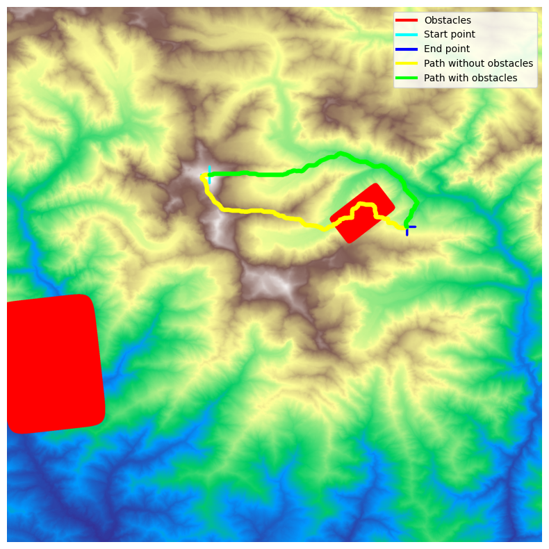
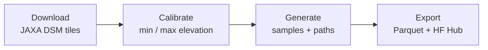

<!-- PASSAGE README — renders on both GitHub and Hugging Face -->

<p align="center">
  
</p>

<h1 align="center">🌍 PASSAGE — Path Solving Dataset & Generator</h1>

<p align="center">
  <strong>Real-world elevation-based pathfinding benchmarks to advance research — and save lives.</strong>
</p>

<!-- Badges -->
<p align="center">
  <a href="https://github.com/ThalesGroup/passage/actions/workflows/ci.yml"></a>
  <a href="https://github.com/ThalesGroup/passage/actions/workflows/docs.yml"></a>
  <a href="https://www.python.org/"></a>
  <a href="https://github.com/ThalesGroup/passage/blob/main/LICENSE"></a>
  <a href="https://huggingface.co/datasets/geoffrey-g-delhomme/passage"></a>
  <a href="https://docs.astral.sh/ruff/"></a>
  <a href="https://docs.astral.sh/uv/"></a>
  <a href="https://pre-commit.com/"></a>
</p>

<p align="center">
  <a href="https://thalesgroup.github.io/passage/">📖 Documentation</a> •
  <a href="https://huggingface.co/datasets/geoffrey-g-delhomme/passage">🤗 Dataset</a> •
  <a href="https://github.com/ThalesGroup/passage">💻 GitHub</a> •
  <a href="#-citation">📝 Cite</a>
</p>

---

## Table of Contents

- [Table of Contents](#table-of-contents)
- [Get started](#get-started)
- [Documentation](#documentation)
- [🚁 Why PASSAGE?](#-why-passage)
- [✨ Highlights](#-highlights)
- [🗺️ Visual Summary](#️-visual-summary)
- [🚀 Quick Start](#-quick-start)
- [🔁 Pipeline Overview](#-pipeline-overview)
- [📦 Loading the Dataset](#-loading-the-dataset)
- [⚙️ Configuration](#️-configuration)
- [📓 Notebooks](#-notebooks)
- [🔬 Research Applications](#-research-applications)
- [📁 Output Structure](#-output-structure)
- [🧪 Development \& Testing](#-development--testing)
- [📝 Citation](#-citation)
- [Contributing](#contributing)
- [Security](#security)
- [💬 Support](#-support)
- [👤 Maintainers](#-maintainers)
- [🙏 Acknowledgments](#-acknowledgments)
- [License](#license)

---

## Get started

PASSAGE is an open-source pathfinding dataset and generation toolkit built on real-world elevation data to benchmark and improve terrain-aware routing algorithms.

- **Project goals**: provide reproducible, multi-resolution benchmarks for pathfinding research, ML surrogates, and safety-critical AI evaluation.
- **Sponsoring SIG**: Thales Group open-source and critical AI research contributors.
- **Community contact**: use [GitHub Issues](https://github.com/ThalesGroup/passage/issues), [GitHub Discussions](https://github.com/ThalesGroup/passage/discussions), or email `oss@thalesgroup.com`.

For installation and first run commands, see [🚀 Quick Start](#-quick-start).

## Documentation

Documentation is available at [thalesgroup.github.io/passage](https://thalesgroup.github.io/passage/).

The documentation site is published with GitHub Pages and includes user guides, API references, and architecture notes.

Please also set the repository **About** metadata:
- **Description**: short project purpose statement for PASSAGE.
- **Website**: `https://thalesgroup.github.io/passage/`.

---

## 🚁 Why PASSAGE?

> *Every year, Helicopter Emergency Medical Services (HEMS) crews across Europe perform over 300,000 rescue missions — racing against time through mountain passes, across valleys, and over ridgelines to reach patients in cardiac arrest or severe trauma. For every minute of delay, survival rates drop by 7–10%. The path the helicopter takes matters — yet pathfinding algorithms are still benchmarked on flat synthetic grids.*

**PASSAGE** was created to change that. Built from **real-world satellite elevation data** (JAXA ALOS AW3D30 at 30 m/pixel), it provides the research community with large-scale, multi-resolution pathfinding benchmarks that capture the true complexity of terrain navigation.

We open-source this toolkit because **better benchmarks lead to better algorithms, and better algorithms save lives**.

---

## ✨ Highlights

<table>
<tr>
  <td align="center" width="25%">🌐<br><strong>Multi-Resolution</strong><br><small>64×64 → 4096×4096 px</small></td>
  <td align="center" width="25%">🏔️<br><strong>Real Elevation</strong><br><small>JAXA ALOS AW3D30 DSM</small></td>
  <td align="center" width="25%">🔷<br><strong>Rich Obstacles</strong><br><small>Superellipse shapes</small></td>
  <td align="center" width="25%">⚡<br><strong>5 Cost Models</strong><br><small>Elevation, slope, energy…</small></td>
</tr>
<tr>
  <td align="center">🧮<br><strong>3 Solver Backends</strong><br><small>NetworkX, pathfinding, Numba</small></td>
  <td align="center">🤗<br><strong>HuggingFace-Ready</strong><br><small>Parquet + one-command upload</small></td>
  <td align="center">🔁<br><strong>Fully Resumable</strong><br><small>No wasted compute</small></td>
  <td align="center">✅<br><strong>Tested & CI/CD</strong><br><small>80%+ coverage, pre-commit</small></td>
</tr>
</table>

<table>
<tr>
  <td align="center"><strong>141,300</strong><br><small>Default Samples</small></td>
  <td align="center"><strong>7</strong><br><small>Resolution Levels</small></td>
  <td align="center"><strong>5</strong><br><small>Cost Models</small></td>
  <td align="center"><strong>3</strong><br><small>Solver Backends</small></td>
  <td align="center"><strong>30 m/px</strong><br><small>Spatial Resolution</small></td>
</tr>
</table>

---

## 🗺️ Visual Summary

<p align="center">
  
</p>

<p align="center"><em>Normalized elevation with start/end markers, procedural superellipse obstacles, and two computed paths (free terrain vs. obstacle-aware).</em></p>

---

## 🚀 Quick Start

```bash
# Install uv (if needed)
curl -LsSf https://astral.sh/uv/install.sh | sh

# Clone & install
git clone https://github.com/ThalesGroup/passage.git
cd passage && uv sync

# Run the full pipeline
passage download                       # 1️⃣  Fetch JAXA elevation tiles
passage calibrate                      # 2️⃣  Compute global elevation stats
passage generate --resolution 256      # 3️⃣  Generate pathfinding samples
passage export --no-upload             # 4️⃣  Package as Parquet shards
```

<details>
<summary>💡 Alternative: install with pip</summary>

```bash
python -m venv .venv && source .venv/bin/activate
pip install -e ".[dev]"
```
</details>

---

## 🔁 Pipeline Overview



| Step | Command | What it does |
|:----:|---------|--------------|
| 1 | `passage download` | Download JAXA ALOS AW3D30 5°×5° tile archives with resume |
| 2 | `passage calibrate` | Scan tiles for global min/max elevation |
| 3 | `passage generate` | Create multi-resolution samples with paths, obstacles, tensors |
| 4 | `passage export` | Write Parquet shards, execute notebooks, push to HF Hub |

> 📖 **Full walkthrough:** see the [User Guide](https://thalesgroup.github.io/passage/guide/) or the local [USAGE.md](USAGE.md) reference.

---

## 📦 Loading the Dataset

```python
from datasets import load_dataset
from passage.utils import decode_tensor_blob

# Load a specific resolution from Hugging Face
ds = load_dataset("geoffrey-g-delhomme/passage", name="256x256")
sample = ds["train"][0]

# Decode the compressed tensor → (256, 256, 3) numpy array
tensor = decode_tensor_blob(sample["tensor"], (256, 256, 3))
elevation = tensor[:, :, 0]  # Normalized [0, 1]
markers   = tensor[:, :, 1]  # -1 background, 0 start, 1 goal
obstacles = tensor[:, :, 2]  # Binary mask (0/1)

# Access solver paths
path_cols = [k for k in sample if k.startswith("path_")]
print("Solver paths:", path_cols)
```

---

## ⚙️ Configuration

Core settings live in [`config/config.yaml`](config/config.yaml):

```yaml
resolutions: [64, 128, 256, 512, 1024, 2048, 4096]
num_samples:
  64: 10000
  128: 2500
  256: 1000
  # ...
obstacles:
  enabled: true
  ratio_max: 0.30
  shape:
    n: { distribution: log_uniform, min: 1.0, max: 80.0 }
solvers:
  astar_elevation:
    backend: grid
    algorithm: astar
    cost_model: elevation
    weight: 5878.0
```

CLI options override config values. See the [Configuration Reference](https://thalesgroup.github.io/passage/guide/configuration/) in the documentation.

<details>
<summary>🔐 Hugging Face credentials</summary>

```bash
# .env
HF_USER_NAME=your-hf-username
HF_REPO_NAME=passage-dataset

# .env.secret (never commit!)
HF_TOKEN=hf_XXXXXXXXXXXXXXXXXXXXXXXX
```
</details>

---

## 📓 Notebooks

| Notebook | Description |
|----------|-------------|
| [`demo.ipynb`](notebooks/demo.ipynb) | Quick-start: load, decode, and visualize a sample |
| [`costmodel.ipynb`](notebooks/costmodel.ipynb) | Compare all 5 cost models on the same terrain |
| [`obstacles.ipynb`](notebooks/obstacles.ipynb) | Explore superellipse obstacle generation |
| [`solve.ipynb`](notebooks/solve.ipynb) | Solver timing and quality comparison |
| `_dataset.ipynb` | Template — auto-executed per resolution during export |

---

## 🔬 Research Applications

| Domain | Use Case |
|--------|----------|
| **Classical AI** | A\*, Dijkstra benchmarking across cost models |
| **Reinforcement Learning** | Grid-based terrain navigation agents |
| **Graph Neural Networks** | Learned heuristics on elevation graphs |
| **Surrogate Models** | Fast path prediction (141K+ input/output pairs) |
| **Computer Vision** | Path segmentation from elevation images |
| **Certified ML** | ARP 6983 / ED-324 — bounded ODD, deterministic data |

---

## 📁 Output Structure

```
outputs/
├── download/           # Tile archives + download.csv + extracted GeoTIFFs
├── calibrate/          # calibrate.json + elevation maps
└── dataset/            # Per-resolution samples
    └── 256/
        ├── train/
        │   └── 000000/
        │       ├── tensor.npy.zst          # (H,W,3) zstd-compressed
        │       ├── metadata.yaml           # Full provenance
        │       ├── sample.png              # Visualization
        │       ├── path_astar_elevation_free.csv
        │       └── path_astar_elevation_obstacles.csv
        ├── validation/
        ├── test/
        └── calibration/
```

---

## 🧪 Development & Testing

```bash
# Install dev dependencies
uv sync --group dev

# Run tests (80%+ coverage required)
uv run pytest --cov

# Lint & format
uv run ruff check src/ tests/
uv run ruff format src/ tests/

# Pre-commit hooks
uv run pre-commit install
uv run pre-commit run --all-files
```

---

## 📝 Citation

If you use PASSAGE in your research, please cite:

```bibtex
@article{delhomme2025passage,
  title   = {PASSAGE: A Multi-Resolution Pathfinding Dataset mixing Complex
             Obstacles and Elevation-based Tiles towards Certified Machine
             Learning Systems},
  author  = {Delhomme, Geoffrey and Trap, Fran{\c{c}}ois},
  year    = {2025},
  url     = {https://github.com/ThalesGroup/passage}
}
```

---

## Contributing

If you are interested in contributing to PASSAGE, start by reading the [Contributing guide](/CONTRIBUTING.md).

Contributions are welcome; the guide covers development setup, coding standards, pull requests, and issue reporting.

In brief:

```bash
# Fork & clone, then:
uv sync --group dev
uv run pre-commit install
git checkout -b feature/your-feature-name
# ... make changes ...
uv run pytest --cov
uv run ruff check src/ tests/
```

---

## 💬 Support

Need help? Here's where to go:

| Channel | Link |
|---------|------|
| **Documentation** | [thalesgroup.github.io/passage](https://thalesgroup.github.io/passage/) |
| **Bug Reports** | [GitHub Issues](https://github.com/ThalesGroup/passage/issues) |
| **Discussions & Q&A** | [GitHub Discussions](https://github.com/ThalesGroup/passage/discussions) |
| **Email** | geoffrey.delhomme@thalesgroup.com |

Before opening an issue, please search existing issues and discussions to avoid duplicates.

---

## 👤 Maintainers

| Name | Affiliation | Contact |
|------|------------|--------|
| **Geoffrey Delhomme** | [Thales Group](https://www.thalesgroup.com/) | [geoffrey.delhomme@thalesgroup.com](mailto:geoffrey.delhomme@thalesgroup.com) |
| **François Trap** | [Thales Group](https://www.thalesgroup.com/) | — |

---

## 🙏 Acknowledgments

- **[JAXA](https://www.eorc.jaxa.jp/ALOS/en/dataset/aw3d30/aw3d30_e.htm)** for the ALOS AW3D30 Digital Surface Model
- **[Hugging Face](https://huggingface.co/)** for the Datasets library and Hub infrastructure
- **[Thales Group](https://www.thalesgroup.com/)** for supporting open-source research in safety-critical AI

---

## Security

Security reporting and handling procedures are documented in [SECURITY.md](SECURITY.md).

If you discover a vulnerability, please use private reporting channels described in that file.

---

## License

This project is licensed under the **MIT License** — see the [LICENSE](LICENSE) file for details. Please note that each dependency is subject to its own respective license.

The license is defined in an explicit root-level `LICENSE` file.

The underlying elevation data is sourced from [JAXA's ALOS AW3D30](https://www.eorc.jaxa.jp/ALOS/en/dataset/aw3d30/aw3d30_e.htm) product, freely available for research purposes.

---

<p align="center">
  <a href="https://thalesgroup.github.io/passage/">📖 Documentation</a> •
  <a href="https://huggingface.co/datasets/geoffrey-g-delhomme/passage">🤗 Dataset</a> •
  <a href="https://github.com/ThalesGroup/passage/issues">🐛 Issues</a> •
  <a href="https://github.com/ThalesGroup/passage/discussions">💬 Discussions</a>
</p>
