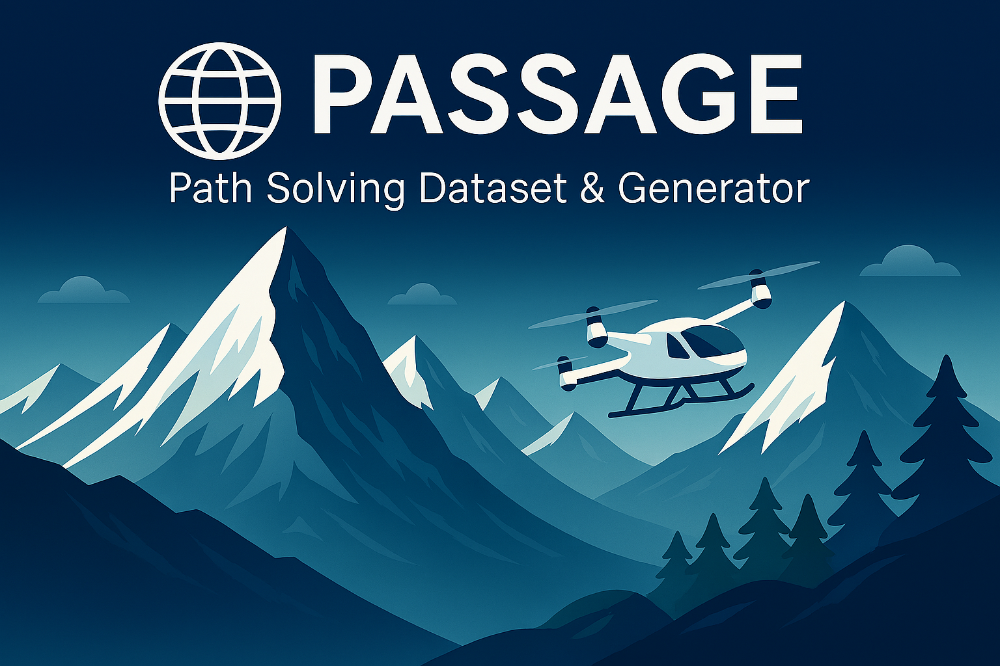

<p align="center">
  
</p>

<h1 align="center">🌍 PASSAGE: real-terrain benchmark for constrained path planning</h1>

<p align="center">
  <strong>Real terrain, exact answers: 4.4 million scenes and 26.4 million reference routes for trustworthy pathfinding and surrogate modelling.</strong>
</p>

<p align="center">
  <a href="#-citation"></a>
  <a href="https://huggingface.co/datasets/thalesgroup/passage"></a>
  <a href="https://www.python.org/"></a>
  <a href="DATASET_LICENSE.md"></a>
</p>

<p align="center">
  <a href="docs/index.md">📖 Documentation</a> •
  <a href="https://huggingface.co/datasets/thalesgroup/passage">🤗 Dataset</a> •
  <a href="https://huggingface.co/datasets/thalesgroup/passage/viewer">🔎 Viewer</a> •
  <a href="#-harness-an-existing-algorithm">🧪 Evaluate</a> •
  <a href="#-citation">📝 Cite</a>
</p>

---

## 📌 Executive summary

PASSAGE is a dataset and benchmark for constrained path planning on real
terrain: each scene is a square crop of the JAXA ALOS World 3D–30 m (AW3D30)
digital surface model with a start cell, a goal cell and procedural obstacles.
Each scene has six route variants: three cost objectives (`elevation`,
`slope_uphill`, `energy`), each on free terrain and with the obstacles blocked.
Each variant carries an exact minimum-cost reference route for the stated
graph (eight-connected, 30 m cells); start and goal cells that the obstacles
disconnect are rejected by the generator. PASSAGE v1.0 holds 4,400,000 core
scenes at seven resolutions, from 64×64 to 4096×4096 cells, and 26,400,000
route variants, all exact routes. Its test split is a geographic hold-out
(South America), and this repository holds the MIT-licensed generator and
the `passage-eval` evaluator.

The [dataset card](https://huggingface.co/datasets/thalesgroup/passage)
describes the files, graph, label guarantees, splits and limitations. Data and
executed notebooks are pinned to [`v1.0`](https://huggingface.co/datasets/thalesgroup/passage/tree/v1.0)
(`c09cc5a21a55a93e7c09d47368d5f5bf75cb8fae`); the current code branch has its own history.

---

## 🔭 At a glance

- **Real terrain:** JAXA AW3D30 digital surface model, routed as 30 m cells.
- **Seven resolutions:** 64×64 to 4096×4096; 4.4 million scenes and six routes per scene.
- **Geographic evaluation:** train / calibration / validation / test = 90 / 2 / 4 / 4 %; South America is held out for test.
- **Ready to explore:** Parquet, streaming, 1,792 preview rows and executed notebooks on the Hub. Previews repeat core scenes.

<p align="center">
  
</p>

*One released scene, six reference routes. Open the executed
[display notebook](https://huggingface.co/datasets/thalesgroup/passage/blob/v1.0/256x256/display.ipynb)
to inspect the input channels and costs.*

---

## 🚀 Quick start

**Explore a scene.** Install `datasets`, `pillow`, `zstandard` and `numpy`, then load a small preview:

```python
import numpy as np
import zstandard
from datasets import load_dataset

rows = load_dataset("thalesgroup/passage", "256x256_samples",
                    split="validation", revision="v1.0")
row = rows[0]
n = row["metadata"]["resolution"]
x = np.frombuffer(zstandard.ZstdDecompressor().decompress(row["tensor"]),
                  dtype="<f4").reshape(n, n, 3)
cal = row["metadata"]["calibration"]
elevation_m = x[..., 0] * (cal["max"] - cal["min"]) + cal["min"]
markers, obstacles = x[..., 1], x[..., 2]
route = np.asarray(row["path_astar_energy_obstacles"])
```

Core configurations are large; use `streaming=True` to read them incrementally.
See the [dataset quick start](https://huggingface.co/datasets/thalesgroup/passage#🚀-quick-start)
for streaming and training targets.

**Use the code.** Install [uv](https://docs.astral.sh/uv/getting-started/installation/), then:

```bash
git clone https://github.com/ThalesGroup/passage.git
cd passage
uv sync --frozen
uv run --frozen passage --help
uv run --frozen passage-eval --help
```

The [generator guide](docs/guide/index.md) covers source-tile download,
calibration, generation and export. [USAGE.md](USAGE.md) lists the commands.

---

## 🧪 Harness an existing algorithm

Wrap your classical planner, graph method, policy or vision model with
`plan(request) -> PlanResult`: receive terrain, obstacles and endpoints, and
return an ordered integer `(row, column)` route. Include preprocessing,
decoding, repair and fallback in the procedure being measured.

```bash
uv run --frozen passage-eval init-spec --out outputs/my-method.yaml
# Set your importable adapter, pinned data, task, seeds and budgets in the spec.
uv run --frozen passage-eval conform --spec outputs/my-method.yaml --output outputs/eval/check
uv run --frozen passage-eval run --spec outputs/my-method.yaml --output outputs/eval/run
uv run --frozen passage-eval score --run outputs/eval/run
```

Follow [Evaluate your planner](docs/benchmark/contributing-a-method.md) for a
runnable CPU example, adapter, specification and matched comparison report.
Freeze choices on calibration before test. The evaluator keeps reference labels
outside the planner and scores the routes it timed; failed requests stay in the results.

**Try the dense-vision candidates:**

- [Seg — ConvNeXt V2 Atto](https://huggingface.co/thalesgroup/passage-seg-convnextv2-atto): path-mask segmentation with a raw-logit A* decoder.
- [Reg — RepViT M1](https://huggingface.co/thalesgroup/passage-reg-repvit-m1): cost-to-go regression with Bellman descent and goal-rooted reconnection.

Both model repositories currently require authorized Hugging Face access. Their
READMEs describe the 256×256 exports, inference commands and native-runtime
requirements. See the [candidate definitions](docs/benchmark/final-candidates.md)
and [evaluation protocol](docs/benchmark/protocol.md) for context.

---

## 📓 Explore further

- [Executed dataset notebooks](https://huggingface.co/datasets/thalesgroup/passage/tree/v1.0/notebooks): load scenes, compare objectives, inspect obstacles and reproduce dataset analyses.
- [Benchmark documentation](docs/benchmark/index.md): evaluator walkthrough, six metrics, comparison reports and results.
- [Generation and analysis](docs/generation/index.md): sampling, cost models, solvers and [notebooks](docs/generation/notebooks/index.md).
- [Datasheet](DATASHEET.md) and [Croissant metadata](croissant.json): intended uses, limitations and machine-readable metadata.

PASSAGE is a research benchmark of static terrain grids and procedural
obstacles. Its costs are routing proxies; it does not model vehicle dynamics,
weather or airspace, and does not certify operational planning.

---

## 📜 Licence and attribution

The generator, evaluator and notebooks use the [MIT licence](LICENSE).
The terrain-derived dataset follows [JAXA AW3D30 terms](DATASET_LICENSE.md),
including attribution, applicable third-party credits and prior notification
to JAXA for commercial use. The dataset is neither MIT-licensed nor public domain.

**The original data used for this product have been supplied by JAXA's ALOS World 3D–30m (AW3D30).**

---

## 📝 Citation

PASSAGE is accepted as a poster at NeurIPS 2026, Track on Evaluations and
Datasets. Cite the paper and state the dataset version used:

```bibtex
@inproceedings{delhomme2026passage,
  title     = {{PASSAGE}: A Real-Terrain Benchmark for Trustworthy Constrained Path Planning},
  author    = {Delhomme, Geoffrey and Trap, François and Kaakai, Fateh},
  booktitle = {Advances in Neural Information Processing Systems (NeurIPS), Track on Evaluations and Datasets},
  year      = {2026},
  url       = {https://github.com/ThalesGroup/passage}
}
```

[Paper sources (access required)](https://gitlab.thalesdigital.io/avs_ia/optim/passage/paper/-/tree/main/neurips)
are in the companion GitLab repository. Proceedings details will be added when
published. Machine-readable citation: [CITATION.cff](CITATION.cff). Cite the AW3D30
source reference listed in the
[dataset card](https://huggingface.co/datasets/thalesgroup/passage#📜-licence-and-attribution) too.

---

## 👥 Authors and contact

Geoffrey Delhomme, François Trap and Fateh Kaakai (Thales).
Questions and contributions: [issues](https://github.com/ThalesGroup/passage/issues),
[discussions](https://github.com/ThalesGroup/passage/discussions) and
[CONTRIBUTING.md](CONTRIBUTING.md). Security reports follow
[SECURITY.md](SECURITY.md); community contact: oss@thalesgroup.com.

Reuse this card's structure with the [README template](docs/README_TEMPLATE.md).
