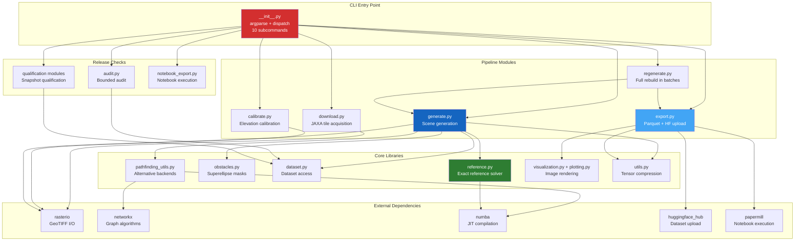

# Code Architecture

This section describes the internal organization of the PASSAGE codebase: module responsibilities, data flows, design patterns and testing strategy. One distribution ships two packages: `passage` (`src/passage/`, the data pipeline) and `passage_eval` (`src/passage-eval/`, the evaluator).

---

## High-Level Architecture

---

## Design Principles

### Lazy Imports

The CLI entry point (`__init__.py`) uses **lazy imports**: a pipeline module is imported only when its subcommand runs. Simple operations such as `--help` therefore do not load heavy dependencies (NumPy, rasterio, NetworkX, Numba).

### Multiprocessing

CPU-intensive steps run in parallel worker processes: download and calibration use a `multiprocessing` pool, and the release generator keeps one process pool per resolution. Each worker handles independent data (an archive, a tile or a scene).

### Resume Support

All pipeline steps record their progress on disk:

- **Download:** a hashed receipt per archive, and `download.csv` with the status of each archive.
- **Calibrate:** `calibrate.json` stores the per-tile statistics and the tile inventory.
- **Generate:** each scene's receipt is written last and marks the scene as complete; on resume, the generator checks every existing receipt and skips complete scenes.
- **Regenerate:** a journal records the committed batches.

### Numba JIT

The exact reference solver, the evaluator's cost functions and the grid backend are compiled with **Numba**, which is a required dependency.

---

## Sections

### [Module Reference](modules.md)
The role of each source module, its main functions and the ten CLI subcommands.

### [Data Format](data-format.md)
Tensor encoding, metadata keys, route files, Parquet columns and file naming conventions.

### [Testing Strategy](testing.md)
65 test files and 860 tests, pytest markers, the 80 % coverage gate and CI integration.

