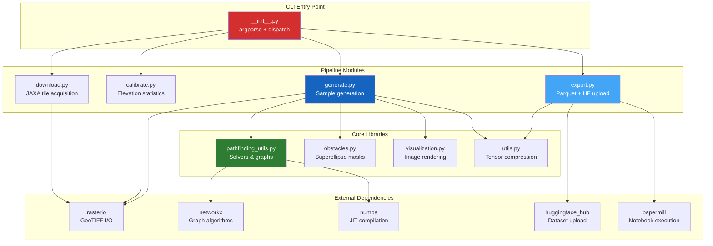

# Code Architecture

This section describes the internal organization of the PASSAGE codebase — module responsibilities, data flows, design patterns, and testing strategy.

---

## High-Level Architecture

---

## Design Principles

### Lazy Imports

The CLI entry point (`__init__.py`) uses **lazy imports** — pipeline modules are only imported when their subcommand is invoked. This avoids loading heavy dependencies (NumPy, rasterio, NetworkX, Numba) for simple operations like `--help`.

### Multiprocessing

CPU-intensive operations (download, calibrate, generate) use Python's `multiprocessing.Pool` for parallelization. Each worker operates on independent data (a tile, a sample) with no shared state.

### Resume Support

All pipeline steps track progress persistently:

- **Download:** `download.csv` records per-tile status
- **Calibrate:** `calibrate.json` stores per-tile statistics
- **Generate:** sample directories on disk serve as checkpoints

### Numba JIT

Performance-critical pathfinding code uses **optional Numba JIT compilation**. The codebase detects Numba availability at import time and falls back to pure Python implementations if unavailable.

---

## Sections

### [Module Reference](modules.md)
Detailed walkthrough of each source module — purpose, key functions, and interdependencies.

### [Data Format](data-format.md)
Tensor encoding, metadata schema, Parquet features, and file naming conventions.

### [Testing Strategy](testing.md)
23 test suites, pytest markers, coverage targets, and CI integration.

