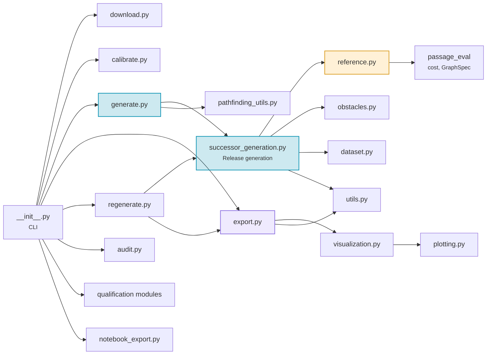

# Module Reference

This reference covers the main modules of the `passage` package (`src/passage/`). The evaluator, `passage_eval` (`src/passage-eval/`), ships in the same distribution; see [`passage-eval` Package](../benchmark/passage-eval.md) and its [API reference](../benchmark/api.md).

---

## Module Map

---

## `__init__.py` — CLI Entry Point

**Role:** command-line interface.

Defines `main()`, the entry point of the `passage` console script. It builds an `argparse` parser with **ten subcommands**: `download`, `generate`, `calibrate`, `compress`, `export`, `upload`, `audit`, `qualify`, `analyze` and `regenerate`. Each subcommand imports its module only when it runs (lazy imports), so `passage --help` stays fast.

| Subcommand | Calls |
|------------|-------|
| `download` | `download.run_download()` |
| `calibrate` | `calibrate.run_calibrate()` |
| `generate` | `generate.run_generate()` |
| `compress` | `export.compress_release()` |
| `export` | `export.prepare_export()` |
| `upload` | `export.upload_export()` |
| `audit` | `audit.audit_source()` |
| `qualify` | `authentication.authenticate_snapshot()`, `qualification.run_metadata_census()`, `qualification_runner.run_route_audit()` |
| `analyze` | `notebook_export.prepare_snapshot_notebooks()` |
| `regenerate` | `regenerate.run_regenerate()` |

---

## Data Pipeline

### `download.py` — Tile Acquisition

Downloads the JAXA AW3D30 5°×5° ZIP archives and extracts their 1°×1° DSM tiles. `run_download()` covers the world grid, or refreshes selected archives; `download_tile()` downloads one archive with bounded retries and writes a hashed completion receipt; `generate_status_map()` draws a PNG map of the archive statuses.

### `calibrate.py` — Elevation Calibration

Scans every DSM tile for its minimum and maximum elevation and writes `calibrate.json`, bound to the complete tile inventory. `run_calibrate()` runs the scan; `validate_calibration_receipt()` checks that a receipt is intact and complete before its global range is used.

### `generate.py` — Scene Generation

`run_generate()` is the entry point of `passage generate`. When the configuration sets `generation.dataset_version` (as the shipped `config/config.yaml` does), it hands over to the release generator in `successor_generation.py`.

`generate.py` also holds helpers that the release generator uses: `_derive_sample_seed()`, `_assign_splits()`, `_resolve_obstacle_config()`, `_generate_obstacles_mask()`, `lat_to_str()`, `lon_to_str()`, `parse_lat_lon_from_filename()` and the constant `TILE_SIZE_PX` (3600). Without `generation.dataset_version`, `run_generate()` runs a configurable generator (`generate_sample()`, `find_path()`, `load_tile()`, `load_tile_grid()`, `count_valid_samples()`) that the v1.0 release does not use.

### `successor_generation.py` — Release Generation

`SuccessorGenerationSession` authenticates the terrain inventory, freezes the geographic split roster and keeps workers available for a resolution. The generator [samples each scene](../generation/sampling.md), solves its six variants with the reference solver, writes the tensor, metadata and routes, and commits the scene receipt last. On resume it validates the existing receipts.

### `reference.py` — Reference Solver

Exact, deterministic A\* on an implicit grid, in float64, compiled with Numba. `solve_reference()` returns an exact route, a proved no-path or a censored result (`ReferenceResult`); `endpoints_connected()` tells, on the same graph, whether the obstacles leave any route from start to goal, and the release generator rejects a crop when they do not; `reverse_goal_field()` computes exact costs-to-go to a goal (`GoalField`); `recost_legal_path()` recomputes the cost of a route. See [Solvers & Heuristics](../generation/solvers.md).

### `obstacles.py` — Superellipse Shapes

`superellipse_mask()` rasterizes one rotated superellipse; `sample_n_from_config()` and `sample_angle_from_config()` draw its exponent and angle. See [Obstacle Generation](../generation/obstacles.md).

### `pathfinding_utils.py` — Alternative Solver Backends

The NetworkX, pathfinding and Numba grid backends, not used for the v1.0 labels: `build_graph_from_elevation()`, `_GraphTemplate`, `_compute_edge_weights()`, `_grid_astar()`, `_grid_dijkstra()`, `_numba_astar_core()`, `_numba_dijkstra_core()`, `_numba_compute_step_cost()`. It also holds the constants `COST_MODELS` (a set of five names), `DIAGONAL_OPTIONS`, `HEURISTIC_MAP` and `PIXEL_SIZE_M` (30.0), and route helpers such as `check_path_collision()` and `hausdorff_distance()`. The classical A\* baseline of `passage-eval` calls `_grid_astar()`.

### `utils.py` — Tensor Compression

`encode_tensor_blob()` and `decode_tensor_blob()` convert between arrays and Zstandard-compressed raw bytes; `save_tensor()` and `load_tensor()` do the same with files. Constants: `TENSOR_SUFFIX` (`".npy.zst"`) and `TENSOR_COMPRESSION_LEVEL` (12). `_log_timing()` is a decorator that logs the duration of a call.

---

## Release and Publication

### `export.py` — Parquet Export and Upload

Packages the generated scenes for Hugging Face. `compress_release()` (`passage compress`) writes the Parquet shards; `prepare_export()` (`passage export`) refreshes the notebooks, assets, calibration and README of the export tree; `upload_export()` (`passage upload`) uploads it; `export_and_upload()` runs the three steps in one call. `_features()` defines the Hugging Face `Features` schema, and `parse_path_csv()` reads a route file (one `row,col` pair per line) into `[[row, col], …]`. The module also exports and verifies release batches for `passage regenerate`. For release builds, it calls `successor_publication.py` to write and verify the dataset card, datasheet, Croissant metadata and a content receipt.

### `regenerate.py` — Full Rebuild

`run_regenerate()` (`passage regenerate`) generates, exports and verifies the whole dataset in bounded, resumable batches; it never uploads. `build_plan()` computes the batches and `verify_release()` checks the written shards.

### `dataset.py` — Dataset Access

`DatasetSource` reads the released Parquet populations from a local snapshot or from a pinned Hub commit (a 40-character hash is required for remote use). `decode_scene_inputs()` turns a row into elevation in meters, an obstacle mask and the two endpoints, after validating the tensor.

### `audit.py` — Bounded Audit

`audit_source()` (`passage audit`) re-checks a bounded number of rows per resolution without modifying any file. `audit_row()` checks the legality and cost of each stored route against a fresh, bounded solve by `exact_reference()`. `geographic_footprint()` and `footprint_overlaps()` check that crops of different splits do not overlap.

### `authentication.py`, `qualification.py`, `qualification_runner.py`, `qualification_reports.py` — Qualification

The `passage qualify` campaign. `authenticate_snapshot()` checks every file of a local snapshot against a pinned Hub commit, without downloads. `run_metadata_census()` scans all core rows and freezes a roster; `run_route_audit()` audits the routes of that roster. `qualification_reports.py` (`qualification_report()`, `dataset_census_report()`, `render_qualification_figures()`) reads the resulting receipts for the notebooks.

---

## Notebooks and Figures

### `notebook_export.py` — Notebook Execution

`prepare_snapshot_notebooks()` (`passage analyze`) prepares or runs the per-resolution notebooks and the study reports in a separate staging directory; `execute_notebook()` runs one notebook with cell and job time limits.

### `notebook_reports.py` — Notebook Producers

Read-only, bounded functions shared by the release and paper notebooks, such as `dataset_report()`, `generation_outcome_report()`, `route_metrics_report()` and `evaluation_report()`.

### `plotting.py` — Scene Plots

Plan-view plots of a scene and its routes: `terrain_colormap()` (the sage–sand elevation palette), `decode_scene()`, `render_scene()` and `render_cost_comparison()` (six routes on one terrain scale, in a 2×3 grid).

### `visualization.py` — Raster Previews

`tensor_to_image()` turns a tensor and up to two routes into a BGR `uint8` image: sage–sand elevation, charcoal hatched obstacles, a blue route and an orange route with white halos, a white circle for the start and a white star for the goal. The export uses it for the preview images.
