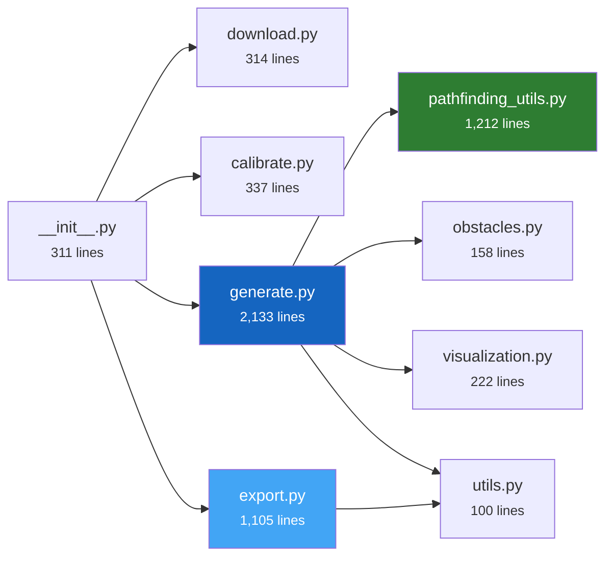

# Module Reference

PASSAGE consists of **8 source modules** in `src/passage/`, totaling approximately 5,700 lines of Python. This page walks through each module's role, key symbols, and relationships.

---

## Module Map

---

## `__init__.py` — CLI Entry Point

**Lines:** 311 | **Role:** Command-line interface

Defines the `main()` function invoked by the `passage` console script. Uses `argparse` with 4 subparsers to route to the appropriate pipeline module.

**Key design:** Lazy imports — the actual module (`download`, `calibrate`, `generate`, `export`) is only imported when its subcommand is dispatched, keeping `passage --help` fast.

??? abstract "Key symbols"
    | Symbol | Type | Description |
    |--------|------|-------------|
    | `main()` | Function | CLI entry point |
    | `_build_parser()` | Function | Constructs argparse parser |

---

## `download.py` — Tile Acquisition

**Lines:** 314 | **Role:** Download JAXA ALOS AW3D30 tiles

Iterates the global lat/lon grid, validates URLs via HEAD requests, downloads ZIP archives, and extracts GeoTIFF files. Tracks all results in a CSV file and generates a world-coverage status map.

??? abstract "Key symbols"
    | Symbol | Type | Description |
    |--------|------|-------------|
    | `run_download()` | Function | Main orchestrator — iterates tiles, manages workers |
    | `download_tile()` | Function | Worker: HEAD check → download → extract |
    | `generate_status_map()` | Function | Creates PNG world map of download results |

---

## `calibrate.py` — Elevation Statistics

**Lines:** 337 | **Role:** Scan tiles for global min/max elevation

Reads each GeoTIFF with `rasterio`, computes per-tile statistics, and aggregates to global min/max. Outputs `calibrate.json` and two visualization maps (max elevation, peak-to-peak).

??? abstract "Key symbols"
    | Symbol | Type | Description |
    |--------|------|-------------|
    | `run_calibrate()` | Function | Main entry — parallel tile scanning |
    | `_process_tile_worker()` | Function | Worker: reads one tile, returns (min, max) |

---

## `generate.py` — Dataset Generation :star:

**Lines:** 2,133 | **Role:** Core sample generation pipeline

The largest and most complex module. Orchestrates the full generation pipeline: elevation sampling, tile selection, crop assembly, marker placement, obstacle generation, path solving, tensor encoding, and disk output.

??? abstract "Key symbols"
    | Symbol | Type | Description |
    |--------|------|-------------|
    | `run_generate()` | Function | Main entry — loads config, iterates resolutions |
    | `generate_sample()` | Function | Worker: generates one complete sample |
    | `find_path()` | Function | Dispatches to correct solver backend |
    | `load_tile()` / `load_tile_grid()` | Function | Tile I/O with rasterio windowed reads |
    | `_assemble_crop_from_tiles()` | Function | Multi-tile crop assembly for large resolutions |
    | `_generate_obstacles_mask()` | Function | Procedural obstacle placement loop |
    | `_assign_splits()` | Function | Deterministic split assignment |
    | `tiles_needed_for_resolution()` | Function | Computes N×N tile grid needed |
    | `count_valid_samples()` | Function | Resume support — counts existing samples |
    | `TILE_SIZE_PX` | Constant | 3600 pixels per JAXA tile |

---

## `pathfinding_utils.py` — Solvers & Graphs

**Lines:** 1,212 | **Role:** All pathfinding implementations

Implements three solver backends (NetworkX, pathfinding, grid), five cost models, three heuristics, and supporting utilities. The grid backend includes optional Numba JIT compilation.

??? abstract "Key symbols"
    | Symbol | Type | Description |
    |--------|------|-------------|
    | `build_graph_from_elevation()` | Function | Builds NetworkX DiGraph with weighted edges |
    | `_GraphTemplate` | Class | Cached graph topology for efficient reuse |
    | `_compute_edge_weights()` | Function | Vectorized edge weight computation |
    | `_grid_astar()` | Function | Grid-based A\* (pure Python / Numba) |
    | `_grid_dijkstra()` | Function | Grid-based Dijkstra |
    | `_numba_astar_core()` | Function | JIT-compiled A\* kernel |
    | `_numba_dijkstra_core()` | Function | JIT-compiled Dijkstra kernel |
    | `_numba_compute_step_cost()` | Function | JIT cost computation for all 5 models |
    | `check_path_collision()` | Function | Tests if a path crosses obstacles |
    | `PIXEL_SIZE_M` | Constant | 30.0 meters per pixel |
    | `COST_MODELS` | Constant | List of cost model names |

---

## `obstacles.py` — Superellipse Generation

**Lines:** 158 | **Role:** Obstacle mask creation

Creates boolean masks for rotated superellipses and provides sampling functions for shape parameters (exponent, angle).

??? abstract "Key symbols"
    | Symbol | Type | Description |
    |--------|------|-------------|
    | `superellipse_mask()` | Function | Rasterizes a single rotated superellipse |
    | `sample_n_from_config()` | Function | Samples exponent from configured distribution |
    | `sample_angle_from_config()` | Function | Uniform angle sampling |

---

## `visualization.py` — Image Rendering

**Lines:** 222 | **Role:** Converts tensors to BGR images

Renders multi-channel tensors as color images using matplotlib's `terrain` colormap for elevation, with overlays for obstacles (red), markers (cyan/blue plus signs), and paths (yellow/green polylines).

??? abstract "Key symbols"
    | Symbol | Type | Description |
    |--------|------|-------------|
    | `tensor_to_image()` | Function | Full tensor → BGR image conversion |

---

## `utils.py` — Tensor Compression

**Lines:** 100 | **Role:** Shared utilities

Zstandard-based compression/decompression for numpy arrays, plus a timing decorator.

??? abstract "Key symbols"
    | Symbol | Type | Description |
    |--------|------|-------------|
    | `encode_tensor_blob()` | Function | Compress numpy array → bytes |
    | `decode_tensor_blob()` | Function | Decompress bytes → numpy array |
    | `save_tensor()` | Function | Write compressed tensor to file |
    | `load_tensor()` | Function | Read compressed tensor from file |
    | `_log_timing()` | Decorator | Logs function entry/exit/duration |
    | `TENSOR_SUFFIX` | Constant | `".npy.zst"` |

---

## `export.py` — Parquet Export & HF Upload

**Lines:** 1,105 | **Role:** Dataset packaging and distribution

The second-largest module. Prepares Parquet shards with Hugging Face `Features` schema, copies assets and notebooks, executes notebooks via `papermill`, and uploads everything to HF Hub.

??? abstract "Key symbols"
    | Symbol | Type | Description |
    |--------|------|-------------|
    | `export_and_upload()` | Function | Main orchestrator (24 parameters) |
    | `_features()` | Function | Defines HF Features schema |
    | `_create_parquets()` | Function | Writes chunked Parquet files |
    | `_process_meta_for_prepare()` | Function | Processes single sample for Parquet |
    | `_execute_notebook_with_papermill()` | Function | Runs notebook via uv/papermill |
    | `_execute_notebook_with_retries()` | Function | Retry wrapper for notebooks |
    | `_generate_huggingface_yaml_header()` | Function | Creates YAML front-matter |
    | `_load_hf_credentials()` | Function | Reads .env + .env.secret |
    | `parse_path_csv()` | Function | Parses (x,y) path CSV files |
