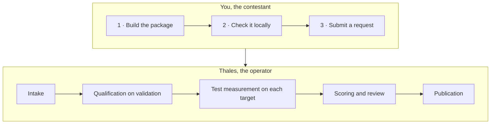

# Submit a candidate

This page is for anyone who wants a planner on the PASSAGE
[leaderboard](leaderboard/index.md). You build your planner as a frozen package, check
it on your own machine with the public tools, then ask Thales for the official
evaluation. Thales then measures it on the edge targets and publishes the result.
You need no account on a results service, no signing key and no access to
private code.



*Figure 1. From your package to a leaderboard row. [Official evaluation](official-evaluation.md) details the Thales steps.*

## :material-target: What is evaluated

Every entry is measured on one fixed task profile, described in the
[leaderboard](leaderboard/index.md#what-every-entry-is-measured-on): PASSAGE v1.0 at
revision `c09cc5a21a55a93e7c09d47368d5f5bf75cb8fae`, 256 × 256 scenes, the
`elevation` objective with weight 62.4, the 40,000-scene test split, a 5 s
deadline per request, and three edge targets. Your package must therefore:

- accept that request and return a route for it;
- train on the training split only, and select decoder or other settings on the
  calibration split, never on test;
- come with three independently trained checkpoints, seeds **1234**, **2026** and
  **3407**, unless it is a classical planner without training.

The public test split has been available since the dataset release. Tell us in
your submission whether, and how, your work has used it.

## :material-package-variant-closed: Step 1 — Build the package

A candidate package is a folder, best published as a model repository, that
contains the complete procedure: everything between the ordinary input and the
returned route. The
[Seg](https://huggingface.co/thalesgroup/passage-seg-convnextv2-atto) and
[Reg](https://huggingface.co/thalesgroup/passage-reg-repvit-m1) model repositories
are complete examples. The small
[classical example](https://github.com/ThalesGroup/passage/tree/main/examples/candidate-package)
is the minimal one.

*Table 1. What the package contains.*

| Item | Content |
| --- | --- |
| Adapter | A class `module:Class` with `plan(request: PlanRequest) -> PlanResult`; `synchronize()` if it uses CUDA; `close()` to release resources. See [Evaluate your planner](contributing-a-method.md) for the request and result types. |
| Weights | The trained weights for each seed, with the network also exported to **ONNX** if you request accelerated edge targets: Thales compiles that export for each target runtime. |
| Decoder | The source of any search, repair or fallback that turns network outputs into a route. It runs on the target CPU. |
| Locks | Hashed dependency locks for Python 3.11–3.14, with the Python minor declared in the descriptor. |
| Recipe | A Containerfile that builds a runtime from a public base image, your locks and the public PASSAGE core wheel, like the Seg and Reg `containers/CPU.Containerfile`. |
| Descriptor | `source.json`: identity, entry point, dataset, budget, backends, training declaration and the list of files (see the [field reference](#descriptor-field-reference)). |
| Rights | `LICENSE` for your code and weights, and notices for third-party components. |
| Card | A README that explains the method, the training data and recipe, and any use of the test split. |

Keep these rules in mind:

- **Ordinary inputs only.** The planner receives elevation, obstacles, start and
  goal. Reference routes, optimal costs and any other label never enter the
  package or its inputs.
- **The whole procedure is timed.** Preparation, network inference, decoding,
  repair, fallback and device synchronisation all count. Use `request.budget` and
  `request.remaining_wall_ms()`, and return a terminal status: `ok`, `no_path`,
  `invalid_path`, `budget_exhausted`, `timeout`, `oom`, `runtime_error` or
  `cancelled`.
- **Declared files only.** The runner copies only the files listed in the
  descriptor. Nothing else from your machine is available at run time.
- **One descriptor per seed.** Each seed has its own descriptor and therefore its
  own identity, as in the Seg and Reg repositories. Set `budget.wall_time_ms` to
  `5000`, the leaderboard deadline.

## :material-test-tube: Step 2 — Check it locally

Run the same pipeline that Thales runs for its qualification, on 1,024
validation scenes. Use a Linux host with a working rootless `runc` and Docker, and
a Python environment with the PASSAGE **1.0.0** core installed from the
[release guide](../release.md). Build the core wheel from the same checkout for
your image; the recipe installs it.

**Freeze and validate the package.** `freeze` hashes the declared files and
writes the sealed manifest beside the descriptor, without importing your code:

```bash
export PASSAGE_WORK="$(mktemp -d -t passage-check.XXXXXXXX)"
passage-eval candidate freeze my-candidate/source.json --out my-candidate/candidate.json
passage-eval candidate validate my-candidate/candidate.json
passage-eval candidate register my-candidate/candidate.json --catalog "$PASSAGE_WORK/catalog.json"
```

Repeat these commands for each seed's descriptor. Keep each reported `identity`
(`candidate_id@version`) and `manifest_sha256`: your submission names them.

**Prepare 1,024 validation scenes.** Download the `256x256/train` and
`256x256/validation` shards of the dataset at the pinned revision, then write the
prepared scenes and export their input-only arrays:

```bash
python -m passage_eval.candidates.prepare --dataset /path/to/passage \
  --revision c09cc5a21a55a93e7c09d47368d5f5bf75cb8fae \
  --out "$PASSAGE_WORK/prepared" --validation-count 1024
python -m passage_eval.campaign.candidate.inputs \
  --index "$PASSAGE_WORK/prepared/validation/index.json" \
  --output "$PASSAGE_WORK/inputs/scenes.npz" --count 1024
```

`prepare` also writes training supervision for 32,768 training scenes by default,
which you can use to train; lower `--train-count` if you do not need it. Only
`scenes.npz` enters the runner. Its two sidecars stay on your host for scoring.

**Run the package in the rootless runner.** Build your image, export it to a
root file system, run the 1,024 scenes, then bind the container receipt:

```bash
docker build -f my-candidate/containers/CPU.Containerfile -t local/my-candidate:cpu my-candidate
python -m passage_eval.campaign.candidate.oci prepare \
  --image local/my-candidate:cpu --output "$PASSAGE_WORK/rootfs"
python -m passage_eval.campaign.candidate.oci run \
  --rootfs "$PASSAGE_WORK/rootfs/rootfs-receipt.json" \
  --manifest my-candidate/candidate.json \
  --inputs "$PASSAGE_WORK/inputs/scenes.npz" \
  --output "$PASSAGE_WORK/run-cpu" --device cpu --timeout-seconds 7200
python -m passage_eval.campaign.candidate.binding --run "$PASSAGE_WORK/run-cpu"
```

For CUDA, run with `--device cuda --gpu-uuid <your GPU UUID>`. The
[rootless OCI runner](candidate-oci.md) page explains the isolation and the
receipts.

**Score the routes on the host.** The scorer checks every route, recomputes its
cost against the stored reference and writes the scores:

```bash
python -m passage_eval.campaign.candidate.scoring \
  --run "$PASSAGE_WORK/run-cpu" \
  --index "$PASSAGE_WORK/inputs/scenes.cohort.json" \
  --target my-workstation-cpu --output "$PASSAGE_WORK/validation-row.json" \
  --gpu-seconds <training GPU seconds>
```

The check passes when all 1,024 scenes complete, the runner exits with code 0 and
no timeout, and the score file shows the status counts and metrics you expect.
Omit `--gpu-seconds` if you do not know your training cost.

## :material-send-outline: Step 3 — Submit

1. **Publish the package** in a model repository, on Hugging Face for example, at
   a fixed revision. A public repository is simplest. A gated one also works if
   you grant Thales access.
2. **Open a submission request** with the
   [leaderboard submission form](https://github.com/ThalesGroup/passage/issues/new?template=leaderboard-submission.yml)
   on GitHub. It asks for:
    - the repository URL and the exact revision;
    - the identity `candidate_id@version` and the `manifest_sha256` of each seed's
      sealed manifest;
    - the backends and the targets you request;
    - your training declaration: data, recipe, compute and any use of the test split;
    - the licence under which Thales may run the package and publish its results;
    - the `validation-row.json` from your local check, attached.

If you cannot use GitHub, write to oss@thalesgroup.com with the same information.

## :material-timeline-check-outline: Step 4 — What happens next

Thales answers in the request at each stage. The
[official evaluation](official-evaluation.md) page describes the work on the
Thales side.

*Table 2. Stages after you submit.*

| Stage | What Thales does | What you receive |
| --- | --- | --- |
| Intake | Checks completeness, rights and the requested scope | Acceptance, or a list of changes |
| Qualification | Freezes the package, builds the runtimes and runs the 1,024 validation scenes on a workstation and on each target | A qualification summary to compare with your local check |
| Test measurement | Runs each seed on the 40,000 test scenes on each target, beside an A* reference | Notice that the runs are complete |
| Scoring and review | Scores every route on the host and reviews the evidence | Your results, before publication |
| Publication | Publishes one row per target and seed as *measured*, or *verified* once signed | The row identities in the leaderboard |

**Changes and corrections.** A fix to code, weights, locks, recipe or budget is a
new version: freeze it again and open a new request. Earlier rows keep their
identities. You can ask for an entry to be withdrawn at any time.

## :material-table-key: Descriptor field reference

The [JSON Schema](https://github.com/ThalesGroup/passage/blob/main/schemas/candidate-package-v1.schema.json)
gives the exact manifest. `freeze` fills in the hashes, which are `null` in the
editable descriptor.

*Table 3. Descriptor fields.*

| Field | Meaning and accepted values |
|---|---|
| `schema` | Exactly `passage-candidate-package/v1`. |
| `candidate_id`, `version`, `family` | Each matches `[a-z0-9][a-z0-9.-]{0,95}`. The registry key is `candidate_id@version`. |
| `entrypoint`, `kwargs` | Importable `module:Class` inside the sealed package and a JSON object of constructor parameters. Relative `checkpoint` and `root` parameters are resolved against the package root. |
| `python`, `backends` | Python minor `3.11`, `3.12`, `3.13` or `3.14`; a nonempty unique list drawn from `cpu`, `cuda`, `openvino`, `tensorrt`. The current worker/OCI device interface runs `cpu` or `cuda` only. |
| `seed` | Nonnegative integer or `null`. The displayed pilot requires 2026 for learned candidates; classical references use `null`. A package can validate without qualifying for that display profile. |
| `dataset` | Exact fields `id`, immutable 40-character lowercase commit `revision`, `config` such as `256x256`, `cost_model` and finite nonnegative `cost_weight`. Models are `distance`, `elevation`, `absolute_elevation`, `slope_uphill`, `energy`; `slope` is an accepted alias. |
| `budget` | Only `wall_time_ms`, `max_expansions`, `max_queue_operations`, `max_live_states`; omitted or `null` means no configured limit. Wall time must be finite and positive; work limits must be positive integers. |
| `precision`, `license` | Nonblank descriptions of actual execution precision and applicable rights. |
| `training` | Object with `split: "train"` or `"none"` and a truthy `test_usage` declaration. Add meaningful provenance: training/calibration data revisions, code, weights, label generation and selection policy. The loader permits extra provenance fields; validation does not verify their claims. |
| `image` | Exactly `recipe` and `reference`. Recipe names a declared file. Reference is `null` before a build, or an immutable `name@sha256:…` reference. The loader does not resolve a tag or authenticate an image. |
| `artifacts` | Nonempty records with exactly `path`, actual lowercase SHA-256 and `role`. Roles are `code`, `weights`, `config`, `lock`, `recipe`, `notice`; at least code, lock and recipe are required. Weights are optional. |

Artifacts are regular files under the package root, without symbolic links,
absolute paths or `.` and `..` segments. A registered `candidate_id@version` can
never be reused for different bytes.
