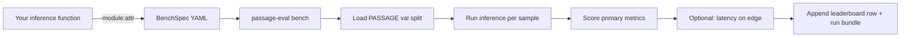

# Submit a candidate

This page is the **canonical entry point** for any third party who
wants their planner scored under PASSAGE — vision baseline, GNN, RL
agent, or classical search. The flow is identical for all of them
because the contract is approach-agnostic.



!!! tip "TL;DR — score a planner in three commands"

    ```bash
    passage-eval init-spec --out my_method.passage-bench.yaml      # 1. starter spec
    # edit my_method.passage-bench.yaml: set `inference:` + `edge_accelerator:`
    passage-eval bench --spec my_method.passage-bench.yaml          # 2. score it
    passage-eval leaderboard --metric cost_regret_median            # 3. inspect
    ```

## 1. Implement the inference signature

You can ship either a [`Planner`][passage_eval.Planner] subclass or
a plain function. The CLI auto-detects which one you handed in.

=== "`Planner` subclass (recommended)"

    ```python
    # my_method/planner.py
    import passage_eval as pe

    class MyPlanner(pe.Planner):
        name = "my_method"

        def __init__(self, checkpoint: str, *, device: str = "cuda"):
            self.model = load_my_model(checkpoint, device=device)

        def predict_path(self, scene: pe.Scene) -> pe.PlannerOutput:
            path = self.model.run(
                elevation=scene.elevation,
                obstacles=scene.obstacles,
                start=scene.start,
                goal=scene.goal,
                cost_model=scene.cost_model,
                cost_weight=scene.cost_weight,
            )
            return pe.PlannerOutput(predicted_path=path, predicted_cost=0.0)
    ```

=== "Free function (quickest)"

    ```python
    # my_method/predict.py
    import numpy as np

    def my_predict_fn(*, elevation: np.ndarray, obstacles: np.ndarray,
                      start: tuple[int, int], goal: tuple[int, int],
                      cost_model: str, cost_weight: float, **kwargs
                      ) -> list[tuple[int, int]]:
        """Return the ordered (i, j) cells of the path from start to goal."""
        ...
    ```

The required signature is **kwargs-only** for forward compatibility.
Future PASSAGE releases may add fields without breaking your method.

## 2. Declare your submission

`passage-eval` consumes a single declarative spec — every flag you
might pass on the CLI lives in this file:

```yaml title="my_method.passage-bench.yaml"
method_name: my_method                       # short identifier, snake_case
family: rl                                    # dense_regression / dense_segmentation / graph / classical / rl
architecture: ppo_actor_critic                # backbone or class label
decoder_variant: argmax_policy

inference: my_method.planner:MyPlanner        # 'module:Class' OR 'module:callable'
inference_kwargs:
  checkpoint: outputs/my_method/best.pt

resolution: 256                               # PASSAGE input resolution
cost_model: elevation                         # elevation / slope_uphill / energy
cost_weight: 1.0
split: val
n_samples: 1024
seeds: [1234, 2026, 3407]                     # MUST match passage_eval.DEFAULT_SEEDS

edge_accelerator: Thor-GPU                    # h100 / Thor-GPU / Orin-GPU / Orin-NPU / Tiger-iGPU / null
batch_size: 1
dtype: fp16
measure_latency: true
latency_warmup: 5
latency_repeats: 30

results_root: outputs/passage-eval/results
dataset_version: thalesgroup/passage:v0.4
extra:
  notes: "first end-to-end submission"
```

Generate a starter file with `passage-eval init-spec`.

## 3. Score it

```bash
passage-eval bench --spec my_method.passage-bench.yaml
```

Behind the scenes the CLI:

1. Imports `MyPlanner` from `my_method.planner` and instantiates it with `inference_kwargs`.
2. Loads the released PASSAGE val split for the declared `(resolution, cost_model)` cell.
3. Runs your `predict_path` once per sample.
4. Computes the **six primary metrics** — `cost_regret_median`,
   `cost_regret_p90`, `path_assd`, `path_hausdorff_p95`,
   `success_rate`, `obstacle_violation_rate` — applying the
   pre-registered censored-penalty rule.
5. (If `measure_latency: true`) repeats `predict_path` on a
   reference scene `latency_warmup + latency_repeats` times and
   records `latency_e2e_ms_p50`.
6. For each seed, builds a `Submission`
   record and calls `pe.submit(...)`. The on-disk bundle lands at:

```
outputs/passage-eval/results/runs/r256/elevation/<accelerator>/
└── my_method__seed1234__<timestamp>/
    ├── metrics.json
    └── per_sample.npz   (when supplied)
```

The leaderboard CSV is atomically appended.

## 4. Same flow on a different accelerator

Run the bench on the actual edge target — the spec changes only
in the deployment block:

```yaml
# my_method.thor-gpu.yaml
edge_accelerator: Thor-GPU
batch_size: 1
dtype: fp16
measure_latency: true
results_root: outputs/passage-eval/results
```

```bash
passage-eval bench --spec my_method.thor-gpu.yaml \
                   --edge-accelerator Thor-GPU \
                   --inference my_method.planner_thor:MyTRTPlanner
```

The metrics are *seed-invariant* across accelerators (same checkpoint
runs everywhere), so the second call writes a row that differs from
the first only in the `latency_*` columns and the `host_accelerator`
directory it lands under. The leaderboard heatmap and grouped-bar
plots automatically pick up the new row.

## 5. Inspect

```bash
passage-eval leaderboard --metric cost_regret_median
```

```bash
# Refresh figures + SCOREBOARD.md + docs/benchmark/leaderboard.md +
# README leaderboard section, all from one CSV:
uv run python scripts/passage-eval/render_leaderboard.py
```

---
title: "Submit a candidate"
icon: material/account-plus-outline

## Concrete worked example — score the A* oracle as a candidate

The simplest possible submission: hand the CLI the bundled
`passage_eval.AStarPlanner` (the analytic A\* oracle). It implements
the [`Planner`][passage_eval.Planner] ABC out of the box, so we don't
have to write any glue code — we only need a YAML spec and one
command. This walks through the exact bytes that pass through the CLI
on a fresh checkout.

### Step 1 · Generate the starter spec

```bash
passage-eval init-spec --out astar.passage-bench.yaml
```

Replace its contents with the entry point that points at the bundled
oracle:

```yaml title="astar.passage-bench.yaml"
method_name: astar-oracle-demo
family: classical
architecture: analytic
decoder_variant: analytic_a_star
inference: passage_eval.baselines.classical:AStarPlanner
inference_kwargs: {}

resolution: 64           # 64² keeps the demo runnable on a CPU laptop
cost_model: elevation
cost_weight: 1.0
split: val
n_samples: 8
seeds: [1234]
measure_latency: false

results_root: outputs/passage-eval/results
dataset_version: thalesgroup/passage:demo
extra:
  notes: "oracle baseline reference"
```

### Step 2 · Run the bench

```console
$ passage-eval bench --spec astar.passage-bench.yaml
[passage-eval] bench v0.3.0: method='astar-oracle-demo' on r64/elevation
[passage-eval] loaded 8 scenes; planner = AStarPlanner
[passage-eval] seed 1234: CR-med=0.0000 -> runs/r64/elevation/<host>-cpu/astar-oracle-demo__seed1234__<timestamp>
```

Because the candidate planner *is* the analytic oracle, every primary
metric is exactly zero (`cost_regret_*`, `path_assd`,
`path_hausdorff_p95`) and `success_rate = 1.0`. That's the canonical
self-consistency check: if your wired-up CLI does not zero out the
oracle, something is wrong with the metric pipeline before it's wrong
with your planner.

### Step 3 · Inspect the artefacts

```text
outputs/passage-eval/results/
├── leaderboard.csv
└── runs/r64/elevation/<host>-cpu/
    └── astar-oracle-demo__seed1234__<timestamp>/
        └── metrics.json
```

`metrics.json` (annotated):

```json
{
  "method_name": "astar-oracle-demo",
  "family": "classical",
  "resolution": 64,
  "cost_model": "elevation",
  "seed": 1234,
  "metrics": {
    "cost_regret_median": 0.0,
    "cost_regret_p90": 0.0,
    "path_assd": 0.0,
    "path_hausdorff_p95": 0.0,
    "success_rate": 1.0,
    "obstacle_violation_rate": 0.0,
    "n_samples": 8,
    "n_regret_valid": 8
  }
}
```

```console
$ passage-eval leaderboard --metric cost_regret_median --root outputs/passage-eval/results
       method_name    family architecture  edge_accelerator  seed  cost_regret_median  latency_e2e_ms_p50  n_samples
astar-oracle-demo classical     analytic               NaN  1234                0.0                 NaN          8
```

### Step 4 · Repeat on a real accelerator

Once your planner has GPU-side latency to report, the only edit is a
two-key block in the spec — *no other change*:

```yaml
edge_accelerator: Thor-GPU
batch_size: 1
dtype: fp16
measure_latency: true
latency_warmup: 5
latency_repeats: 30
```

The CLI then drops the row under
`runs/r64/elevation/thor-gpu/...`, populates `latency_e2e_ms_p50`,
and the leaderboard's per-accelerator heatmap and per-method bar
chart pick the new entry up automatically.

!!! note "Why this is the right sanity-check"

    The A* oracle is not just *any* baseline — it is the planner that
    produced the dataset's reference labels. Scoring it against itself
    must yield zeros, by construction. Any submission whose CLI
    pipeline does not reproduce that property has wired the metric
    machinery wrong; until the oracle row collapses to zero, no
    headline number is trustworthy. This is exactly why
    `passage-eval bench` ships with `AStarPlanner` already importable.

## API reference

::: passage_eval.cli.BenchSpec
    handler: python
    options:
      show_root_heading: true
      show_source: false

::: passage_eval.Planner
    handler: python
    options:
      show_root_heading: true
      show_source: false

::: passage_eval.score_planner
    handler: python
