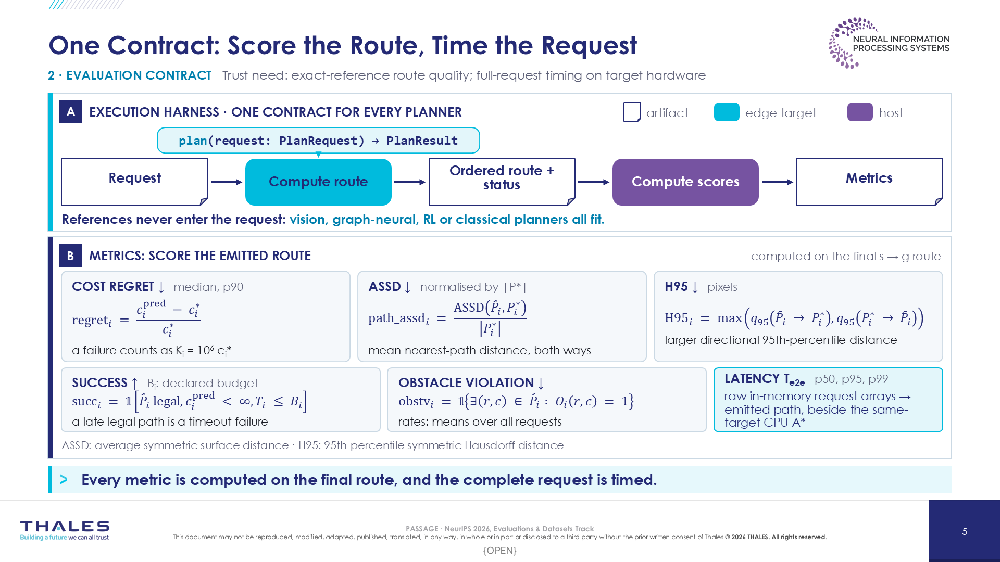

# Leaderboard

The PASSAGE leaderboard compares complete planning procedures on the same tasks
and the same hardware. Each entry is a frozen candidate package that Thales runs
on the complete test split, on each edge target, under one evaluation contract.
The emitted routes are then scored independently on a separate host. Anyone can
propose a candidate: [Submit a candidate](../candidate-registration.md) explains the
process, and [Official evaluation](../official-evaluation.md) lists what Thales does
to turn a submission into an official result.

## :material-scale-balance: What every entry is measured on

All entries share one task profile, so their numbers can be compared target by
target.

*Table 1. The leaderboard task profile.*

| Item | Value |
| --- | --- |
| Data | [PASSAGE v1.0](https://huggingface.co/datasets/thalesgroup/passage), revision `c09cc5a21a55a93e7c09d47368d5f5bf75cb8fae` |
| Task | 256 × 256 scenes, `elevation` objective with weight 62.4, eight-connected grid of 30 m cells, obstacles blocked |
| Population | The complete test split: 40,000 scenes from the South-American geographic hold-out |
| Request | One ordinary input per scene (elevation, obstacles, start, goal); reference routes and costs stay on the host |
| Deadline | 5 s per request; a later legal route counts as a timeout failure |
| Training seeds | Three independently trained checkpoints, seeds 1234, 2026 and 3407 (none for a classical planner) |
| Targets | NVIDIA Jetson AGX Orin, NVIDIA Jetson AGX Thor, Intel Tiger Lake (Core i7-1185GRE with Iris Xe graphics) |
| Timing | Batch one, one persistent session per target and seed, 16 warm-up calls on a separate validation scene; the timer runs from raw in-memory arrays to the returned route |
| Scores | Median and p90 cost regret, ASSD, H95, success rate and obstacle-violation rate, with p50, p95 and p99 latency |
| Reference | An exact CPU A* session on each target, shown beside the candidates and outside their ranking |

*Figure 1. The evaluation contract, as presented in the [NeurIPS 2026 talk](../../presentation.md).*

The [evaluation protocol](../protocol.md) defines each metric, the failure penalty
and the aggregation. Compare latency within a target: CPU, GPU and integrated-GPU
execution differ between devices.

## :material-podium: Main candidates

The leaderboard opens with two candidates contributed by the PASSAGE authors.
Both bridge vision networks and path planning: a dense network predicts a field
over the grid, then a frozen graph decoder turns that field into a legal route.

*Table 2. The main candidates and the reference.*

| Entry | Idea | Model page |
| --- | --- | --- |
| **Seg** — segmentation | ConvNeXt V2 Atto predicts where the route passes; a raw-logit A* connects start and goal | [thalesgroup/passage-seg-convnextv2-atto](https://huggingface.co/thalesgroup/passage-seg-convnextv2-atto) |
| **Reg** — regression | RepViT M1 predicts the remaining cost to the goal; a Bellman descent follows it, with a Dijkstra reconnection if it stalls | [thalesgroup/passage-reg-repvit-m1](https://huggingface.co/thalesgroup/passage-reg-repvit-m1) |
| **A\*** — reference | Exact search on the physical edge costs, on the target CPU | Part of the [evaluator](../passage-eval.md) |

Each model page documents its method, training, exports and how to run it; the
repositories currently require authorised Hugging Face access. Both candidates
were measured with their three seeds on the three targets, over the complete test
split. The [paper results](../candidates/index.md) report the original study, whose
sessions differ from the leaderboard rows on Tiger Lake in particular.

## :material-puzzle-outline: How the main candidates were integrated

Seg and Reg follow the structure that a new candidate uses. Their model
repositories are therefore complete worked examples.

**What each model repository contains.**

- An adapter class, `candidate_adapter:Candidate`, exposing
  `plan(PlanRequest) → PlanResult` for the common worker.
- The ONNX exports of the network for the three seeds, and the decoder source.
- Hashed dependency locks and a container recipe that installs the public core.
- Licence, third-party notices and a model card describing the method, the
  training data and any prior use of the test split.
- A descriptor, `candidate.source.json`, listing these files with their hashes.
  `passage-eval candidate freeze` seals it into a `passage-candidate-package/v1`
  manifest. Any change to code, weights, locks, recipe or budget makes a new
  version.

**How Thales measured them.**

1. For each edge target, Thales compiled the network exports for the target
   runtime: TensorRT on the two Jetson devices and OpenVINO on Tiger Lake. The
   decoder ran on the target CPU.
2. A functional check ran each export on each native target, on one validation
   scene.
3. Each seed then ran on each target in a persistent session over the 40,000
   test scenes, beside one CPU A* session per target.
4. A separate host scored every returned route against the stored references.
   Each target and seed became one row, with its evidence identities attached.

## :material-check-decagram-outline: Entry status

Every row carries one status:

- **Measured:** Thales ran the identified package and scored its routes on the
  host. The evidence is retained, but it has not been reviewed for admission.
- **Verified:** Thales also reviewed the evidence of that exact package and
  signed its admission for this task profile.

All current rows, including Seg and Reg, are *measured*. No row is verified yet:
the signing policy and operator key that verification requires are still to be
put in place (see [Official evaluation](../official-evaluation.md#one-time-setup)).
A local score computed by a contestant is not a leaderboard entry. Neither are
the [paper results](../candidates/index.md), which report the original study.

## :material-account-plus-outline: Enter the leaderboard

1. Build your candidate as a package, on the model of Seg and Reg.
2. Check it locally with the same public tools Thales uses.
3. Open a submission request.

[Submit a candidate](../candidate-registration.md) gives each step and its
checklist.
