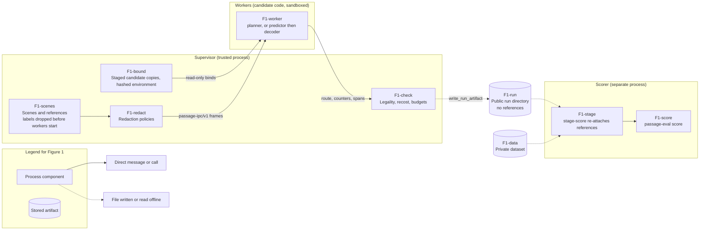

# Supervised execution

**Table 1 — Document revision.**

| Author | Date | Version |
|---|---|---|
| Geoffrey Delhomme | 2026-11-01 | 0.1 — draft; not yet security-reviewed |
| Geoffrey Delhomme | 2026-11-02 | 0.2 — fixes for the findings of an adversarial review (identity, sandboxed probe, timing boundary v3, purpose, roster, field contract, bounded text); not independently re-reviewed |
| Geoffrey Delhomme | 2026-11-02 | 0.3 — fixes for the findings of an independent re-review (roster scorer, pinned workers, planner pin, probe channel, environment pin, device binds, staged-copy and bytecode checks, ONNX Runtime scan); not independently re-reviewed |
| Geoffrey Delhomme | 2026-11-03 | 0.4 — timing profiles (boundary v4 without validation and recost, boundary v5 with a re-warm after each mid-pass restart), request limits in the procedure identity, batch sizing bound, strict comparison, censoring-aware latency; preparation tools for a sealed population (roster v2 with bound block rule and footprint requirement, sealed blocks in roster scores and comparisons, reference admission inventory, warm-up roster, paired order, section 3.F); the v5 restart policy, the censoring rule and the admission category table are proposals, not sealed; not independently re-reviewed |
| Geoffrey Delhomme | 2026-11-03 | 0.5 — test admission gate `passage-test-admission/v1` wired into every guarded entry point, including the evaluated roster of `run`; campaign tooling `passage_eval.campaign` (section 6.L); not independently reviewed |
| Geoffrey Delhomme | 2026-11-03 | 0.6 — phased roster preparation and campaign session mode: sealed blocks and references, warm requests only, dynamic admission, session receipts, and measured prefixes in `score-roster` |

## 1. Executive summary

The in-process runner (`passage_eval.execution.run_requests`) calls a candidate in the same
process that holds the scenes and the reference paths. Its deadlines and work counters are
cooperative: a Python or native call cannot be stopped, and the candidate reports its own
counters. That is sufficient for a trusted local measurement. It is not a basis for a
leaderboard that runs code written by other people.

This guide describes the *supervised* chain in `passage_eval.supervision`. A trusted
supervisor starts each candidate in a separate worker process, sends it a redacted request over
a small framed protocol, enforces the wall-clock deadline by killing the worker, and then
re-validates and re-costs the returned route with the same helpers as the in-process runner.
The result is a standard run artifact that the unchanged offline scorer can score, after a
separate scorer-side step re-attaches the references that the supervisor never wrote down.

An adversarial review of version 0.1 found that the chain did less than it claimed. Version 0.2
closes the findings that code can close: the candidate interpreter is probed inside the worker's
sandbox, never on the host (C2); the identity now covers every byte that is bound into the sandbox, not
only the entry file (C3); every timed pass runs on a fresh worker with fresh tokens and an untimed
warm-up on disjoint inputs (H2); the decoder receives exactly one grid-shaped float plane (H3); a
`--purpose verified-candidate-run` refuses every configuration that cannot support a verified claim (H1);
the work counters are labelled by their source (H4); a pinned roster fixes the evaluated tasks (H5);
crafted frames and restart storms are recorded as failures instead of aborting the run (M1); and
candidate-controlled text is bounded (M4). The pilot findings are folded in: a spec that names the dataset
location is refused, and a worker fails closed when a forbidden module such as `onnxruntime` appears.

An independent re-review of version 0.2 found one blocker and five further findings; version 0.3 closes the ones
that code can close. A roster run can now be scored: the `score-roster` command loads the labelled scenes through the
roster, checks the run against it and calls the unchanged offline scorer in its own process (section 3.D). A decoder
or planner that the operator pinned by digest now runs with only the pinned tree, the interpreter environment and
the evaluator sources, so the digest covers every candidate-side byte it can import (N1, section 3.C). A verified
run no longer decides from the spec's family text: it needs a pinned decoder in split mode or a pinned planner in
planner mode, a pinned interpreter environment, no tree-hash cache and no ONNX Runtime anywhere in the bound trees
(N2, N3, N5, section 4.E). The interpreter probe returns its result on a dedicated pipe descriptor and only the first
message counts (N3); `--dev-bind` accepts character-device nodes only (N4); staged copies are re-checked by stat
signature as well as by content, and workers do not load bytecode that lies beside the sources (N5).

Version 0.4 aligns the chain with the manuscript's timing rule and with the proposed protocol for the 256
evaluation. A run can choose a *timing profile* (section 5.G). The default stays the v3 boundary, in which the
supervisor's validation and physical recost count against the candidate. `supervised_service_v1` (boundary v4)
compares and scores the service time alone and records the validation and recost separately, as the manuscript
requires. `supervised_service_rewarm_v1` (boundary v5) adds a re-warm after every mid-pass restart, outside the
boundary (section 5.H). Every bound on a request is now part of the procedure identity (section 6.I). A helper
bounds the worst-case wall time of a batch against a lease (section 6.J). `compare` refuses runs with different
timing profiles and offers a strict mode for identical limits. The scorer adds censoring-aware latency quantiles
next to the legacy ones (section 5.I). The v5 restart policy and the censoring rule are **proposals that the
author has not sealed**.

Version 0.4 also adds tools that prepare a sealed population before any candidate output exists (section 3.F).
Rosters (`passage-roster-v2`) bind the geographic block rule and the footprint requirement, and `score-roster` and
`compare` carry those sealed blocks into scores and paired intervals. A reference admission inventory sorts every
task of a source roster into admissible, excluded or halting before execution. A warm-up roster is selected from the
validation split, disjoint from the evaluated inputs by content, and a paired procedure order is drawn per batch. The
category table of the admission inventory, the warm-up size and the paired-order granularity are **proposals that
the author has not sealed**.

This chain remains a **building block, not a qualification**. It has been exercised with fixture
candidates and with two real candidates on one aarch64 Linux host. It must not be described as safe for
untrusted third-party code before an independent re-review and before the limits in section 7.B are
accepted or closed. A container lane, which would close several of them, is designed in section 8 and not
implemented.

Section 2 explains the architecture. Section 3 defines what a candidate may see and how its identity is
measured. Section 4 states what each isolation level really provides. Section 5 defines the timing
boundary `passage-timing-boundary/v3-supervised-ipc-fresh-pass`, contrasts it with the earlier ones, and defines the
timing profiles with boundaries v4 and v5 and the censoring-aware latency quantiles.
Section 6 gives the commands and the host worker environment without ONNX Runtime, section 7 lists the evidence
gathered and what remains open, and section 8 designs the container lane.

## 2. Architecture

The questions this section answers are: which process holds which data, and which messages cross
between them? Figure 1 shows the answer for one run.



**Figure 1 — Trust zones. Solid arrows are live messages or calls; dashed arrows are files.**

*Legend for Figure 1.* A rectangle is a process component, a cylinder is a stored artifact, a
solid arrow is a live message or call, and a dashed arrow is a file written by one step and read by
another.

The blocks of Figure 1 are as follows. **F1-scenes** is the supervisor's copy of the evaluated
scenes; it qualifies the references first, derives hashes from them, and then keeps only
label-free scenes in memory while candidates run (best effort: freed memory is not wiped).
**F1-redact** builds each candidate-facing message (section 3). **F1-bound** holds
what the sandbox may see: private read-only copies of the declared candidate files, hashed while they were
copied, and the tree digests of the interpreter environment (section 3.C). **F1-worker** is the only place
candidate code runs; in split mode there are two workers, a predictor and a decoder.
**F1-check** applies the scientific contract of the runner to the returned route. **F1-run** is
what the supervisor writes: the same files as `run_requests`, without references and without
the dataset location. **F1-data** is the dataset, reachable only by the scorer. **F1-stage** and
**F1-score** are the scorer-side steps of section 6.

**Table 2 — Modules of `passage_eval.supervision`.**

| Module | Role |
|---|---|
| `protocol.py` | `passage-ipc/v1` framing: strict, size-limited, no pickle |
| `redaction.py` | the two candidate-facing policies and the opaque per-run token |
| `worker.py` | entry point `python -I -m passage_eval.supervision.worker`; loads the candidate and serves requests |
| `sandbox.py` | scrubbed environment, rlimits, static interpreter layout, sandboxed interpreter probe on a dedicated pipe, `bwrap` command line, character-device check, protected-path checks |
| `treehash.py` | deterministic tree digests, stat signatures and their cache, the private read-only staging area (re-checked by content and signature), name scan, non-source file check |
| `environment.py` | what is bound into the sandbox: staged candidate trees, hashed interpreter environment, the narrowed view of a pinned worker, change checks, `onnxruntime*` scan |
| `identity.py` | candidate identity from file bytes, without importing candidate code; kwargs path policy; decoder and planner pins; namespace packages refused |
| `sanitize.py` | bounds on candidate-controlled text and tables, and removal of the dataset location from them |
| `supervisor.py` | launch, passes, deadlines, kill and restart, validation, purpose rules, run artifacts, manifest |
| `staging.py` | scorer-side re-attachment of the withheld references |
| `roster_scoring.py` | `score-roster`: scores a roster run against its pinned roster, in its own process, with the unchanged offline scorer |
| `__main__.py` | `python -m passage_eval.supervision {run,stage-score,score-roster,tree-hash}` |

## 3. What a candidate may see, and how its identity is measured

### 3.A. Redaction policies

Both policies are recorded in the manifest. Each message is built field by field; no request
object is serialised wholesale, and the finished message is checked against the allowed field set
before it is sent.

**Table 3 — Candidate-facing policies.**

| Policy | Fields | Deliberately absent |
|---|---|---|
| `ordinary-request/v1` | elevation, obstacles, start, goal, cost model and weight, graph spec, budget, remaining wall time, the released input tensor, an allow-listed metadata subset (empty by default), an opaque token | sample id, references, any metadata not allow-listed |
| `decoder-only/v1` | exactly one predicted field plane that satisfies `decoder-field/v1`, obstacles, start, goal, budget | elevation, input tensor, metadata, cost model, token, any second field |

The token replaces the sample id. It is an HMAC of the sample's position **and of the pass** (series and
repeat) under a per-run random key that never leaves the supervisor. A candidate therefore cannot look up a
reference by id, and it sees a different token for the same sample in every timed pass, so it cannot
recognise a sample it has answered before. The metadata allow-list accepts only keys of the
ordinary-metadata schema (for example `calibration.min`); anything else is refused. One exception is
structural: when an input tensor is sent, `calibration.min` and `calibration.max` are added automatically
because `PlanRequest` rejects a tensor without them. They only describe how the tensor was normalised, and
the elevation array is sent anyway.

In split mode, the `redact_decoder` function takes only the allowed items as parameters, so it cannot be
handed a request. The decoder runs in its own process and is called as
`decode(field, start, goal, obstacles, budget)` with exactly those five positional arguments.
`budget.wall_time_ms` carries the *remaining* wall time at dispatch, because one admission deadline covers
both hops.

**Field contract `decoder-field/v1`.** Version 0.1 allowed a predictor to return up to eight float64
arrays of any shape, so a hostile predictor could forward the elevation it had received as a second
"field". The supervisor now enforces, for every request and before anything reaches the decoder: exactly
one field; shape equal to the grid `(H, W)` of the request; dtype `float32` or `float16`; all values
finite. A network output with leading singleton dimensions, such as the `(1, 1, H, W)` of an ONNX model,
holds the same H by W values as one plane, so the supervisor removes the leading ones and the decoder always
receives `(H, W)`; layouts such as `(H, W, 1)`, `(1, 2, H, W)` or `(2, H, W)` are not admitted. Anything else
is a `runtime_error` for that request, with `error_type = FieldContractViolation` and
the first violated rule as the reason. The predictor worker is not killed, since it followed the wire
protocol; the next request proceeds normally.

> **Limit of the field contract.** The contract bounds what the decoder can receive. It does not bound
> what a predictor puts into its single plane: a predictor can still emit elevation-shaped data as that one
> float32 plane. What is guaranteed is narrower than the version 0.1 text claimed: the operator's fixed
> decoder only ever sees one network-output plane plus obstacles, start, goal and budget, never the
> supervisor's elevation array, an input tensor, a second channel or a float64 plane. Whether the plane is
> a genuine network output is a property of the predictor, not of the chain.

### 3.B. The wire protocol

`passage-ipc/v1` frames are `b"PIPC"`, a 32-bit header length, a 64-bit payload length, a JSON
header and raw little-endian array buffers. Message types are `hello`, `ready`, `plan`, `predict`,
`decode`, `result`, `error`, `ping`, `echo` and `shutdown`, each valid in one direction only.
Lengths are checked against limits before any allocation: header 1 MiB, payload 256 MiB, at most 16
buffers of at most 4 dimensions, **each dimension at most 2^28 and at most 2^28 elements per buffer**.
Dtypes come from a closed list; JSON rejects NaN, infinities and duplicate keys.

A frame that violates any rule raises `ProtocolError`, and nothing a peer sends can escape as another
exception. Version 0.1 let a crafted shape such as `[0, 2**70]` (zero elements, absurd dimension) reach
NumPy, whose `ValueError` was not a `ProtocolError` and aborted the whole run. Dimension and element limits
are now checked first, every NumPy error is wrapped, and the supervisor's reply handling converts any
residual exception into a protocol failure of that worker. The consequence is a `runtime_error` record for
that request (`failure = protocol_error`), a killed and restarted worker, and a run that continues.

The worker moves its candidate's `stdout` to `stderr` and replaces its stdin with `/dev/null`, so
printing candidates cannot corrupt the stream. The worker sends `ready` (its rlimits and what it
can see) *before* importing candidate code.

### 3.C. Candidate identity without importing the candidate

`passage_eval.cli._candidate_identity` imports the entry point, which the supervisor must never do.
Version 0.1 therefore located and hashed the entry module's files with the worker interpreter's own path
finders and trusted the worker's report of what it loaded. The review showed that this covered a fraction
of the executed bytes: helper modules, weights passed under other kwarg names, bound directories and the
virtual environment were outside the identity, and the load report came from the candidate's own process.

The identity now covers every byte that is bound into the sandbox. Three mechanisms provide that.

1. **Staging.** Every declared candidate file or directory (`--candidate-path`, `--ro-bind`, checkpoint
   and bundle keys of the kwargs, the runtime bundle manifest and its members) is copied into a private,
   content-addressed, read-only area. The SHA-256 of each file is computed *while its bytes are copied*, so
   the bytes hashed are the bytes written, and the staged copy is the only thing the sandbox binds, at the
   original path. Editing the original afterwards changes nothing that a worker sees; the copy is
   re-hashed, and its stat signature compared, before every artifact is written (a staged file that was changed and put
   back keeps its bytes, mode and modification time but not its change time, so the signature finds it; a `__pycache__`
   that appears in the copy is a difference, since the copy never holds one). Symbolic links and special files are refused, and
   `__pycache__` directories are not copied, so that a stale or forged bytecode file cannot stand in for
   the source that was hashed. A declared path that overlaps a protected path is refused before anything
   is copied.
2. **Tree digests.** Each bound tree has a deterministic digest `passage-tree-sha256/v1`: for every entry
   in sorted relative-path order, the relative path, the kind, the executable bit and the SHA-256 of each
   regular file; symbolic links are recorded by target and never followed; unreadable files are recorded,
   not skipped. The interpreter environment cannot be copied, so it is hashed in place and its digest is
   recorded for every tree the sandbox binds: the virtual environment, the supervisor's own evaluator
   sources that the environment maps in, `--runtime-bind` extras (which is also how an interpreter prefix
   outside `/usr`, or an editable install of the candidate's own code, is declared) and, under `bwrap`, `/usr`. A stat signature of each tree (path, kind, mode, size, modification time,
   change time, link target) is re-read before every artifact is written, and any difference fails the run.
   Change time cannot be set from user space, so rewriting a file while restoring its size and modification
   time still changes the signature.
3. **The digest cache.** Hashing `/usr` reads many gigabytes. Digests of environment trees may be reused
   from an on-disk cache keyed by the path and the stat signature. This is an optimisation only: every tree
   record states `hash_source` (`computed` or `stat_signature_cache`) and carries the signature. Diagnostic
   runs use the cache by default (`$PASSAGE_TREE_HASH_CACHE`, else the user cache directory). A verified run
   **refuses** `--tree-hash-cache` and ignores `$PASSAGE_TREE_HASH_CACHE`: it recomputes every digest, and a digest
   that did not come from this run is a ground for refusal. The cache lives outside every sandbox, but a candidate
   run at `process` level shares the user's file system and could alter it, and a cache keyed by stat signature can
   be filled by an earlier process.

The manifest records all of this under `candidate_identity.bound_trees` (so it is part of
`procedure_id`) and under `supervision.bound_trees`, with the identity binding
(`staged_read_only_copy` under `bwrap`, `in_place_hash_rechecked` under `process`, where there is no mount
namespace to bind from and the digest is re-checked instead). The identity record still carries
`schema = passage-candidate-identity-v1`, so the unchanged offline scorer accepts it; its method is now
`identity_method = tree_hash_of_bound_bytes_without_import`.

**Kwargs path policy.** Every string in the inference kwargs (nested values too) that is shaped like a path
(`/…`, `~/…`, `./…`, `../…`) and exists on the host must lie inside a bound tree; otherwise the run is
refused with a message that names the key. A weights file under a key such as `onnx_path` would otherwise be
read without ever being hashed. Declare it with `--ro-bind`, or give it a checkpoint or bundle key, which
declares it automatically. This is an honesty check on the submitter, not a defence: a string can be written
so that it does not look like a path. Against a hostile candidate the protection is the sandbox, which binds
nothing that was not hashed.

**Worker reports are cross-checks.** The worker reports the files it loaded, and now also the top-level
names in `sys.modules`. Both are self-reported. A reported file is accepted when it is one of the entry
chain's hashed files or lies inside a bound tree; anything else aborts the run. The report cannot make the
identity stronger, only expose a contradiction. `loaded_code_sha256` stays empty because code objects exist
only after an import.

**Evaluator source.** The worker environment may hold its own copy of `passage_eval`. The supervisor
computes the evaluator source fingerprint (the algorithm of `cli._source_hash`, which reads `*.py` only) over the
packages the probe found in the worker environment and records whether it equals its own. Version 0.2 stopped
there, and a worker copy could hold a file that an import prefers to the source that was hashed: an extension
module (`.so`, tried before `.py` in the same directory), sourceless bytecode (`.pyc`), a `.pth` file or a symbolic
link. Version 0.3 also walks the worker's copies of `passage` and `passage_eval` and requires every non-source file
(everything but `*.py` and `__pycache__`) to exist at the same relative path in the supervisor's own package with the
same SHA-256; links and special files never match (`supervision.evaluator.non_source_files`). Only files found in the
worker's copy are read, so a checkout with large data directories costs nothing when the worker holds a plain
installed package; when the worker maps the supervisor's own directory (an editable install of the same checkout) the
comparison is trivially true and says so. A verified run requires both the source fingerprint and the non-source
files to match.

**Pins: decoder in split mode, planner in planner mode.** The manifest records the tree digest of the entry
point's top-level package directory (or of its module file when it is a single file), with `__pycache__` excluded.
That is the value an operator pins with `--decoder-allow-sha256` (the decoder behind a predictor) or
`--planner-allow-sha256` (a planner such as a classical A* baseline);
`python -I -m passage_eval.supervision tree-hash PATH` prints it. Version 0.2 hashed the decoder's package but gave
the decoder worker every candidate import path, so a top-level module next to the package (`helper.py` in the same
candidate directory) could be imported unreviewed and swapped after the review, while the counters still said
`operator_decoder`. A **pinned worker now receives only**: the interpreter environment (the virtual environment,
the evaluator sources, `/usr`), and one read-only bind of the *staged copy of its own package* at the package's
original path. Its `sys.path` addition is that package's parent directory, which in the sandbox holds nothing but the
package. Sibling modules, the predictor, weights and every other declared path are not mounted, so `import helper`
fails and the worker does not load. The digest therefore describes every candidate-side byte the pinned worker can
import. Consequences, all recorded in `supervision.worker_views`: a pinned worker is self-contained (kwargs that
declare checkpoint or bundle files for it are refused before anything starts; put such files inside the pinned tree);
the unpinned role of a split run (the predictor) keeps the whole candidate view; an **unpinned** decoder or planner
keeps the whole candidate view too, because its counters are self-reported anyway and nothing claims otherwise. At
`process` isolation there is no mount namespace: `sys.path` is narrowed but the file system is shared, and the view is
recorded as `not_enforced_process_isolation_shares_the_file_system`.

A **namespace package** (a directory without `__init__.py`, or a package that resolves to several locations) cannot
be pinned: its content is a union of directories that no single digest describes, and a portion can be added from any
`sys.path` entry. A decoder that is a namespace package is refused; so is a planner whenever a pin applies. The
interpreter-environment trees are covered by the environment pin of a verified run (section 4.E), not by these
digests.

### 3.D. Pinned rosters

A roster (`passage-roster-v2`, written by the current builders; `passage-roster-v1` stays readable) names the exact
rows of one benchmark cell. `--roster FILE --roster-sha256 HEX
--dataset-root DIR` makes the run load exactly those rows through `load_roster_scenes`, in roster order,
after checking the roster digest against the pin and the dataset root against the roster's
`dataset_root_identity`. The spec must agree with the roster's cell (resolution, cost model, task variant,
split, cost weight and, when given, the dataset revision); a mismatch is refused. The labels that
`load_roster_scenes` decodes stay supervisor-side and are dropped before any worker starts.

The manifest records `roster_id` (the roster's `benchmark_id` unless `--roster-id` is given),
`roster_sha256`, `n_expected`, the number of scenes loaded, the dataset repository, commit, split and
resolution, and the roster's dataset root identity (the file name and digest of `PINNED.json`). It never
records the dataset root path. Every roster task must produce a record in every pass: the artifact
validation requires a complete, unique record set, and a task that cannot be served still gets a
`runtime_error` record (section 5.E).

**Scoring a roster run.** The unchanged `cmd_score` reloads scenes from the spec, not from a roster whose rows
come from a salted ranking over the whole population, so it cannot score such a run; `stage-score` accepts `--roster`
to verify and stage a roster run and refuses `--score` for it. Version 0.2 therefore had no way to score a roster run.
The `score-roster` command is that way:

```bash
python -I -m passage_eval.supervision score-roster \
  --run public/run --roster rosters/<roster>.json --roster-sha256 <pinned roster_sha256> \
  --dataset-root /path/to/pinned/dataset --output private/scored [--roster-id <id recorded in the run>]
```

It runs in its own process, on the scorer's side of the boundary (it reads the dataset and the labels, and never imports
candidate code). Before any label is read it checks every public manifest under the run against the roster: the
roster digest equals the operator's pin, the manifest's roster id (default: the roster's `benchmark_id`), digest,
`n_expected` and `n_loaded`; the pinned dataset root identity, repository, revision, split, resolution and the cell
(cost model, weight, task variant); the exact ordered task list (a run that lacks a roster task, adds one or reorders
them is refused); the ordinary input identity of every task as the supervisor recorded it, against the roster's;
and the candidate and procedure identity. It then loads exactly the roster's rows with `load_roster_scenes` (source
files re-hashed, `PINNED.json` checked against the roster), recomputes the dataset content hash and the reference
identity and compares them with the recorded ones. Only then does it copy the run to the private output, attach the
re-qualified references to each copied manifest (the staged layout of section 6.D: the public manifest is kept beside
it as `public_run_manifest.json`, and `scoring_stage` records the scorer and the roster) and call the unchanged
`score_run_artifact` (with the roster's block table, section 3.F) and `write_scored_artifact`. The output has the
layout `cmd_score` produces (`per_sample.npz`,
`metrics.json`, `score_receipt.json`, `score_reference_inputs.json`), and
`hf-passage-leaderboard-results/tools/receipt_from_run.py` reads it (`load_scored_run`; this is tested). A failure at any
point removes the output. The scored directory holds the reference routes and costs: keep it private.

### 3.E. Candidate-controlled text

Diagnostics, error messages, stage and precision labels, counter keys and the stderr tail are chosen by the
candidate. They are bounded: a diagnostics dictionary is cut to 64 items per container, six levels, 1 KiB
per string and 4 KiB in total (a whole-value replacement states the original size); an error message is at
most 512 characters, the stderr tail 1 KiB; counter tables hold at most 64 keys of at most 64 characters,
and a larger table is a protocol failure. Every candidate-controlled string is scrubbed of the dataset
location before it is written. These limits make bulk exfiltration through the public run directory
impractical. They do not make the text trustworthy: **run artifacts contain candidate-controlled text and
must be treated as private until they have been reviewed.**

### 3.F. Preparing a sealed population: blocks, reference admission, warm-up and paired order

These tools prepare the population before any candidate output exists. None of them reads a candidate result.

**Test-split refusal.** `passage_eval.protocol.guards` refuses the test split from declarations only (the declared
split name, and for a roster also every source file path), before any file of the split is opened. It accepts the test
split only with `allow_test=True` and an admission grant: proof that a `passage-test-admission/v1` record checked all
six gates `GREEN` (`docs/benchmark/test-admission.md`). The grant re-hashes its record and evidence before each use.
These entry points call the guard:

- the reference admission command and its library functions `admission_policy` and `build_reference_inventory`;
- `protocol.warmup`: `select_warmup_scenes`, the pool of `build_warmup_roster`, and `scripts/build_warmup_roster.py`
  (validation only: the warm-up inputs of the test split are refused even with a grant); `build_warmup_roster` and
  the script also guard an evaluated roster of the test split, whose task identities they read;
- `scripts/build_public_test_roster.py`: its `build_roster` (default split `test`) and its command;
- the label-free block census `protocol.block_census` (library and command);
- `run_supervised` and `run`: the spec's split and the evaluated `--roster`, which must be the record's sealed
  admissible roster or a child derived from it (a spec run without roster is never admitted on test);
- `score-roster`: `score_roster_run` and the command, with the same roster binding;
- the supervisor's warm-up sources (`WarmupInput`): `--warmup-split test` and a `--warmup-roster` of the test split;
- the campaign tools of `passage_eval.campaign` (section 6.L).

A command lifts the refusal only with an explicit flag (`--allow-test-split`; `--allow-test-warmup` for the
supervisor's warm-up) and a `--test-admission-record` (with `--test-admission-evidence-dir`) that checks all `GREEN`;
a flag without a record, or a record without the flag, is refused, and a `RED` record is refused with the list of its
`RED` gates. The record checks (`validate_inventory`, `admissible_roster`, `admission_chain`) load no scene and do not
apply the guard. The guard does not cover `stage-score`, `passage-eval score`, `passage-eval bench` or `compare`.

**Phased preparation.** Four readers produce the artefacts that gates G4 and G5 check: the roster builder, the block
census, the reference inventory and the warm-up roster builder (`guards.PREPARATION_READERS`). Their commands also take
`--test-preparation-approval FILE`; with the flag and the record, `admission.grant_test_preparation` returns a
`PreparationGrant` when the record's only `RED` reasons are those artefacts and the author's
`passage-test-preparation-approval/v1` approval is valid (test admission guide, section 5.C). The guards accept it only
for a call that names one of these readers and that the approval lists. Every other entry point (a run, a warm-up
source, `score-roster`, the campaign tools) passes no reader and refuses it: a run, a candidate and scoring still need
an all-`GREEN` admission.

**Roster v2 and sealed blocks.** The builders write `passage-roster-v2`. Its `geographic_blocks` record is always
present and is covered by `roster_sha256`. It names the block rule (`rule`), binds its identity (`function`: the record
schema, the callable and the SHA-256 of `geographic_blocks.py`) and declares `footprints_required`. Two rules exist:
`source_window_union` (rule A, the default: the 5-degree cells of the used source tiles, merged by transitive union
across tasks) and `main_tile_cell` (rule B, `--block-rule main_tile_cell`: the 5-degree cell of the main source tile,
`metadata.tile.source`, without union; tasks whose used tiles cross a cell boundary are counted). Validation refuses a
v2 roster whose bound rule differs from the installed one, so any edit of `geographic_blocks.py` requires rebuilding
the v2 rosters sealed before it. When `footprints_required` is true, a task without the footprint its rule needs makes
the roster invalid. `--unplaced-block` (`unplaced_block=True`) plans block analysis with one sealed `unplaced` block
instead: the roster lists every task without footprint, in roster order, in `geographic_blocks.unplaced_block`, and
records `footprints_required: false`; the task records keep no block and no singleton block is invented. The builders
require footprints unless one of these options, or `--allow-missing-footprints` for a roster without block analysis,
is given. `passage-roster-v1` files stay readable with their former rule (unplaced tasks tolerated, rule version not
bound).

**Block census (`passage-block-census/v1`).** `python -I -m passage_eval.protocol.block_census --roster R
--roster-sha256 H [--criterion FILE] [--output FILE]` reads only the roster's task footprints (no dataset file, no
label) and reports, for rule A and rule B at 5 degrees, the number of blocks `G`, the block size distribution and the
largest block's share, plus two non-decisive sensitivities of rule B (without the crossing tasks, and at 10 degrees).
Its decision follows the judge's order: rule A if it meets the criterion, otherwise rule B if it does, otherwise
`descriptive_only`; tasks without footprint above `max_unplaced_fraction` give `halt_unplaced_cap` (the block analysis
stops for diagnosis). `PROPOSED_CRITERION` (at least 30 blocks, no block above 10 % of the tasks, at most 0.5 %
unplaced) is **proposed, not sealed**; the record carries the criterion's status.

`roster_block_table` gives the block of every task with a digest; `block_summary` gives the counts and sizes to seal.
`derive_roster` keeps a subset of a parent's tasks in parent order, without fresh sampling: every task records
`parent_rank` and `parent_geographic_block`, and the block table of the child returns those inherited blocks, not the
blocks recomputed on the subset (which can split a parent block). `verify_child_blocks(parent, child)` refuses a child
that would be analysed with other blocks than the parent's, which is the case of a child that only recomputed local
blocks. `score-roster` passes the roster's block table to the scorer, so `per_sample.npz` holds the roster's blocks in
`cluster_id` and `metrics.json` records the table digest. The provenance is `sealed_roster_geographic_block` only for a
`passage-roster-v2` table that binds the installed block rule; the blocks of a `passage-roster-v1` roster, including a
v1 child that recomputed local blocks without derivation fields, are labelled `unsealed_roster_geographic_block`, and a
v2 table that binds another block rule is refused. A task in the declared `unplaced` block has that block; a table
with a task without any block leaves every block unknown. A block
table must belong to the roster that the run records (`roster_sha256` in the manifest's `supervision.roster`,
`procedure.supervision.roster` or `scoring_stage.roster`): the scorer and `compare` refuse a table of another roster and
a run that records none. `passage-eval compare` uses the stored blocks when every score carries the same table, or the
blocks of `--roster FILE --roster-sha256 HEX` when given; that roster must be the one every compared run records, a
stored block that disagrees with it is refused, and a score without stored blocks (an earlier score of the same roster)
is accepted. The comparison reports the provenance as `sealed_…` or `unsealed_…` (`uncertainty.block_provenance`).

**Reference admission (`passage-reference-admission/v1`).**

```bash
python -I -m passage_eval.protocol.reference_admission \
  --roster rosters/<source roster>.json --roster-sha256 <pinned roster_sha256> --dataset-root /path/to/pinned/dataset \
  --reference-policy released_labels --reference-max-expansions 65536 --output-dir private/reference-admission
```

The reference policy has no default. The independent analytic policy needs `--reference-cohort-id`, exclusion caps
(`--exclusion-caps FILE`; `PROPOSED_EXCLUSION_CAPS` is the proposal) and a category table that halts on an exhausted
search; the released-label policy refuses a cohort and applies caps only when given. The search limit must be at least
N² for the roster's resolution, so the exact search cannot be exhausted; one limit (proposed 65,536) must be used by
the policy, the run spec and the scorer, since it enters every reference identity. Every task gets a record with its
status, reasons, reference identity (for an admitted task), second-implementation check and category:

**Table 4 — Categories of the reference admission inventory.**

| Category | Meaning | Effect |
|---|---|---|
| `admissible` | qualified exact reference | enters the admissible roster |
| `excluded` | reference not qualifiable (reason listed) | stays in the source count; never replaced |
| `halt` | input inconsistency, duplicate id, unreadable or unmatched scene, undeterminable reference (exhausted search), unknown reason, disagreement of the second implementation (`second_reference_disagreement`), no-path exclusion of a task whose published label is a legal path (`no_path_with_legal_label`), and under `released_labels` a qualified reference whose row the execution loader refuses | no admissible roster is derived |

The mapping from qualification reasons to `excluded` or `halt` belongs to the protocol author. `PROPOSED_CATEGORY_TABLE`
is a **proposed default, not a sealed decision**: a non-qualifiable reference is excluded and an exhausted search halts.
Its status (`proposed_not_sealed`) is part of the hashed policy; `--category-table` supplies another table. A table maps
exactly the reasons that the qualifiers of `passage.audit` emit, so no candidate outcome can become an exclusion: a
candidate failure on an admissible task stays in the admissible denominator with the canonical penalty.

The command reads the pinned rows with `load_admission_scenes`. The execution loader (`scene_from_row`) refuses a row
whose stored route is illegal or whose stored cost is missing or not positive; the admission reader then decodes the
same inputs with the label unvalidated, so the qualifiers record the defect for that task (`stored_path_illegal`,
`stored_cost_missing_or_invalid`, `stored_path_optimum_unassessable`) and the category table decides, instead of the
whole inventory stopping. Under `released_labels` such a task is never qualified, so it is never in the admissible
roster that the supervisor loads. Under `independent_analytic_reference` the published label is never the reference:
its defects (`source_label_reasons`, and a label the validating loader refuses) are **dataset findings**, listed in the
inventory's `label_findings` with the graph tolerance (rtol 1e-7, atol 1e-6), and the task stays admissible. The
supervisor and `score-roster` then load the rows with the tolerant execution loader (`load_roster_scenes(...,
tolerant_labels=True)`, chosen from the spec's reference policy): every input check is unchanged, only the stored route
and cost are kept as read. The policy records this as `execution_loader_labels: tolerant`. Only a task without analytic
path (`independent_reference_no_path`) is excluded. A row whose inputs cannot be decoded halts with `scene_unreadable`.
Only a failure of the dataset root or of a file (receipt, hash, size, row count, columns, row identifier) stops the
inventory before qualification.

Second implementation. Every task whose A* search ended is recomputed by an independent 8-connected Dijkstra search
(`protocol.second_reference`, its own queue and edge costs, no heuristic): an optimum outside the graph tolerance, or a
path where the A* found none, halts with `second_reference_disagreement`. Both implementations share the definition
of the cost: agreement shows that the A* found the optimum of this graph, not that the graph is right.

Exclusion caps. With caps, the inventory reports the excluded tasks in total and by geographic block of the source
roster (`exclusion_caps_check`); more than `max_total_fraction` of the source tasks, or a block with at least
`min_block_exclusions` excluded tasks and more than `max_block_fraction` of its tasks, makes the outcome `halt`.
`PROPOSED_EXCLUSION_CAPS` (0.5 %, 5 %, 2) is **proposed, not sealed**.

The command writes the policy, the inventory, the admissible roster with its `.sha256` sidecar and a chain record. It
exits with code 2, and writes only the policy and the inventory, when the inventory halts, when no task is admissible,
or when `--skip-file-hashes` was given. That option skips re-hashing the source files; the inventory then records
`source_file_hashes: skipped` (under its digest), because the stored labels that decide exclusions are unverified, and
`admissible_roster` and `admission_chain` refuse such an inventory: it serves diagnosis only. A sealed inventory records
`source_file_hashes: verified`, which the admissible roster's derivation and the chain repeat.
The policy digest is inside the inventory and both digests are inside the admissible roster (`selection.derivation`);
`admission_chain` re-derives the admissible roster and checks the chain. `validate_inventory`, which both use, checks
that the policy names the source roster, its cell and the N² minimum of its resolution; that every task keeps the
source's rank, input identity and block; that every category follows from the task's recorded reasons under the
policy's table, so a reason that no qualifier emits (a candidate timeout, for example) cannot exclude a task; that an
admissible task carries a reference identity; and that the counts, the outcome and the exclusion, halt and reason-count
tables equal those recomputed from the task records. These checks establish consistency, not that the qualifiers were
run: rebuilding the inventory and comparing its digest does that. The caps check, the label findings and the
second-implementation records are recomputed or checked the same way. On the test split, the supervisor and the
scorer accept only the admission record's sealed admissible roster or its derived children, and every reference they
re-qualify must carry the `reference_id` of the sealed inventory (`check_reference_ids`; a run made with another
search limit or policy is refused before any worker starts). On other splits `score_roster_run(...,
reference_inventory=...)` applies the same check when an inventory is given; the supervisor does not check it there.

**Negative regret.** With qualified references, the scorer stops (`NegativeRegretHalt`) when a legal recorded route,
whatever its status, costs less than `c*` beyond the graph tolerance: the reference is then diagnosed, and the route is
neither a win nor an exclusion.

**Warm-up roster.** `scripts/build_warmup_roster.py` selects `--k` validation rows (eight is the protocol's proposal,
not a sealed value) by `sha256(salt + id)`, skipping the evaluated roster's ids and input contents, and writes a
`passage-roster-v2` that `--warmup-roster` accepts. The content identity is the input identity without
`ordinary_metadata_hash` (`roster.CONTENT_IDENTITY_FIELDS`): the ordinary metadata carries the split name and the row
index, so a validation copy of an evaluated row has another input identity but the same content. The salt has no default. `--warmup-roster` reads its rows from
`--dataset-root`, so the warm-up roster must pin the same `PINNED.json` as the evaluated roster: `--allow-shared-root`
accepts a root that also lists other splits, of which only `<N>x<N>/validation/` files are listed, verified and read.

**Paired order.** `passage_eval.protocol.warmup.paired_order(schedule_seed, batch_index, procedures)` orders the
procedures of one batch by SHA-256 of the seed, the batch index and the procedure id; `paired_schedule` records the
orders of every batch with a digest. The per-batch granularity is proposed, not sealed; the campaign runner (section
6.L) uses it.
Re-warming a worker after a mid-pass restart is the `supervised_service_rewarm_v1` profile (section 5.H); the
warm-up roster built here is one of the disjoint sources that profile replays.

## 4. Isolation levels and their real limits

Isolation is requested explicitly (`--isolation process` or `--isolation bwrap`), is never
downgraded silently, and is recorded in the manifest as `supervision.isolation`, including
`effective_level` (what the worker attestation is consistent with), `candidate_code_confined` and a plain
statement. The record lists what was applied and what was not.

**Table 5 — What each level provides.**

| Property | `process` | `bwrap` |
|---|---|---|
| Separate process, session and process group; kill reaches children | yes | yes |
| Scrubbed environment, private HOME and cwd, rlimits | yes | yes |
| Same uid as the supervisor | yes | yes (user namespace maps it) |
| Candidate code, and the start-up code of its interpreter (`.pth`, `sitecustomize`, the interpreter probe) | **runs unsandboxed** | runs in the sandbox |
| Filesystem | the user's whole filesystem is readable | tmpfs root; read-only binds of the hashed interpreter environment and of staged copies of declared candidate paths; tmpfs HOME and `/tmp` |
| Network | the host network | unshared; loopback only |
| Other processes; descendants that escape the process group (double fork and `setsid`) | visible; **they survive the kill** | own pid namespace; they die with it |
| Dataset, references, registry, credentials | **reachable** | not bound; binds that overlap protected paths are refused |
| Protection against kernel exploits | none | none |
| GPU memory cap, seccomp filter, cgroup CPU or memory limits | none | none |

### 4.A. `process`

This level contains faults and accidental leaks, nothing more. A candidate can read any file the
user can read and open sockets; **candidate code runs unsandboxed, and so does everything its interpreter
executes at start-up**, because the interpreter probe runs at the same level as the worker. The manifest says so
(`candidate_code_runs_unsandboxed = true`). Use it for trusted candidates, development and tests. The test
suite demonstrates the gap on purpose: the same probe reads a reference file under `process` and cannot see it
under `bwrap`, a `.pth` hook in a candidate environment writes to the host under `process` and cannot under
`bwrap`, and a double-forked descendant outlives the run under `process` and dies under `bwrap`.
A `process` run is never admissible for a verified claim (section 4.E).

### 4.B. `bwrap`

The sandbox is unprivileged bubblewrap with `--unshare-all --die-with-parent`. The root is empty and
receives only `/usr`, the host's merged-usr symlinks, `/etc/ld.so.cache`, the interpreter environment
trees (read-only, hashed in place) and the staged copies of the declared candidate paths (read-only, bound at
their original path). Declared paths come from `--candidate-path`, `--ro-bind`, checkpoint or bundle keys in the
inference kwargs, and the runtime bundle. Binds are checked against protected paths: the dataset, the output
directory, `--protect` entries and credential directories under the user's home. A bind that contains or lies
inside one of them is refused. GPU access needs explicit `--dev-bind /dev/...` entries and driver libraries;
it has not been tested here. A device bind must name an **existing character-device node** below `/dev` and nothing
else (`lstat` without following links; no component of the path may be a link): version 0.2 accepted any path under
`/dev`, so `--dev-bind /dev/shm` made a shared read-write directory of it. Directories, symbolic links (`/dev/stdout`,
`/dev/fd`), regular files, block devices, pipes and sockets are refused when the configuration is built and again when the
`bwrap` command line is assembled.

**The interpreter is probed inside the sandbox.** Version 0.1 ran `python -I -c ...` on the host to learn
where the candidate interpreter lives, before the sandbox existed. A `.pth` file or `sitecustomize` in the
candidate's virtual environment executes at interpreter start-up, so the review's hook ran unsandboxed, with
the supervisor's file system, network and credentials. The binds are now derived from files only
(`static_runtime_layout` reads `.pth` lines and setuptools editable finders with `ast`; it executes
nothing and counts executable `import` lines). A path that the candidate's environment names is **not bound on
its say-so**, because a `.pth` line, an editable finder or a `home` line in `pyvenv.cfg` could otherwise expose any
directory of the host. Bound automatically are `/usr`, the environment's own root, the supervisor's own evaluator
sources, `--runtime-bind` trees, and locations named by the environment that lie inside one of those. The
interpreter prefix is taken from the executable that will run, never from `pyvenv.cfg`. Any other location the
environment names (an editable install of the candidate's own code, a base prefix outside `/usr` such as a
`uv` or `pyenv` interpreter) must be declared by the operator with `--runtime-bind`, `--candidate-path` or
`--ro-bind`; otherwise the run is refused and the location is named. The probe then runs inside the same sandbox,
binds and environment as the worker, with a one-megabyte output cap. `-S` is deliberately not used: the probe must see the
`sys.path` the worker will have, and that includes entries added by `.pth` files. Everything the probe reports
(`sys.path` entries, prefixes, module locations) must lie inside a bound tree; otherwise the run fails closed
and names the location, which is then declared with `--runtime-bind` or `--ro-bind`. The manifest records
where the probe ran (`interpreter_probe.executed_in`) and anything the interpreter printed at start-up.

**The probe result travels on a dedicated pipe descriptor (N3).** In version 0.2 the probe printed its result as the
last marker line on standard output, and the supervisor took the *last* marker, so an exit hook in the candidate's
environment (`atexit` in a `.pth` file or `sitecustomize`) could print a second marker that relocated the decoder to a
decoy path while the reviewed copy was what got hashed. The supervisor now creates a pipe, passes the write end to the
interpreter (it survives `bwrap`), and reads the **first complete message** only: a magic line, a length and a JSON
body. Standard output is never parsed; it is a size-limited file whose first kilobyte is recorded as
`startup_output`. Whatever follows the first message is counted (`interpreter_probe.channel.trailing_bytes_ignored`),
not parsed; a channel that carries more than one megabyte is a failure. This closes the exit-hook forgery. **It does not
close a start-up hook that runs before the probe, finds the inherited descriptor and writes first**; the real
message then follows and the trace is visible (a verified run refuses any trailing bytes), but a hook that writes
first and then exits without letting the probe run leaves none. The defence that does not depend on a trace is the
environment pin of a verified run (section 4.E): the hook would have to be part of the environment tree whose digest
the operator reviewed. The test suite demonstrates both outcomes.

**Bytecode (N5).** An interpreter loads `__pycache__/*.pyc` that lie beside the sources it imports, and trusts a
`.pyc` whose recorded source mtime and size match. Candidate trees hashed in place (`process` isolation) exclude
`__pycache__` from the digest, and environment trees are hashed as files without any link between a `.pyc` and the
source it claims to come from, so a forged `.pyc` could stand in for a hashed source. Every worker and the probe now
start as `python -I -B -X pycache_prefix=<private path>` (a tmpfs inside the sandbox under `bwrap`, a fresh private
directory at `process` level; `-B` is explicit because `-I` also ignores `PYTHONDONTWRITEBYTECODE`). The prefix is empty
and nothing is written, so no bytecode beside any source is read and every import compiles from source. The cost is
paid at every worker start (about 1.7 s for NumPy and the evaluator on the development host; a large framework costs
more), outside the timing boundary and repeated for every timed pass.

`bwrap` is not a hardened boundary. A kernel vulnerability, a character device that exposes more than the
benchmark needs, or an unprivileged-user-namespace policy weakness defeats it. Memory and CPU are limited only by the
optional rlimits (`--rlimit-as-mb`, `--rlimit-cpu-s`; CPU time is cumulative per worker process),
and `--rlimit-fsize-mb` bounds file writes.

### 4.C. Environment

Only `PATH`, `LANG`, `LANGUAGE`, `LC_*`, thread-count variables and accelerator device-selection
variables are copied from the supervisor. `--env NAME=VALUE` and `--env-passthrough NAME` add
explicit extras; names that look like credentials or that control the interpreter or loader
(`*TOKEN*`, `*SECRET*`, `HF_*`, `AWS_*`, `PYTHON*`, `LD_PRELOAD`, and so on) are refused. Values of
`--env` appear in process listings, so never place a secret there.

### 4.D. What is still self-reported

The supervisor measures wall time and re-validates and re-costs the route itself. Everything below is produced by the
process that runs candidate-influenced code and is **self-reported**: the work counters (`work`,
`stage_work`, `resource_peaks`), the stage and fallback flags, the precision, the diagnostics, the worker's
own spans and `candidate_reported_ms`, the list of loaded files and the `sys.modules` names. The manifest
lists these fields in `supervision.counters.self_reported_fields`, and every record carries
`counters_source`. A hostile candidate that shares the worker process with the IPC descriptors can also forge
frames. `max_expansions`, `max_queue_operations` and `max_live_states` are therefore enforceable only when
the code that produces the counters is trusted.

Every record carries `counters_source`, and it has three values. In split mode the counters come from the decoder; when
the decoder's package tree digest is in the operator's `--decoder-allow-sha256` list the value is `operator_decoder`.
In planner mode the counters come from the planner; when the planner's package tree digest is in
`--planner-allow-sha256` the value is `operator_planner`. In every other case it is `candidate_self_reported`.
`operator_decoder` and `operator_planner` mean that the counters come from code the operator pinned **and that ran with
only that tree** (section 3.C; at `process` isolation the label is recorded but the narrowing is not enforced, which
`worker_views` states, and only a `bwrap` run can be a verified one). They do not attest the environment that code runs in (in a diagnostic run the
environment trees are hashed and recorded but not pinned; a verified run pins them, section 4.E), nor the predictor's
output. The leaderboard policy must decide what to do with each value; the chain only states it.

**Forbidden modules.** After the candidate is imported and after every request, the worker looks the names
of `--forbid-module` (default `onnxruntime`) up in `sys.modules`. A hit at import time refuses the load; a hit
during a request answers with a `ForbiddenModule` error and exits, so the supervisor records a `runtime_error`
and discards the process. This check runs in the candidate's own process and is self-reported evidence against
accidents, not against a hostile candidate. Independent evidence now exists for the static case: while the supervisor
hashes each bound tree it also lists every entry whose name starts with `onnxruntime` or `libonnxruntime`
(distributions, `*.dist-info`, shared libraries) in `supervision.forbidden_modules.supervisor_scan`, and a verified run
refuses such a tree (section 4.E). That scan is a name walk of the hashed bytes, not a scan of the worker's mapped
libraries. In the implicit system `/usr` tree, `onnxruntime*.json` indexes (such as vcpkg version metadata) are hashed
but do not count as runtime artifacts. Declared candidate and runtime trees retain the strict prefix rule;
an explicit runtime or separate interpreter environment under `/usr` keeps that whole tree strict.
An ONNX Runtime renamed on disk or built into another library is not found by the scan.

### 4.E. What a run may claim: purpose

`--purpose diagnostic` (the default) accepts any configuration and states in the manifest that the run is
never a verified result. `--purpose verified-candidate-run` is the only purpose that can lead to one. It
refuses to start unless **all** of the following hold. Requirements 1 to 4 and 8 are checked before any scene is
loaded; the others are checked after the trees are staged and hashed, before any worker is launched:

1. the isolation is `bwrap` (`process` runs candidate code unsandboxed);
2. a pinned roster is given (`--roster`, `--roster-sha256`, `--dataset-root`);
3. **either** split mode with at least one `--decoder-allow-sha256`, **or** planner mode with at least one
   `--planner-allow-sha256`. Version 0.2 required split mode only when `spec.family` was one of six names and nothing
   otherwise, so a family spelled differently skipped the rule; the family and every other spec text are no longer
   consulted. A classical baseline such as A* is verified through its planner pin;
4. an operator interpreter-environment allow-list is given (`--environment-allow-sha256`, repeatable);
5. the digest of the pinned entry (the decoder in split mode, the planner in planner mode) is in its list, and that
   worker runs with only the pinned tree (section 3.C). The value of `counters_source` follows: `operator_decoder` or
   `operator_planner`;
6. **every** interpreter-environment tree the sandbox binds is in the environment allow-list, `/usr` included, and
   its digest was computed by this run (not taken from a cache). The trees are listed in
   `supervision.environment_pin` and in `supervision.bound_trees.environment` of any diagnostic run; the operator pins
   them with `tree-hash --environment PATH`, which applies the rule the run applies (nothing excluded, links recorded
   by target). This is what makes the interpreter probe and the start-up code of the candidate environment (`.pth`
   files, `sitecustomize`) operator-reviewed bytes rather than candidate-chosen ones. The digest of `/usr` changes
   with the operating system; the pin belongs to one host image;
7. the evaluator packages in the worker environment equal the supervisor's own, source fingerprint and non-source files
   alike (section 3.C);
8. no tree-hash cache is configured (`--tree-hash-cache` is refused, and `PASSAGE_TREE_HASH_CACHE` is ignored), because
   a cache keyed by stat signature can be filled by an earlier process; and `--no-default-forbidden-modules` is not
   used, so `onnxruntime` stays forbidden at run time;
9. the supervisor found no `onnxruntime*` distribution or library in any bound tree, whether the interpreter
   environment or a staged candidate tree (`supervision.forbidden_modules.supervisor_scan`), and the interpreter probe
   wrote exactly one message.

The manifest records the purpose and the checks that were enforced (`supervision.purpose`). A run that satisfies them
is still subject to the limits of section 7.B; the purpose records that the chain's own requirements were met, not
that the result is verified.

## 5. Timing boundary `passage-timing-boundary/v3-supervised-ipc-fresh-pass`

The boundary answers one question: what does one number in `total_wall_ms` cover? Every request
record carries the identifier, and the manifest repeats it in `timing_boundary`. Version 3 keeps the
per-request definition of version 2 and adds a **pass policy**, which closes the way the review inflated warm
latency into a cache lookup.

**Table 6 — Per-request timing fields.**

| Field | Definition | Authority |
|---|---|---|
| `service_wall_ms` | supervisor monotonic clock, from just before the redacted message is built and serialised, to just after the reply is fully read and deserialised; includes both IPC directions, worker-side deserialisation, candidate compute and the device synchronisation that precedes the reply; in split mode it spans both hops and the supervisor work between them, including the field contract check | supervisor |
| `candidate_reported_ms` | worker-internal `call + synchronize`, summed over hops | candidate-side, self-reported |
| `hops[*]` | per hop: role, `service_wall_ms`, `candidate_reported_ms`, worker spans, worker generation; `inter_hop_ms` is the remainder in split mode | supervisor and self-reported |
| `validation_recost_ms` | legality check, physical recost and budget accounting after the reply (zero when there is nothing to validate) | supervisor |
| `total_wall_ms` | `service_wall_ms + validation_recost_ms`; under the default profile, compared with the wall budget and used as the latency by the scorer (the service profiles of section 5.G use `service_wall_ms` instead) | supervisor |
| `pass_id`, `pass_worker_start_ms` | the pass the record belongs to and the time the fresh workers took to start (outside the boundary) | supervisor |

### 5.A. Pass policy

A *pass* is one complete traversal of the roster: one series and one repeat. In version 2 a single worker
served the cold pass, the warm-up passes and every warm repeat, with tokens that were the same in every pass.
A candidate that memoised on the input could answer repeat 2 from the cache that repeat 1 had filled; the
review measured 5.8 ms against 256 ms for the same task. Version 3 changes three things.

1. **A fresh worker for every timed pass.** Before each pass the supervisor kills the workers and starts new ones.
   The start is outside every request's boundary and is recorded (`pass_start` events, `pass_worker_start_ms`
   on each record, `passes[*].worker_generations_at_start`). Planned pass starts do not count against the
   restart cap.
2. **Fresh per-pass tokens.** The token of a sample is different in every pass (section 3.A).
3. **Warm-up on disjoint inputs.** A warm pass is preceded by an untimed warm-up of `latency_warmup` requests in
   the pass's fresh worker. The warm-up inputs come from a source that is disjoint from the roster:
   `--warmup-split NAME` (another split of the dataset, e.g. `calibration`) or `--warmup-roster` with its pin.
   Disjointness is checked by sample id and by the input content identity, which leaves out the ordinary
   metadata (split name, row index) so that a copy of a roster input in another split is detected; an overlap
   refuses the run, as does a warm-up split equal to the evaluated split. Warm-up requests are not tasks: they have no record, and the
   manifest states the policy, source, input count and an input-set digest.

The cold series is the first pass on fresh workers with no warm-up. If `latency_warmup` is positive and no
disjoint source is given, the run is refused before any worker starts, because warming up on the evaluated
inputs would reopen the cache path. The IPC baseline (section 5.B) runs on a separate worker that serves no
timed pass, so it cannot warm the cold pass. The unit of `latency_warmup` changes from "recorded warm-up
passes" to "warm-up requests per warm pass", and the `warmup/` series artifact is no longer produced.

### 5.B. Echo baseline

Before the first pass, each role's worker receives `ping` messages whose payload has the same size as
the real request, and echoes either the whole payload or a short reply. Fifty pings (after five
discarded) are timed exactly like a request, and the median, quartiles, 5th and 95th percentiles,
minimum, maximum, mean and standard deviation are stored in the manifest as
`supervision.ipc_echo_baseline_ms`. The baseline is **never subtracted** from any recorded value.
It is measured once per run, on that separate worker. In split mode the decoder-hop size is assumed to be
one float32 field plus the obstacles, which the field contract now makes exact for float32; the manifest lists the
sizes actually observed so that a mismatch is visible.

### 5.C. Not inside the boundary

Interpreter and sandbox start, candidate import and model load, the baseline pings, the warm-up requests, worker
kill and restart (recorded as separate `worker_events` with `kill_ms`, `start_ms` and `restart_ms`), artifact
persistence, and offline scoring are all outside the measured time. Under the default and v4 profiles, the
first request after a mid-pass restart runs on a freshly loaded worker with cold caches. Its restart time is not
charged to it, but the cold effect is real and is not corrected. The record carries `worker_generation` and
`worker_restart_ms_before_request` so that the leaderboard policy can decide how to treat it. The v5 profile
warms the restarted worker up again first (section 5.H).

### 5.D. Deadlines, late results and preemption

If no complete reply has arrived `deadline_grace_ms` (default 10 ms) after `wall_time_ms`, the
supervisor kills the worker's whole process group, records `timeout` with `preempted: true`, and
restarts the worker before the next request. A reply that arrives after the deadline but inside the
grace is a late timeout as in the runner: the route is kept for inspection and is never a success.
Without a wall budget, a hard timeout (default 600 s) still bounds each request. A killed request has
`validation_recost_ms = 0`, `failed_attempt_ms = min(total, deadline)` and `drain_ms` equal to the
time beyond the deadline.

### 5.E. Failures that do not abort the run

A crafted or oversized frame, a crash, an exit, a stream corruption, a forbidden module and a field contract
violation each make *that request* a `runtime_error` with a reason, and the run continues. Mid-pass restarts are
counted against `max_restarts` (default 100), for each seed's runner, except the restart of a worker lost in a failed
v5 re-warm (section 5.H). When a restart cannot be made (the cap is reached, or the
candidate no longer loads), the supervisor does not abort:

- **Cap reached.** Every remaining roster task, in this pass and in every later pass, is recorded as a
  `runtime_error` with `reason = worker_restart_cap` and `completion_mode = not_executed_worker_restart_cap`.
  The complete artifact of every series is still written, and the manifest states the cap
  (`supervision.restart_cap`).
- **Restart failed.** The request gets `reason = worker_restart_failed`; the next request tries again and counts
  again.

A task that never reached a worker has no measured latency. It is charged the wall budget, or the hard timeout
when there is none, and the record says so (`latency_charged_not_measured`), so that a failure can never improve a
latency statistic. Identity or isolation contradictions still abort the run, because an artifact written after
one would claim more than the evidence supports.

### 5.F. Difference from the earlier boundaries

**Table 7 — Boundary v1, v2 and v3.**

| Aspect | v1 `request_copy_through_validation_recost_completion` | v2 `passage-timing-boundary/v2-supervised-ipc` | v3 `passage-timing-boundary/v3-supervised-ipc-fresh-pass` |
|---|---|---|---|
| Starts | request copy in the runner process | message building and serialisation in the supervisor | as v2 |
| Transport | none (function call) | pipe, both directions, plus deserialisation on both sides | as v2 |
| Worker per timed pass | the same process | one worker for all passes | a fresh worker for every pass |
| Tokens | not applicable | the same in every pass | fresh in every pass |
| Warm-up | recorded passes on the roster inputs | recorded passes on the roster inputs | untimed requests on disjoint inputs; no warm-up artifact |
| Device synchronisation | after the candidate returns, before validation | in the worker, before the reply | as v2 |
| Validation and recost | inside `total_wall_ms` | inside `total_wall_ms` as `validation_recost_ms` | as v2 |
| Overdue candidate | cooperative; drained, then marked `timeout` | killed after deadline plus grace | as v2 |
| Budget enforcement tag | `cooperative_safe_completion` | `preemptive_wall_deadline_cooperative_work_counters` | as v2 |

Values from different boundaries must not be pooled or compared as if they measured the same thing. Version-2
artifacts stay readable (`READABLE_TIMING_BOUNDARY_IDS`; `stage-score` accepts them, and refuses an unknown
boundary), but v2 warm values may contain cache lookups. `passage_eval.metrics.comparison` refuses runs whose
timing profiles differ (section 5.G). Runs of the default profile can still carry the v1, v2 or v3 boundary; by
default they are compared as before, and only the strict mode (`compare --require-identical-limits`) refuses a
boundary mix.

### 5.G. Timing profiles and boundaries v4 and v5

The manuscript's timing rule counts everything between the request arrays and the emitted path, including
serialisation and interprocess transport, and keeps validation and physical recosting separate. The default
profile does not follow the second half of that rule: it compares `total_wall_ms`, which contains the supervisor's
own validation and recost, with the budget. The option `--timing-profile` of `run` selects what is measured
(`passage_eval.execution.timing`). A profile fixes, together, the artifact schema, the boundary in every record, the
field compared with the budget and scored as latency, and the restart policy.

**Table 8 — Timing profiles.**

| Profile | Schema | Boundary | Budget and latency field | After a mid-pass restart |
|---|---|---|---|---|
| `supervised_total_v3` (default) | `passage-complete-request-v1` | `passage-timing-boundary/v3-supervised-ipc-fresh-pass` | `total_wall_ms` | cold worker |
| `supervised_service_v1` | `passage-complete-request-supervised-service-v2` | `passage-timing-boundary/v4-supervised-ipc-service` | `service_wall_ms` | cold worker |
| `supervised_service_rewarm_v1` | `passage-complete-request-supervised-service-v3` | `passage-timing-boundary/v5-supervised-ipc-service-rewarm` | `service_wall_ms` | re-warm (section 5.H) |

The service profiles record `validation_recost_ms` and keep `total_wall_ms = service_wall_ms + validation_recost_ms`;
the artifact validator checks that sum and the boundary of every record. A manifest names its profile in
`timing_profile` and in `procedure.supervision.timing_profile`; a schema, boundary or profile that disagrees with the
others is refused, and so is an unknown profile. Artifacts without `timing_profile` keep the default meaning, so every
earlier artifact stays readable with its earlier semantics. `stage-score`, `score-roster`, `passage-eval score` and
`compare` read all three profiles.

The default stays `supervised_total_v3` so that existing runs, pins and receipts keep their meaning. A run that
follows the manuscript's rule uses a service profile. Which profile the 256 protocol uses is an open decision of the
author.

### 5.H. Re-warm after a restart (boundary v5, proposed)

Under the default and v4 profiles, a worker that is killed for a timeout, or that crashes, inside a warm pass is
restarted cold. The next measured request then includes cold-start effects, and the warm-up the protocol declares no
longer describes the worker that serves it. The profile `supervised_service_rewarm_v1` changes this. Because the change
alters what a warm measurement means, it has its own boundary identifier, and earlier receipts are not altered. The
policy below is a proposal for the protocol, not a sealed rule (`timing_policy.restart_rewarm.status` is
`proposed_not_sealed`).

1. **Trigger.** Before a measured request of a warm pass that has a warm-up, the supervisor compares the generations of
   the serving workers with those of the last warm-up attempt. When they differ, because a worker was restarted, it
   replays the pass warm-up (same inputs, fresh tokens) outside the boundary.
2. **Recursion guard.** At most one re-warm precedes a measured request, and a warm-up request never triggers a
   re-warm.
3. **Initial warm-up.** The warm-up at the start of a pass runs every request, as in the other profiles, and the
   restarts it needs count against `max_restarts` exactly as they do there.
4. **Failed re-warm.** A re-warm stops at its first request whose status is not `ok` or that loses a worker. It is
   recorded by a `rewarm_failed` event, and the pass is **not re-warmed again**: the same inputs would fail again on
   the next restarted worker. A worker that the re-warm lost is restarted once, outside `max_restarts` (event
   `rewarm_restart`, counted in `supervision.restart_cap.rewarm_restarts_outside_cap`), and the measured request runs on
   it. A warm-up is *complete* when every requested warm-up returned `ok` and every worker is still alive; an
   incomplete one never aborts the run.
5. **Records.** Every record carries `rewarmed_before_request` (a re-warm ran just before it) and
   `warmup_complete_before_request`. The second field is `true` when the serving workers completed a warm-up, `false`
   otherwise, and `null` where no warm-up applies, as in the cold series or a run without measured latency. Each pass
   lists its re-warm summaries in `passes[*].rewarms`.

**Restart cap and quality.** Only the restarts that the other profiles would also make count against `max_restarts`:
those caused by roster tasks and by the initial warm-up. The re-warm, an action of the supervisor on inputs outside the
roster, cannot exhaust the cap. A warm-up input that fails therefore cannot turn a roster task into a `runtime_error`
with `worker_restart_cap`, which the scorer would penalise as a failure. Charging re-warm restarts to the cap, or
re-warming after every restart with inputs that keep failing, would make the success rate and the regret of the roster
depend on the timing profile and on the choice of warm-up inputs. Two residual differences remain. First, the warm-up
itself can change a timeout into a success, which is its purpose. Second, a worker that cannot be started again after a
failed re-warm leaves the measured request unexecuted (`worker_restart_failed`); the other profiles, which do not
re-warm, would have run it.

**Departure from the protocol draft.** The protocol draft says that every worker restart requires a new warm-up. After
a failed re-warm, this policy runs the remaining measured requests of the pass on workers without a complete warm-up.
It does not stop or exclude them. Their records say so, and the latency block counts them as not warm (section 5.I).
Whether such requests should instead be excluded, or the pass stopped as a warm-up incident, is an author decision.
A restart caused by the initial warm-up also still counts against `max_restarts`, as in the other profiles.

All profiles now record in each warm-up summary how many requests succeeded, whether the warm-up is complete and whether
the workers survived it. They also emit a `warmup_failed` event for an incomplete warm-up. Only a v5 re-warm stops
early; every initial warm-up runs all its requests.

### 5.I. Latency percentiles and censored requests (proposed)

The scorer keeps its legacy quantiles, linearly interpolated over every recorded value, under
`latency_all_repeats_ms`. Next to them it writes `latency_all_repeats_censored`, computed by
`passage_eval.metrics.latency.censored_latency_quantiles` under a **proposed, not sealed** rule:

- Every request of the series counts, failures included.
- A `timeout`, or a latency charged without a measurement (`latency_charged_not_measured`), is right-censored and
  ordered as `+inf`.
- Quantiles are order statistics (`inverted_cdf`, no interpolation). When the selected rank falls on a censored
  request, the block says `censored: true` and gives a lower bound instead of a value.
- The block reports the requests, distinct scenes, repeats per scene, successes (`n_ok`), timeouts (`n_timeout`),
  censored requests (`n_censored`) and failures that are not timeouts (`n_failed_non_timeout`, split into
  `n_charged_not_measured`, which are censored, and `n_failed_non_timeout_measured`, fast failures that keep their
  time). `n_ok + n_timeout + n_failed_non_timeout` equals `n_requests`. It adds the success-only quantiles as
  secondary values and a `meets_min_warm_requests` flag for at least 100 warm requests; the flag is a report, not an
  admission decision.
- A request is warm only after a declared warm-up, so the flag does not rely on the series name: both runners call
  their measured series `warm` even without a warm-up (`measure_latency: false`, or `latency_warmup: 0`). The block
  copies the warm-up evidence of the manifest (`warmup`, from `passage_eval.execution.timing.manifest_warmup`): for a
  supervised run, the declared `timing_policy.latency_warmup` and its source, and the warm-up summary of every pass; for
  an in-process run, `bench_spec.measure_latency` and `latency_warmup`. The flag is `false` when no warm-up was declared,
  or when one pass of the series ran none. Under the v5 profile only the requests whose
  `warmup_complete_before_request` is `true` count as warm, and `n_requests_without_complete_warmup` counts the others,
  `null` states included. `n_warm_requests` gives the count used, and `meets_min_warm_requests_reason` says why the
  flag is not `true`.

The per-sample arrays gain `latency_censored`. `compare` reports the same block for every method, and `bench` writes
it to the sidecar as `latency_e2e_censored`. The legacy interpolated summaries that `compare` keeps (per method, per
component row and per joint cell) and its paired latency contrasts still treat a censored request as its recorded
value; each of them now states how many censored requests it includes (`n_censored`, `includes_censored`,
`n_tasks_censored_in_either`, `latency_censored_count`), and the Markdown report shows them. The quantile definitions
of the quality metrics are unchanged. The [evaluation protocol](protocol.md) states the rule.

**Validation and recost, reported separately.** The scorer keeps each record's `validation_recost_ms` in
`per_sample.npz` (`nan` where the runner records none, as the in-process runner does) and summarises it in
`metrics.json` under `validation_recost_all_repeats_ms`: counts, mean, maximum and order-statistic quantiles, the
status `recorded`, `partially_recorded` or `not_recorded`, and `inside_scored_latency`, true under the default profile,
whose scored latency contains this time, and false under the service profiles, which leave it outside the boundary.
`compare` reports the same block for every method (`all_repeat_validation_recost_ms`) and checks a stored array against
the timed records; `bench` writes it to the sidecar as `validation_recost_ms`.

## 6. Running the chain

### 6.A. Prepare

Use an ordinary `BenchSpec` (JSON or YAML). Keep the spec with `dataset_path` private; the public
run directory records `dataset_path: null`. **No other spec field may contain the dataset location** (the root
as given or resolved, or a file name below it): the public manifest copies every spec field except
`dataset_path`, so the run is refused before it starts when free text such as `dataset_version` names the
path (the pilot found exactly that). The worker interpreter must be able to import `passage_eval`, `passage`
and `numpy`.

### 6.B. Supervised run

```bash
python -I -m passage_eval.supervision run \
  --spec private/spec.json --output public/run \
  --worker-python /path/to/.venv/bin/python --isolation bwrap \
  --candidate-path /path/to/candidate/src
```

The supervisor loads the scenes, qualifies the references, stages and hashes what the sandbox will bind, probes
the interpreter inside the sandbox, then starts the candidate. For a split candidate add
`--split-predictor module:attr --split-decoder module:attr`, optionally
`--split-decoder-kwargs '{...}'` and `--split-precision float16`; the spec's `inference_kwargs` go
to the predictor. `--timing-profile` selects the boundary of section 5.G (default `supervised_total_v3`). Other
useful options are `--metadata-allow KEY`, `--rlimit-as-mb`,
`--rlimit-cpu-s`, `--deadline-grace-ms`, `--hard-timeout-ms`, `--ipc-baseline-pings`, `--max-restarts`, `--env`,
`--protect`, `--dev-bind` (character-device nodes only), `--runtime-bind` (an extra interpreter-environment tree),
`--forbid-module`, `--tree-hash-cache DIR|off` (diagnostic runs only) and `--staging-dir`. The output has the layout of `passage-eval run`: `seed-N/` for
the warm series, with `cold/` below it. It contains no `qualification.json`.

### 6.C. Purposes, the roster and the warm-up

A verified candidate run, in split mode, with a pinned roster, a pinned decoder and a pinned environment:

```bash
# once, by the operator, on the audited decoder package:
python -I -m passage_eval.supervision tree-hash /path/to/candidate/src/decoder_package
# once per interpreter-environment tree (the venv, /usr, ...): the digests are listed in the manifest of a diagnostic run
python -I -m passage_eval.supervision tree-hash --environment /path/to/worker/venv

python -I -m passage_eval.supervision run \
  --spec private/spec.json --output public/run \
  --worker-python /path/to/worker/venv/bin/python --isolation bwrap \
  --candidate-path /path/to/candidate/src \
  --split-predictor pkg.mod:Predictor --split-decoder decoder_package.mod:Decoder \
  --purpose verified-candidate-run --decoder-allow-sha256 <digest printed above> \
  --environment-allow-sha256 <venv digest> --environment-allow-sha256 <usr digest> \
  --roster rosters/passage-public-test-v1-r0256-roster-v2.json --roster-sha256 <pinned roster_sha256> \
  --dataset-root /path/to/pinned/dataset --warmup-split calibration
```

In planner mode (a classical baseline) replace the split options and `--decoder-allow-sha256` by
`--planner-allow-sha256 <digest of the planner's package>`; nothing in the spec decides which of the two applies. The
decoder or planner package must be self-contained apart from the interpreter environment and the evaluator
(section 3.C). `--roster-sha256` and the three allow-lists are the operator's pins and must come from outside the
candidate's submission. A spec with a positive `latency_warmup` needs `--warmup-split` or `--warmup-roster`
(with `--warmup-roster-sha256`); a spec with `latency_warmup: 0` needs neither. A verified run hashes `/usr` and the
environment again every time (about 11 s for `/usr` on a warm page cache on the development host).

### 6.D. Stage and score

`passage-eval score` reads references from `manifest.reference_qualification`, which the public run
withholds. A separate scorer-side step recomputes the dataset hash and the reference identity,
checks that the recorded spec equals the private spec except for `dataset_path`, and writes a
private copy with the references attached:

```bash
python -I -m passage_eval.supervision stage-score \
  --run public/run --spec private/spec.json --output private/staged
python -I -c 'import sys; from passage_eval.cli import main; sys.exit(main(sys.argv[1:]))' \
  score --run private/staged
```

The second command is equivalent to `passage-eval score --run private/staged`. Running
`python -I -m passage_eval.cli score …` does nothing, because `cli.py` has no `__main__` guard. The
staged directory contains `score_reference_inputs.json` with the optimal paths: keep it private and
publish only a separately produced, redacted projection. `stage-score --score` runs both steps in
one process. A roster run is staged with the same `--roster`, `--roster-sha256` and `--dataset-root`, but it cannot
be scored by the unchanged `cmd_score`; it is scored by `score-roster` (section 3.D), which stages and scores in one
step into a private directory and needs no spec.

### 6.E. What the public run directory contains

Per request: status, route hash, recost, legality, the timing fields of Table 6, work counters and
diagnostics as reported by the candidate (bounded, section 3.E), the wire policies used, `completion_mode` and
`counters_source`. In the manifest: the procedure and its id (which includes the isolation level, boundary,
purpose, policies and the candidate identity with its bound trees), `reference_identity` (a hash), the
isolation record and interpreter probe, the environment allow-list, the roster block, the timing policy and
passes, the echo baseline, the worker events, the restart cap and the host platform. Not contained: reference
paths or costs, the dataset location, candidate stderr beyond a 1 KiB tail in crash diagnostics. Candidate-controlled
text is still present: treat the directory as private until it has been reviewed.

### 6.F. Changes from version 0.1 that affect existing users

- The boundary id is `passage-timing-boundary/v3-supervised-ipc-fresh-pass`; no `warmup/` artifact is written, and a
  positive `latency_warmup` needs a disjoint warm-up source.
- Specs that name the dataset location outside `dataset_path` are refused.
- Inference kwargs that point to existing files outside the declared and runtime trees are refused.
- A predictor must return exactly one grid-shaped float32 or float16 finite plane; anything else is a
  `runtime_error` for that request.
- Restart storms and crafted frames no longer abort the run; they produce `runtime_error` records.
- The load report gains `sys_modules_top_level`; `onnxruntime` in a worker is fatal by default.
- Under `bwrap` the candidate directories are bound from private copies, so a candidate can no longer see
  files that were added to a declared directory after the run began.

### 6.G. Changes from version 0.2 that affect existing users

- New command `score-roster` (section 3.D); `stage-score --roster --score` still refuses and now points to it.
- `--decoder-allow-sha256` now has teeth: a matching decoder runs with only its own package tree, the environment and
  the evaluator. A decoder that imports a sibling module of its package from the candidate directory loads as long as it is
  *not* pinned and fails to load once it is. Kwargs that declare files for a pinned worker are refused. A namespace-package
  decoder is refused in every run.
- New `--planner-allow-sha256` and `--environment-allow-sha256` (repeatable). `counters_source` has a third value,
  `operator_planner`.
- `--purpose verified-candidate-run`: the family named in the spec is no longer consulted; the run needs a decoder pin
  (split mode) or a planner pin (planner mode), an environment allow-list covering every bound environment tree, and it
  refuses `--tree-hash-cache`, `--no-default-forbidden-modules` and any `onnxruntime*` name in a bound tree.
- The interpreter probe returns its result on a pipe, not on standard output; the first message wins and trailing bytes
  are recorded. The `PASSAGE-PROBE:` marker no longer means anything.
- `--dev-bind` accepts existing character-device nodes only; `/dev/shm`, links and directories are refused.
- Workers and the probe start with `-B -X pycache_prefix=<private>`: no bytecode beside any source is read, and
  every worker start compiles its imports from source (slower; outside the timing boundary).
- Staged copies are re-checked by stat signature as well as by content; in-place candidate trees (`process`) by signature as
  well as by content; the manifest records `worker_views`, `environment_pin`, `forbidden_modules.supervisor_scan`,
  `evaluator.non_source_files`, `interpreter_probe.channel` and `worker_bytecode`.
- `tree-hash --environment` prints the digest that an environment tree has in the manifest.

### 6.H. A host worker environment without ONNX Runtime

The rehearsal needs a worker interpreter in which `onnxruntime` is not merely unused but absent. One was built
outside both repositories, at `/path/to/inference/outputs/worker-venv-host-20261102/venv`
(its `README.md` has the commands, the provenance and the digests). It is a CPython 3.12.3 virtual environment
(`/usr/bin/python3.12 -m venv --without-pip`: the host has neither `ensurepip` nor `pip`, so `uv pip install` ran with
the flags `pip install` would take) filled **only** from the locked aarch64 wheelhouse of the edge base images
(`edge-base-images-20261101/wheelhouse/wheelhouse-thor-aarch64-cp312`, 80 wheels, `--no-index --find-links
--require-hashes -r requirements.lock`). `passage` (which ships `passage` and `passage_eval`) and `passage-inference` are
then installed `--no-deps --no-build-isolation --no-index`, **non-editable**, from snapshots of the two working trees
that are kept beside the environment. Non-editable, because the environment is then one self-contained tree: the
environment pin is its single digest plus `/usr`, it does not move when someone edits a working tree, and building it
leaves no `build/` or `*.egg-info` in either repository. The price is a stale copy after any change to the evaluator
sources: `supervision.evaluator.matches_supervisor` turns false and a verified run refuses until the environment is rebuilt.

Absence of ONNX Runtime was checked four ways and is recorded in the README: `importlib.util.find_spec("onnxruntime")`
is `None`; none of the installed distributions is named `onnxruntime*` or `ort*`; a file system scan of the tree finds no
entry named `*onnxruntime*`; and the supervisor's own scan of the hashed tree (`flagged_entries`) is zero. `onnx` itself
(graph tooling, no runtime) is installed. The environment trees to pin for a run that uses it as `--worker-python` are the
environment itself (digest `af7531f8190c90bec8146f93fcf40d20632ba96148d5610ce5aca3b92e021bac` as built on 2026-11-02; 82
distributions, 11 686 files) and `/usr` (`616368ba8867414f12f2f559427601421d10a94bef72e662341f90ef10c8ac32` on this host),
both printed by `tree-hash --environment`; a verified planner-mode dry run with a
synthetic roster (A* from the evaluator package inside the environment, pinned by `tree-hash` of that package) ran under
`bwrap` with every digest recomputed and was scored by `score-roster`. Nothing in that check touched the public test
split.

One caution belongs to the environment, not to the chain: importing `passage` or `passage_eval` from it on the host, outside
the sandbox, makes Numba create an empty `__pycache__` next to every `@njit(cache=True)` function (and CPython writes
bytecode unless told not to), and either changes the environment digest. Inside the sandbox the environment is bound
read-only and the digest did not move across the runs above. The README gives the `-I -B` and `NUMBA_CACHE_DIR` precautions
and says to re-check the digest after any host-side use.

### 6.I. Request limits in the procedure identity

`procedure.supervision.limits` (schema `passage-procedure-limits/v2`) records every bound that applies to a request.
It holds the complete budget (`wall_time_ms`, `max_expansions`, `max_queue_operations`, `max_live_states`, `null`
where unlimited), the timing profile, its boundary and latency field, and whether it re-warms. It also holds
`deadline_grace_ms`, `hard_timeout_ms`, `startup_timeout_s`, `max_restarts` and the kill wait, the rlimits that each
worker applies to itself (`worker_rlimits`: `--rlimit-cpu-s`, `--rlimit-as-mb`, `--rlimit-fsize-mb`, the open-file
limit and the disabled core dumps; `null` where unset) and the IPC frame limits (`ipc_frame_limits`, including the
payload limit). A CPU-time or address-space limit can kill a worker, a file-size limit can fail a write, and an
oversized frame is a protocol failure, so each of them can turn a request into a failure.
`procedure.supervision.latency_protocol` records whether latency is measured, the warm repeats, the warm-up requests
per warm pass, and the warm-up source and input-set digest. Both blocks are inside `procedure`, so
`procedure_id` changes with any of these values. Runs of every profile carry them, which changes `procedure_id` for new
runs of the default profile; earlier artifacts keep their own procedure and stay valid. Runs made before the rlimits
and frame limits were added carry schema `passage-procedure-limits/v1` without them.

The split-procedure digest that an operator pins with `--split-procedure-allow-sha256` follows the same rule for the
service profiles: their descriptor (`passage-split-procedure-pin/v2`) adds the `v1` limits block. Both pin
descriptors already bind the rlimits and the frame limits through their own `isolation.rlimits` and `frame_limits`
entries, so adding them to the procedure identity changed no pinned digest. The default profile keeps the `v1`
descriptor unchanged, so digests already pinned for it remain valid; that descriptor binds the budget, the grace, the
hard timeout, the rlimits and the frame limits, but not the start-up timeout or the restart cap.

`compare --require-identical-limits`, or `compare_artifacts(..., require_identical_limits=True)`, refuses runs whose
per-task budgets, timing boundary, grace, hard timeout, start-up timeout, restart cap, worker rlimits or frame limits
differ. It also refuses a run that does not record one of these limits: a limit absent from both runs is reported as
`unrecorded`, never as identical. In-process runs and artifacts written before these blocks existed therefore cannot
pass the strict mode. Without it, budgets and limits may differ as before, and the result lists the differing fields
under `procedure_limits.differences` and the missing ones under `procedure_limits.unrecorded`. The manuscript
compares methods on matched budgets; whether the leaderboard requires the strict mode is a decision of the author.

### 6.J. Sizing batches against a lease

A launcher that runs a roster in batches gives each batch a lease or a timeout. If a batch can outlive that bound while
the supervisor is still within its own limits, an admissible but slow candidate produces a killed, ambiguous batch.
`passage_eval.protocol.batching` computes the worst-case wall time of one supervised run from its settings.
`check_batch_plan` refuses a plan that exceeds the bound, and `largest_batch_size` returns the largest batch that fits. A campaign no longer sizes its batches with this bound: its sessions admit requests dynamically
(section 6.M) and its plan is checked by `admission_sizing` (`docs/benchmark/campaign.md`, Table 5).

The bound counts each executed request at `wall_time_ms + deadline_grace_ms` plus the kill wait and a declared
per-request overhead. It counts each worker start at `startup_timeout_s` plus the kill wait, for the planned starts of
every pass and for the restarts the cap allows. It adds the warm-up requests, the re-warms of the v5 profile and the
restarts that a failed re-warm makes outside the cap (at most one per role and warm pass). One run executes all of this
once **per seed** of the spec, with a fresh runner and restart counter for each seed, so the plan states the number of
seeds (`seeds`, derived from `len(spec.seeds)` by `from_run_settings`). A launcher that keeps the three default seeds
in one batch must size the batch for three times the per-seed work. The fixed overhead (environment inspection,
reference qualification) is counted once per run. The per-seed overhead (echo baseline, identity check, persistence)
is counted once per seed, and the per-request overhead once per request. The operator measures these overheads on the
target; they are required inputs, because the bound means nothing without them. With the defaults
(`startup_timeout_s = 600`, `max_restarts = 100`), restarts dominate the worst case. To fit a short lease, a plan must
lower these limits, the batch size or the number of seeds per batch. Batch sizes, leases, seeds per batch and the
treatment of a killed batch are open decisions of the author.

### 6.K. Changes from version 0.3 that affect existing users

- New runs of every profile carry `procedure.supervision.limits` (schema v2, with the worker rlimits and the frame
  limits) and `latency_protocol`, so their `procedure_id` differs from that of a version 0.3 run with the same settings
  (section 6.I). Earlier artifacts stay valid, and no split-procedure pin changes.
- Warm-up summaries gain `succeeded`, `complete` and `workers_alive_after`, and an incomplete warm-up emits a
  `warmup_failed` event (section 5.H).
- `per_sample.npz` gains `latency_censored` and `validation_recost_ms`, and `metrics.json` gains
  `latency_all_repeats_censored` and `validation_recost_all_repeats_ms` (section 5.I).
- `compare` refuses runs whose timing profiles differ, and its output gains `timing_profile` and `procedure_limits`.
  Its latency summaries and paired latency contrasts count the censored requests they include.
- The roster builders write `passage-roster-v2` and require a footprint for every selected task unless
  `--allow-missing-footprints` is given; the output file names end in `roster-v2`. Version 1 rosters stay readable.
- Editing `protocol/geographic_blocks.py` invalidates the v2 rosters sealed before the edit.
- Scores written by `score-roster` carry the roster's blocks, and `metrics.json` has a `geographic_blocks` record;
  `passage-eval compare` uses those blocks and accepts `--roster` with `--roster-sha256`.
- The supervisor refuses warm-up inputs whose content equals a roster input even when their ordinary metadata
  differ; the manifest's `disjointness_checked_by` becomes `sample_id_and_input_content_identity`.
- The test split is refused by `scripts/build_public_test_roster.py` (whose default split is `test`), by `score-roster`
  for a test roster and by the supervisor's warm-up sources, unless an explicit flag comes with a verified test
  admission record, which no record is yet (section 3.F). The reference admission command takes
  `--allow-test-split --test-admission-record FILE` instead of `--admission-record FILE`.
- Blocks from a `passage-roster-v1` roster are labelled `unsealed_roster_geographic_block`, and a block table must
  belong to the roster each scored or compared run records.
- The reference admission inventory records `source_file_hashes`; `--skip-file-hashes` gives a diagnostic inventory
  only, and the command exits with code 2 when no task is admissible.

### 6.L. Campaigns and the test admission gate (version 0.5)

`passage_eval.campaign` partitions an admissible roster, reads a SHA-256-pinned plan (`passage-campaign-plan/v1`) that
seals every setting of a campaign, runs the batches with the procedures in their paired order (each one supervised run
with the re-warm profile and the warm-up roster, then `score-roster`), resumes completed batches, relaunches a failed
batch only through the traced `relaunch-batch` command, and aggregates the concatenated per-task rows. The developer
guide `docs/benchmark/campaign.md` describes it. `passage-eval admission-check` checks a test admission record
(`docs/benchmark/test-admission.md`).

Changes visible to existing users:

- `allow_test=True` alone no longer lifts a guard: the test split needs an admission grant as well. Fixtures whose
  synthetic split is named `test` use the all-`GREEN` synthetic record of `tests/passage_eval/campaign_world.py`.
- `run` now refuses an evaluated roster or a spec of the test split (it took a test roster before). It takes
  `--allow-test-split` for the evaluated roster, keeps `--allow-test-warmup` for the warm-up source, and both share
  `--test-admission-record` and `--test-admission-evidence-dir`.
- The refusal messages say `not all GREEN` and list the `RED` gates instead of `cannot be verified`.
- `metrics.comparison.load_scored` is public; `_load_scored` remains as an alias.

## 7. Evidence, limits and way forward

### 7.A. Verification performed

The tests (`tests/passage_eval/test_supervision_*.py`) run real worker processes at both isolation
levels, with `bwrap` tests skipped where unprivileged bubblewrap is unavailable. They cover frame round trips,
rejection of malformed, oversized and crafted frames and random corruption; redaction allow-lists and the
field contract; environment scrubbing with a dummy `HF_TOKEN`; a candidate that cannot open a reference file,
reach a host listener or write to its read-only source under `bwrap`; preemption of an overdue candidate, death
of its child processes and a successful next request; missing counters, exceeded budgets, illegal and empty
routes; crash, exit and stream-corruption recovery; parity of statuses, costs and work with the in-process
runner on the same fixtures; split mode, including the bytes sent to the decoder; large frames; and a supervised
run staged and scored by the unchanged `cmd_score`. A subprocess test asserts that the supervisor never
imports candidate code. On the development host (aarch64, unprivileged `bwrap` available, so none of them is
skipped) the 402 tests of `test_supervision_*.py` pass (304 at version 0.2), and so does the whole
`tests/passage_eval` suite, 891 tests in about 11 minutes. Worker starts compile their imports from source
(section 4.B) and the verified end-to-end tests hash `/usr` and the environment again, which is most of that time.

Each finding of the adversarial review has a regression test that reproduces the attack: a `.pth` hook in a
candidate environment (confined under `bwrap`, unsandboxed and recorded as such under `process`); a helper
module, weights under another key and a bound directory outside the old identity; editing the source after
staging; a memoising candidate over several passes, with a single long-lived worker as the control that shows
the test can see a cache hit; a predictor that forwards a second float64 channel; a crafted `[0, 2**70]` frame;
a restart storm with the complete artifact; a diagnostics flood, a stderr flood and an oversized counter table;
a spec that names the dataset path; a forbidden module imported at load and during a request; a daemonising
candidate; and a complete verified run in split mode under `bwrap` with a roster and an allow-listed decoder.

Each finding of the independent re-review of version 0.2 has a regression test as well (`test_supervision_roster_scoring.py`,
`test_supervision_pins.py`, and the additions to `test_supervision_tree.py` and `test_supervision_hardening.py`): a
supervised roster run scored by `score-roster` into the layout `cmd_score` produces, compared with an independent
computation by the unchanged scorer and read by the leaderboard receipt tool, with fail-closed cases for a wrong pin, a
run that lacks, adds or reorders a task, another dataset root identity, a changed request identity, a tampered source
file and a failure midway; a decoder that imports a sibling module of its package from the candidate directory (it loads
unpinned and does not load once pinned, and the pinned worker sees only its package), a namespace-package decoder, and a
pinned and an unpinned planner; a verified run under `bwrap` with a pinned decoder and a verified run with a pinned
planner, both with every digest recomputed; an `atexit` hook that forges the probe result through a second message and
through a stdout marker, the start-up hook that still pre-empts it (shown on purpose, with its trace), and a flooded
result channel; `/dev/shm`, links, directories and other file types as device binds; a staged copy that was changed and put
back, found by its stat signature only; a forged `.pyc` that a plain interpreter loads and a worker does not; evaluator
packages with an extension module, bytecode, a `.pth` file or a link; and `onnxruntime*` names in an environment
tree, in a runtime-bind tree and in a staged candidate tree. The wide Seg and wide Reg runs of the supervised pilot were re-run through the hardened chain: every record equals the recorded one in status, route hash, recost, work counters, stage and fallback fields, and `paths.npz` is byte-identical (the Reg predictor's `(1, 1, H, W)` plane reaches the decoder as `(H, W)`, which that decoder squeezes to the same array in any case).

The additions of version 0.4 have synthetic regression tests as well. `test_supervision_execution.py` covers both
service profiles against real workers: a recost delay that times out under the default profile and not under v4,
preemption, late replies, crashes, unexecuted tasks and a split decoder skipped after the deadline. It also covers
a re-warm after a mid-pass timeout, kept outside the measured service time; the same roster outcomes and counted
restarts under the v3, v4 and v5 profiles when a warm-up input kills its worker, when a re-warm fails on the restarted
worker and when roster tasks reach the cap; a failed re-warm restarted outside the cap that ends re-warming for its
pass; the unchanged default and v4 behaviour; CLI runs of both profiles that are staged and scored, including a v5 run
without measured latency whose `warm` series is reported as not warm; and the procedure identity of the limits.
`test_execution.py` and `test_comparison.py` cover the profile checks of the validator, the scorer and `compare`,
including the strict mode. `test_latency_censoring.py` compares the censored quantiles with hand-computed order
statistics and checks that 100 requests of a series named `warm` qualify only after a declared and performed warm-up.
`test_batching.py` covers the batch bound, including a three-seed plan that one seed would fit. `test_final_bounded.py`
and the final-operator tests show that the protocol's Reg budget of N + 1 expansions runs the frozen kernels unchanged.
The preparation tools of section 3.F are covered on synthetic validation fixtures: `test_roster_blocks.py` (sealed
block rule, footprint requirement, derived rosters and inherited blocks, blocks carried by `score-roster` and used by
`compare`), `test_reference_admission.py` (policy, per-task label findings, category table, inventory and chain checks,
forged inventories), `test_warmup.py` (selection, content disjointness, shared roots, paired order) and
`test_guards.py` (the test-split refusal).

### 7.B. Known limits

State plainly, as of version 0.4:

- **No seccomp filter, no cgroup CPU, memory or process limits, no GPU memory cap, no protection against kernel exploits,**
  and an unconfined `process` level (section 4). Memory and CPU are bounded only by the optional rlimits.
- **A predictor can still emit an elevation-shaped plane.** The field contract bounds what the decoder receives
  (one finite float32 or float16 plane of the grid shape, never the supervisor's elevation array), not what the
  predictor puts into that plane; a predictor that has the elevation can encode it as its single output
  (section 3.A). Whether the plane is a genuine network output is a property of the predictor, not of the chain.
- **The released test answers can be embedded by a candidate.** The public test split stays public, and supervision hides
  references from the candidate process, not the released data. A candidate can carry a lookup table from the ordinary
  inputs to the released routes. Fresh workers, fresh tokens and a disjoint warm-up (section 5.A) stop a candidate from
  *remembering* an answer between passes; they do not stop it from *knowing* one before the first request. A score on the
  public split is evidence about a candidate that did not look the answers up, not a proof.
- The counters, stage flags, precision, diagnostics, spans, loaded files and `sys.modules` names are
  self-reported (section 4.D). `operator_decoder` and `operator_planner` pin the code that produced the counters and
  restrict what that code can import; they do not make a predictor's output trustworthy, and in a diagnostic run they do
  not pin the environment.
- A **start-up hook** in an unpinned environment that finds the probe's inherited descriptor and writes first pre-empts
  the interpreter probe (section 4.B). It leaves a trace unless it also stops the probe from running; only the
  environment pin of a verified run removes it.
- The environment pin is a pin of *bytes at the time of hashing*. The environment trees are hashed in place, so a
  change between hashing and a worker start is detected at the end of each series (stat signature and digest), not
  prevented; staged candidate bytes and the pinned entry's staged copy do not have this gap. The pin does not defend
  against an adversary who can write the environment as the supervisor's user.
- The pinned view is enforced by the mount namespace only. At `process` level `sys.path` is narrowed and nothing else.
- The kwargs path policy is an honesty check, not a defence. Files that the spec declares through checkpoint
  or bundle keys are bound into the sandbox, so a submitter-controlled spec can expose any readable file that
  is not protected; list sensitive locations with `--protect`, read the bound trees in the manifest, and use specs
  written by the operator for a verified run.
- A candidate environment can contain native code that the sandbox runs. A verified run pins its bytes; nothing here
  reviews them.
- **ONNX Runtime is excluded by name.** The supervisor-side scan finds entries named `onnxruntime*`/`libonnxruntime*`
  in the trees it hashes, except `onnxruntime*.json` metadata in the implicit system `/usr` tree; the run-time check
  is self-reported. A renamed copy, or one linked into another library, is not found by either.
- Run artifacts hold bounded candidate-controlled text and are private until reviewed.
- Restarted workers are cold under the default and v4 profiles; the v5 re-warm is a proposed policy, exercised with
  CPU fixtures only. After a failed re-warm, v5 runs the rest of the pass on workers without a complete warm-up
  (section 5.H). The echo baseline is measured once per seed. `compare` refuses different timing profiles, but v1, v2
  and v3 values of the default profile are refused only by its strict mode.
- The censoring-aware latency rule (section 5.I) and the v5 restart policy are proposals; neither has been sealed by
  the author or exercised on a target device.
- Outside the test split, the supervisor and the scorer do not check that an executed roster is a sealed admissible
  roster, nor that its references match the admission inventory (section 3.F). No record checks all `GREEN` today, so
  every guarded entry point refuses the test split; the test admission guide states why the strict rule cannot yet be
  met for the preparation tools themselves.
- A worker start compiles its imports from source (section 4.B); a verified run hashes `/usr` and the environment each time.
- The chain was exercised on one aarch64 Linux host with CPU fixtures and the two CPU pilot candidates. No GPU
  or edge runtime was run through it, and no independent re-review of versions 0.3 and 0.4 has taken place.

### 7.C. Way forward

Re-review version 0.4 independently; decide the timing profile, the restart and failed-warm-up policy, the censoring
rule and the batch sizing of the protocol; decide the admission category table, the warm-up size and salt and the
paired-order granularity; decide the leaderboard policy for work counters from
untrusted decoders and boundary mixing; add a seccomp filter and cgroup limits; add a scan of mapped libraries of a
running worker for forbidden modules; test GPU access under `bwrap` or a container; produce and verify the redacted
public projection of scorer outputs; decide how a public-split result is distinguished from a held-out one; and build the
container lane of section 8, which would replace the host-dependent environment hash with an image digest.

## 8. Container lane (design; not implemented)

The `bwrap` lane shares the host kernel and the host operating system layer, hashes an environment it cannot
copy, and has no seccomp filter, cgroup limits or GPU memory cap. A container lane would move those
properties to a runtime built for them and would let the identity of the whole environment be one digest. The
design below keeps the supervisor, the protocol and the validation unchanged; only the worker launcher
changes. It is a design: nothing in it exists in the code, and no container has been run for it.

### 8.A. Launch and transport

The supervisor starts each worker with

```bash
docker run -i --rm --network none --read-only \
  --name passage-<run id>-<role>-<generation> \
  --user <uid>:<gid> --cap-drop ALL --security-opt no-new-privileges \
  --pids-limit <n> --memory <m> --cpus <c> \
  --tmpfs /tmp:rw,size=<s> --tmpfs /home/worker:rw,size=<s> \
  <image>@sha256:<digest> \
  python -I -m passage_eval.supervision.worker <the same arguments as today>
```

and speaks the same `passage-ipc/v1` over the standard streams of the `docker run -i` process. The worker already
duplicates the real descriptors 0 and 1 for the protocol and redirects the candidate's stdout to stderr, so
no worker change is needed. The supervisor sets no `-t` (a terminal would translate bytes) and reads
stderr into a bounded file as now. Because the container runtime relays the streams through its own client and
daemon, the echo baseline must be measured through the same path and the boundary id must say that the
transport is a container stream. The dense GPU profiles of the edge containers add the NVIDIA runtime or the
render node exactly as `deploy/edge_container/run.py` does; this design does not change those flags.

### 8.B. Preemption

Killing the `docker run` client does not stop the container, which is a child of the daemon. The supervisor
therefore names every container (`passage-<run id>-<role>-<generation>`) and preempts with
`docker kill --signal KILL <name>`, then waits for the client process to exit and for `docker inspect` to report
the container gone (`--rm` removes it). Only containers whose name carries the supervisor's own run id are ever
killed. The deadline accounting is unchanged: service time ends when the deadline plus grace expires, before the
kill and the reaping, which are recorded as events. A leftover container from a crashed supervisor is found by
its name prefix and removed at the next start.

### 8.C. Identity is the image digest

The supervisor accepts only an immutable reference `name@sha256:<digest>` and refuses a tag. The manifest records
the image digest, the base image digest, and the layer chain taken from `docker image inspect`, and requires the
candidate image's layer list to begin with the base image's layers in order, so that the candidate image is the
base plus added layers and nothing in the base can have been replaced. The base image is the operator's: the
operating system layer, the interpreter, `passage_eval`, the worker and, for a verified run, the pinned decoder
package. The candidate image is derived from it, as in `deploy/edge_container/Dockerfile.candidate.example`,
adding the candidate's code, dependencies and weights from a locked wheelhouse; it is built without network and
without secrets, as `deploy/edge_container/README.md` prescribes. The candidate manifest validated by
`candidate_contract.py` then becomes an input of the supervisor, not a separate step. The environment trees of
section 3.C are replaced by the image digest, and the staging area by the image layers; the kwargs path policy
applies to paths inside the image.

### 8.D. What the lane would and would not add

It would add a separate kernel-visible filesystem and user, a seccomp profile and capability set, cgroup
memory, CPU and process limits, device exposure limited to what the profile names, and one digest for the
environment. It would not add protection against kernel or runtime vulnerabilities, a defence against a
candidate that forges frames from inside its own process (the counters stay self-reported unless the decoder is
operator-pinned), or a measurement of GPU memory ceilings on unified-memory devices, which the edge container
notes already flag. Reaching the container daemon is a privilege of its own: the supervisor must run as a
user that may use the runtime, and the runtime socket must never be mounted into a worker. The container
runtime did not run on the development host used for this work (the pilot notes record a D-Bus activation
timeout), so the lane's behaviour, including the stream latency of 8.A, is untested.

### 6.M. Campaign session mode (version 0.6)

`run --campaign-session` (``run_supervised(..., session=SessionPolicy(...))``, module
`passage_eval.supervision.session`) is the mode in which the campaign runner starts every supervised run. It requires
one seed, a measured warm series with a declared warm-up on disjoint inputs, one request per task and the re-warm
profile, and refuses anything else before a worker starts.

- **Warm requests only.** No cold series is run. The cold start is reported per session in
  `supervision.session.cold_start`: the start time of each role's worker for the measured pass, the initial start of
  each role, and the first warm-up request (latency, status, input digest). The timing policy and `cold_series_scope`
  say `none`.
- **Dynamic request admission** (`passage-dynamic-request-admission/v1`). `--session-deadline-monotonic` gives the end
  of the window as a `time.monotonic()` value of the host, `--session-persistence-ms` the reserve kept after the last
  request. Before every initial warm-up, re-warm and measured request, the window must still hold the request's wall
  budget and grace (its hard timeout without a budget), the kill wait and the persistence, plus a full start for every
  dead worker; the check is repeated after a re-warm. Before its workers start, a session needs one start of every role
  and one request. Otherwise the session closes cleanly (`closed_by_admission`): the measured prefix is written as the
  run artifact and the remaining tasks are deferred in roster order.
- **Session invalidation.** A worker that cannot start (initial start, fresh start of the pass, restart), an initial
  warm-up that stops at its first request that does not return `ok` or loses a worker, and a reached restart cap make
  the session `invalid`: no run artifact, no task charged, and the initial warm-up never consumes `max_restarts`.
  Identity and isolation contradictions still abort the run.
- **Receipt.** Every session writes `session.json` (`passage-supervised-session/v1`): status, executed and deferred
  tasks, closure point, invalidation reason, admission terms, cold start and the event names.
- **Procedure identity.** `procedure.supervision.session_policy` is `passage-campaign-session/v1` in this mode, so a
  session's `procedure_id` differs from that of an ordinary run; the window and the persistence reserve are not hashed.
- **Measured prefix.** `score-roster` scores a session that declares a measured prefix of its roster and the deferred
  remainder, in order (`roster_scoring.executed_task_ids`); a gap, a reordering or an invalid session is refused.

Change visible to every user: a measured series that runs without a warm-up (latency not measured, or
`latency_warmup` 0) is now called `unwarmed`, never `warm`, in the supervised runner; `_run_series` refuses a `warm`
series without a warm-up. Its latency block says `not_a_warm_series`. The in-process `cli` runner keeps its historical
`warm` name, whose warm-up is the recorded passes over the roster.
