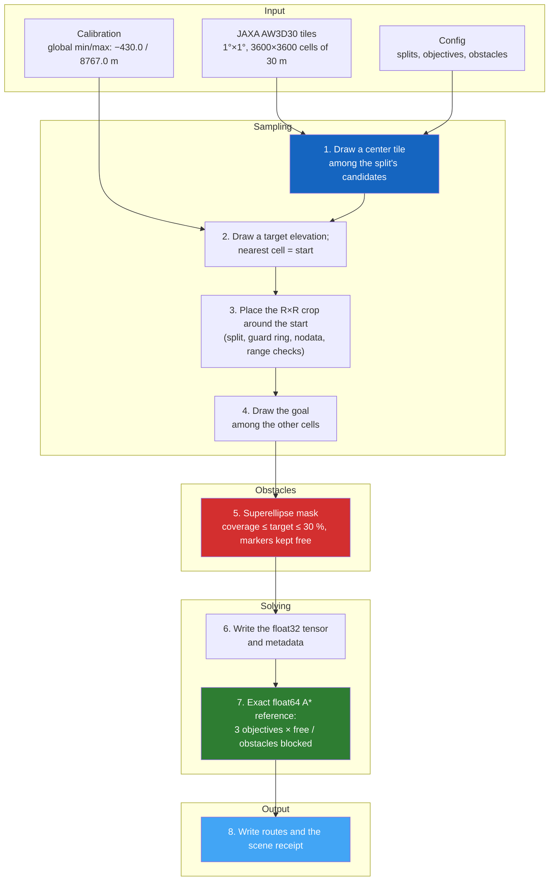

# Generation Process

This section provides a **deep technical dive** into how PASSAGE generates its scenes, from the sampling of each scene and the cost models to obstacle placement and the exact reference solver. It describes the generator that built **PASSAGE v1.0**: what `passage generate` runs with the shipped `config/config.yaml`.

---

## Pipeline Overview

Each scene yields six route variants, each an exact optimal route, never an approximation. A crop whose obstacles disconnect the start from the goal is rejected before any label is computed, and the scene draws its next candidate crop (see [Blocked Cells and Connected Endpoints](obstacles.md#blocked-cells-and-connected-endpoints)).

---

## Sections

### [:material-dice-multiple: Sampling Procedure](sampling.md)
How each scene is drawn: center tile, start cell, crop, goal and normalization, plus the geographic split rules (test-only South America hold-out, 5°×5° blocks, one-tile guard ring).

### [:material-scale-balance: Cost Models](cost-models.md)
Five crop-relative step-cost functions. PASSAGE v1.0 uses three of them: `elevation`, `slope_uphill` and `energy`.

### [:material-shape: Obstacle Generation](obstacles.md)
Superellipse obstacles with random shape, size and rotation, covering up to 30 % of the crop. Obstacle cells are blocked.

### [:material-graph: Solvers & Heuristics](solvers.md)
The exact float64 A\* reference solver that labels v1.0, and three alternative backends (NetworkX, pathfinding, Numba grid) not used by the release.

### [:material-notebook: Interactive Notebooks](notebooks/index.md)
Explore released scenes in Jupyter notebooks: the three objectives, obstacle masks and detours, and exact re-solves of the stored labels.

