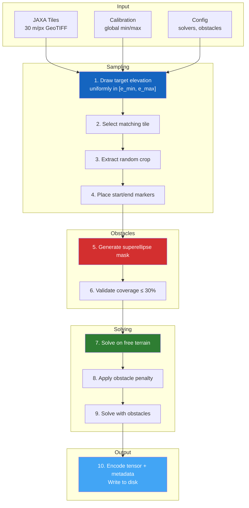

# Generation Process

This section provides a **deep technical dive** into how PASSAGE generates pathfinding samples — from the mathematical foundations of sampling and cost models to the algorithmic details of obstacle placement and solver execution.

---

## Pipeline Overview

---

## Sections

### [:material-dice-multiple: Sampling Procedure](sampling.md)
The 6-step process for generating each sample — from elevation targeting to normalization, with full mathematical detail.

### [:material-scale-balance: Cost Models](cost-models.md)
Five distinct edge-weight functions that model different navigation priorities — elevation, distance, slope, energy, and absolute.

### [:material-shape: Obstacle Generation](obstacles.md)
Superellipse-based procedural obstacles with configurable shape distributions, rotation, and coverage control.

### [:material-graph: Solvers & Heuristics](solvers.md)
Three solver backends (NetworkX, pathfinding, Numba-JIT grid), A\* and Dijkstra algorithms, and three admissible heuristics.

### [:material-notebook: Interactive Notebooks](notebooks.md)
Explore the dataset visually through Jupyter notebooks — cost model comparisons, obstacle distributions, and solver analysis.

