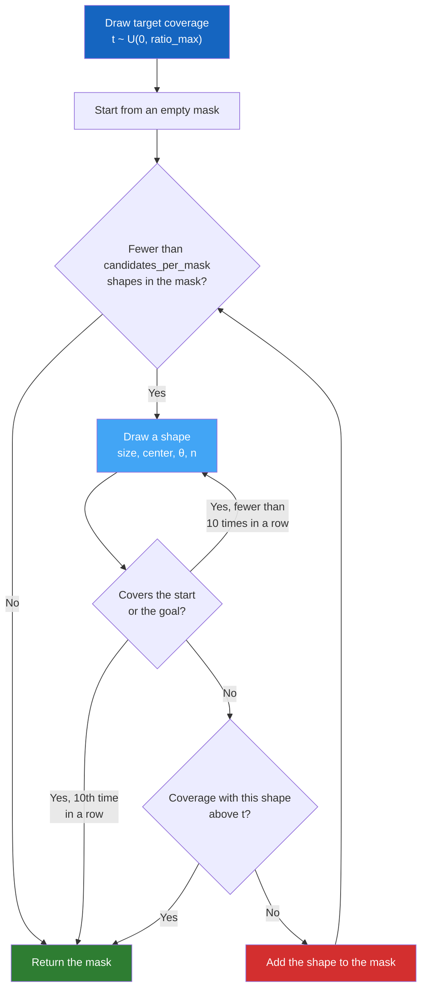

# Obstacle Generation

PASSAGE draws procedural obstacles as **superellipses** (Lamé curves). Shapes range from diamonds and ellipses to near-rectangles, with any rotation and size. In PASSAGE v1.0, obstacle cells are **blocked**: no route may enter them.

---

## The Superellipse Equation

A superellipse is the set of cells that satisfy:

$$
\left(\frac{\lvert x' \rvert}{a}\right)^n + \left(\frac{\lvert y' \rvert}{b}\right)^n \leq 1
$$

where $(x', y')$ are the cell's coordinates relative to the center $(c_x, c_y)$, rotated by the angle $-\theta$:

| Parameter | Description |
|-----------|-------------|
| $(c_x, c_y)$ | Center of the obstacle |
| $a, b$ | Semi-axes (half the width and half the height, before rotation) |
| $n$ | Shape exponent; controls how square the shape is |
| $\theta$ | Rotation angle |

---

## Shape Exponent $n$

The exponent $n$ sets the shape:

| $n$ value | Shape | Description |
|----------|-------|-------------|
| $n = 1$ | :material-diamond: Diamond (rhombus) | Sharp corners, diagonal orientation |
| $n = 2$ | :material-circle: Ellipse | Smooth, classical shape |
| $n = 4$ | :material-rounded-corner: Rounded rectangle | Corners begin to flatten |
| $n \to \infty$ | :material-square: Rectangle | Hard right-angle corners |

By default, $n$ is drawn from a **log-uniform distribution**:

$$
\log(n) \sim \mathcal{U}(\log(n_{\min}),\; \log(n_{\max}))
$$

with $n_{\min} = 1.0$ and $n_{\max} = 80.0$. Under a log-uniform draw, each doubling of $n$ (1–2, 2–4, 4–8, …) is equally likely. Pointed, elliptical and near-rectangular shapes therefore all occur.

!!! info "Other supported distributions"
    The `obstacles.shape.n.distribution.type` key also accepts:

    - `uniform`: $n \sim \mathcal{U}(n_{\min}, n_{\max})$
    - `beta`: a beta distribution (parameters `a` and `b`, default 2 and 5) scaled to $[n_{\min}, n_{\max}]$
    - `exponential`: a truncated exponential (rate `lambda`) scaled to $[n_{\min}, n_{\max}]$, which favors small $n$

---

## Rotation

Each obstacle is **rotated** by an angle drawn uniformly:

$$
\theta \sim \mathcal{U}(0, 2\pi)
$$

The rotation is applied to the cell coordinates before the inequality above is tested.

---

## Size Parameters

The size ratios set the **full width and height** of a shape, as fractions of the crop side $R$. The width $w$ and the height $h$ are drawn independently as whole numbers of cells:

$$
w, h \sim \mathcal{U}\{\max(1, \lfloor r_{\min} R \rfloor), \dots, \max(1, \lfloor r_{\max} R \rfloor)\}
$$

The semi-axes are half of these extents, with a minimum of one cell:

$$
a = \max(w/2,\, 1), \quad b = \max(h/2,\, 1)
$$

| Parameter | Default |
|-----------|---------|
| `shape.size.min_ratio` ($r_{\min}$) | 0.02 |
| `shape.size.max_ratio` ($r_{\max}$) | 0.25 |

With these defaults, each shape is 2 % to 25 % of the crop side wide and high, so its semi-axes are about 1 % to 12.5 % of the side (at least one cell). The center is drawn uniformly over the whole crop, so a shape near the edge is cut by the crop border.

---

## Placement Algorithm

The generator adds shapes one at a time until the next shape would exceed a **target coverage** $t$, the fraction of crop cells covered by obstacles:

1. Draw the target $t \sim \mathcal{U}(0, \text{ratio\_max})$. If $t = 0$, the mask stays empty.
2. Draw a shape: size, center, angle $\theta$ and exponent $n$.
3. If the shape covers the start or the goal, draw another one. After ten such shapes in a row, stop.
4. If adding the shape would raise the coverage above $t$, stop; this shape is not added.
5. Otherwise add the shape and go back to step 2. Stop once the mask holds `candidates_per_mask` shapes.

The final coverage is therefore at most $t$, and $t$ is at most `ratio_max` (30 %). Each scene records both values in its metadata (`obstacles.ratio_target` and `obstacles.ratio_actual`).

### Configuration

All keys sit under `obstacles` in `config/config.yaml`.

| Parameter | Default | Description |
|-----------|---------|-------------|
| `enabled` | `true` | Draw obstacles in each scene |
| `ratio_max` | 0.30 | Upper bound of the target coverage $t$ |
| `shape.size.min_ratio` | 0.02 | Smallest width or height, as a fraction of the crop side |
| `shape.size.max_ratio` | 0.25 | Largest width or height, as a fraction of the crop side |
| `shape.n.min` / `shape.n.max` | 1.0 / 80.0 | Range of the shape exponent |
| `generation.candidates_per_mask` | 200 | Maximum number of shapes in one mask |
| `generation.max_attempts` | 50 | Maximum number of masks drawn, each with a new target. A mask is redrawn only if it covers a marker, which step 3 already prevents, so the first mask is kept. |
| `impassable` | `true` | Obstacle cells are blocked (required by the v1.0 generator) |
| `obstacle_penalty` | $10^8$ | Used only when `impassable: false`; not used by the v1.0 release |

---

## Blocked Cells and Proved No-Path

Each scene is solved twice per objective: once on free terrain, where the obstacle channel is ignored, and once with the obstacles. With obstacles, the obstacle cells are removed from the routing graph:

- A route never enters an obstacle cell.
- A diagonal step is checked against its destination cell only, so a route may pass between two obstacle cells that touch at a corner.
- If no route joins the start to the goal, the exact search proves it. The variant gets the status `infeasible`, an empty route and a null cost. PASSAGE v1.0 contains 41,961 such proved no-path variants out of 26,400,000.

The v1.0 generator refuses a configuration with `impassable: false`.

### Penalty Option (not used by the v1.0 release)

With `impassable: false`, the generator keeps obstacle cells in the graph and raises their elevation instead:

$$
e_{\text{masked}}(i, j) = \max(e) + \text{obstacle\_penalty}
$$

Routes then avoid obstacles but can still cross them, so the graph stays connected. This option only affects the alternative solver backends described in [Solvers & Heuristics](solvers.md).

---

## Implementation

The superellipse helpers are in `src/passage/obstacles.py`:

- `superellipse_mask()` rasterizes one rotated superellipse as a boolean array.
- `sample_n_from_config()` draws the exponent from the configured distribution.
- `sample_angle_from_config()` draws the rotation angle.

The placement loop is `_generate_obstacles_mask()` in `src/passage/generate.py`. The v1.0 generator calls it for every scene, with the start and the goal as protected cells.
