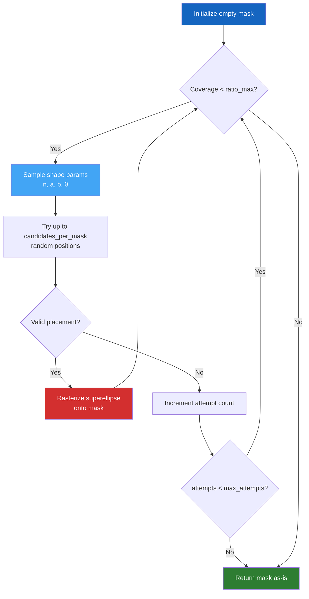

# Obstacle Generation

PASSAGE uses **superellipses** (Lamé curves) to generate procedural obstacles with rich geometric diversity — from smooth circles to near-rectangular blockers, with arbitrary rotation and size.

---

## The Superellipse Equation

A superellipse is defined by the inequality:

$$
\left(\frac{|x - c_x|}{a}\right)^n + \left(\frac{|y - c_y|}{b}\right)^n \leq 1
$$

where:

| Parameter | Description |
|-----------|-------------|
| $(c_x, c_y)$ | Center of the obstacle |
| $a, b$ | Semi-axes (horizontal, vertical extent) |
| $n$ | Shape exponent — controls "squareness" |

---

## Shape Exponent $n$

The exponent $n$ is the key parameter controlling obstacle geometry:

| $n$ value | Shape | Description |
|----------|-------|-------------|
| $n = 1$ | :material-diamond: Diamond (rhombus) | Sharp corners, diagonal orientation |
| $n = 2$ | :material-circle: Ellipse | Smooth, classical shape |
| $n = 4$ | :material-rounded-corner: Rounded rectangle | Corners begin to flatten |
| $n \to \infty$ | :material-square: Rectangle | Hard right-angle corners |

By default, $n$ is sampled from a **log-uniform distribution**:

$$
\log(n) \sim \mathcal{U}(\log(n_{\min}),\; \log(n_{\max}))
$$

with $n_{\min} = 1.0$ and $n_{\max} = 80.0$. The log-uniform distribution ensures a balanced representation of smooth shapes ($n \approx 1\text{–}3$) and angular shapes ($n \gg 5$).

!!! info "Other supported distributions"
    The `obstacles.shape.n.distribution` config key also supports:

    - `uniform`: $n \sim \mathcal{U}(n_{\min}, n_{\max})$
    - `beta`: shaped beta distribution
    - `exponential`: exponential decay favoring small $n$

---

## Rotation

Each obstacle is **randomly rotated** by an angle $\theta$ sampled uniformly:

$$
\theta \sim \mathcal{U}(0, 2\pi)
$$

The rotation is applied via a standard 2D transformation before the mask is rasterized.

---

## Size Parameters

Semi-axes $a$ and $b$ are sampled as fractions of the grid resolution $R$:

$$
a = R \cdot r_a, \quad b = R \cdot r_b
$$

where $r_a, r_b \sim \mathcal{U}(r_{\min}, r_{\max})$ with defaults:

| Parameter | Default |
|-----------|---------|
| `min_ratio` | 0.02 |
| `max_ratio` | 0.25 |

This means obstacles range from **2% to 25%** of the grid size per axis.

---

## Placement Algorithm

Obstacles are placed iteratively until the **target coverage ratio** is reached:

### Configuration

| Parameter | Default | Description |
|-----------|---------|-------------|
| `ratio_max` | 0.30 | Maximum grid fraction covered by obstacles |
| `max_attempts` | 50 | Max placement attempts before stopping |
| `candidates_per_mask` | 200 | Positions tested per obstacle |
| `obstacle_penalty` | $10^8$ | Elevation penalty added to blocked cells |

---

## Obstacle Penalty

When obstacles are applied to the elevation grid for pathfinding, blocked cells receive a massive penalty:

$$
e_{\text{masked}}(i, j) = \max(e) + \text{obstacle\_penalty}
$$

This ensures that solvers strongly avoid obstacle regions while still finding valid paths around them (rather than making the graph disconnected).

!!! note
    Paths are computed **twice** for each solver: once on the free terrain (no obstacles) and once with the obstacle penalty applied. This allows comparing obstacle-free optimal paths with obstacle-aware paths.

---

## Implementation

The core superellipse mask generation is in `src/passage/obstacles.py`:

- `superellipse_mask()` — rasterizes a single rotated superellipse as a boolean array
- `sample_n_from_config()` — samples the exponent from the configured distribution
- `sample_angle_from_config()` — samples the rotation angle

The orchestration (multi-obstacle placement loop) lives in `src/passage/generate.py`:

- `_generate_obstacles_mask()` — iterative placement with coverage control
