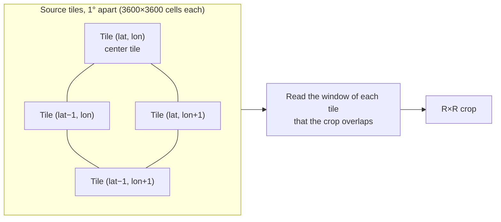
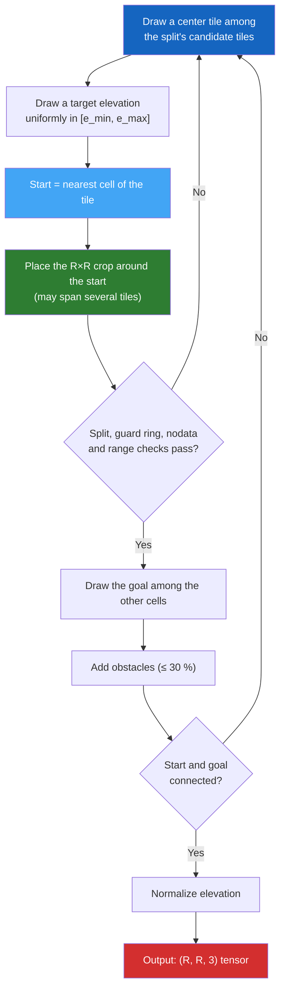

# Sampling Procedure

This page describes how the generator that built **PASSAGE v1.0** draws each scene. It is the generator that `passage generate` runs with the shipped `config/config.yaml`. A scene goes through **six steps**: draw a center tile, pick the start cell, place the crop, draw the goal, add obstacles and normalize the elevation.

Two terms are used throughout:

- A **source tile** is one AW3D30 elevation file. It covers 1°×1° and is resampled to 3600×3600 cells of nominal 30 m by nearest angular-center sampling. JAXA ships tiles inside 5°×5° ZIP archives; the archive is only a download unit.
- The **calibration range** $[e_{\min}, e_{\max}]$ is the lowest and highest elevation over all tiles, found by the [calibration step](../guide/calibrate.md). PASSAGE v1.0 uses $e_{\min} = -430.0$ m and $e_{\max} = 8767.0$ m.

Each scene has its own seed, derived from `generation.seed`, the resolution, the scene index and the split (`blake2b(seed, resolution, index, split)`). Its split comes from a seeded shuffle of exact counts in the ratios of `splits.ratios` (90 / 2 / 4 / 4 % for train / calibration / validation / test). If a check below fails, the scene draws again, up to `generation.max_scene_attempts` times (100 in the shipped configuration).

---

## Step 1 — Draw a Center Tile

The center tile $t^*$ is drawn **uniformly at random** among the candidate tiles of the scene's split. A tile is a candidate when:

- it is listed in the calibration file;
- it belongs to the scene's split, and so do the eight tiles of its one-tile guard ring (see [Geographic splits](#geographic-splits)).

No elevation filter is applied at this step.

---

## Step 2 — Pick the Start Cell

A target elevation is drawn uniformly from the global calibration range:

$$
e_{\text{target}} \sim \mathcal{U}(e_{\min}, e_{\max})
$$

The **start** is the cell of the center tile whose elevation is closest to $e_{\text{target}}$ (nodata cells are ignored):

$$
(i^*, j^*) = \arg\min_{(i,j)} \left\lvert e^{(t^*)}(i, j) - e_{\text{target}} \right\rvert
$$

The target often falls outside the range of the tile. The start then lands on the lowest or highest cell of the tile. Starts therefore favor the elevation extremes of their tile, and coverage is **not proportional to ground area**.

---

## Step 3 — Place the Crop

A crop of $R \times R$ cells ($R$ is the resolution) is placed so that the start falls at a random position inside it. In tile coordinates, the crop origin $(r_0, c_0)$ is:

$$
r_0 = i^* - \delta_r, \quad c_0 = j^* - \delta_c
$$

where $\delta_r$ and $\delta_c$ are drawn uniformly from $\{0, \dots, R-1\}$.

The crop can extend past the edge of the center tile **at any resolution**. The generator then reads the matching window of each neighboring tile, one degree away, and joins the windows. Longitude wraps around at ±180°. A 4096×4096 crop is wider than one tile, so it always spans two or three tiles in each direction.

The attempt is rejected, and the scene draws again, when:

- a source tile of the crop, or a tile of its guard ring, belongs to another split;
- a source tile is missing, or a window contains nodata cells or is incomplete (crops are never padded);
- an elevation of the crop lies outside the calibration range (values are never clipped);
- the obstacles of Step 5 disconnect the start from the goal on the routing graph (see [Blocked Cells and Connected Endpoints](obstacles.md#blocked-cells-and-connected-endpoints)).

---

## Step 4 — Draw the Goal

The **goal** is drawn uniformly among the $R^2 - 1$ cells of the crop other than the start. The generator never redraws the goal alone: if the obstacles of Step 5 disconnect the start from the goal, the whole attempt is rejected and the scene draws its next candidate crop.

The **marker channel** of the output tensor encodes both endpoints:

| Value | Meaning |
|-------|---------|
| $-1$ | Background |
| $0$ | Start marker |
| $1$ | Goal (end) marker |

---

## Step 5 — Add Obstacles

Super-ellipse obstacles are drawn on the crop. They cover at most 30 % of it and never cover the start or the goal. Obstacle cells are blocked for routing; if they disconnect the start from the goal, the attempt is rejected. See [Obstacle Generation](obstacles.md).

---

## Step 6 — Normalize Elevation

The crop's elevations, in meters, are normalized to $[0, 1]$ with the **global** calibration range. The division is done in float64 and the result is stored as float32:

$$
\bar{e}(i, j) = \frac{e(i, j) - e_{\min}}{e_{\max} - e_{\min}}
$$

Values are therefore comparable across scenes from different regions.

!!! info "Back to meters"
    To recover the elevation in meters from a normalized value:

    $$e(i,j) = \bar{e}(i,j) \cdot (e_{\max} - e_{\min}) + e_{\min}$$

    The calibration range is stored in each scene's metadata (`metadata.calibration.min` and `metadata.calibration.max`) and in `calibrate.json` (`global_min` and `global_max`).

The reference routes are then solved on this stored tensor, decoded back to meters: see [Solvers & Heuristics](solvers.md).

---

## Geographic Splits

Every source tile belongs to exactly one split:

- Tiles inside the hold-out mask (South America; `hold_out.mask_path`, a 181×361 PNG with one pixel per degree) go to `test`, and only to `test`.
- The other tiles are grouped in 5°×5° blocks (`generation.geographic_policy.block_degrees`). A seeded hash assigns each block to `train`, `calibration` or `validation`, in proportion to their ratios.

A crop is admitted only if all its source tiles, plus a one-tile guard ring around each (`generation.geographic_policy.buffer_tiles`), belong to the scene's split. The source cells of different splits are therefore disjoint.

---

## Output Tensor

The final **tensor** is a 3-channel float32 array of shape $(R, R, 3)$:

| Channel | Content | Range |
|---------|---------|-------|
| 0 | Normalized elevation $\bar{e}$ | $[0, 1]$ |
| 1 | Marker map | $\{-1, 0, 1\}$ |
| 2 | Obstacle mask (1 = blocked cell) | $\{0, 1\}$ |

The tensor is stored as raw float32 bytes compressed with **Zstandard** (level 12), in a file with the `.npy.zst` suffix. The file has no NumPy `.npy` header; see [Data Format](../architecture/data-format.md).

---

## Summary Diagram

