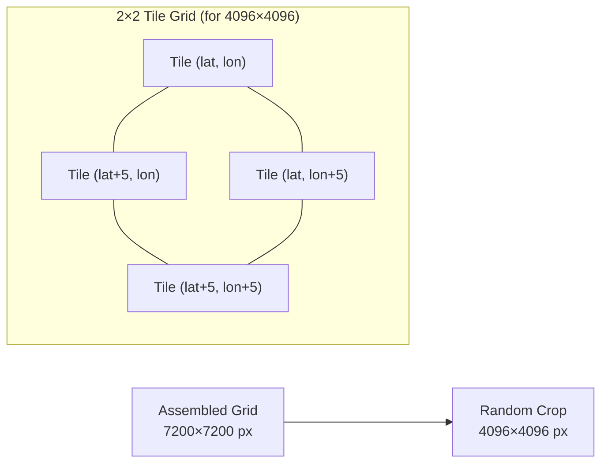
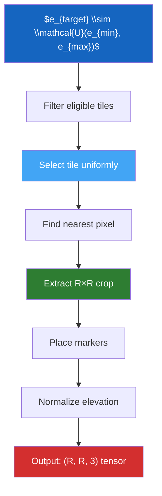

# Sampling Procedure

Each PASSAGE sample is generated through a carefully designed **6-step sampling process**. This process ensures geographic diversity, statistical balance across elevation ranges, and consistent normalization.

---

## Step 1 — Draw Target Elevation

A target elevation is sampled uniformly from the global calibrated range:

$$
e_{\text{target}} \sim \mathcal{U}(e_{\min}, e_{\max})
$$

where $e_{\min}$ and $e_{\max}$ are the global minimum and maximum elevations discovered during the [calibration step](../guide/calibrate.md).

!!! example "Typical values"
    With a full global download: $e_{\min} \approx -415$ m (Dead Sea region), $e_{\max} \approx 8{,}848$ m (Himalaya).

This uniform sampling ensures that low-altitude coastal regions and high-altitude mountain ranges are represented proportionally across the dataset.

---

## Step 2 — Select a Matching Tile

Given $e_{\text{target}}$, the set of eligible tiles is filtered:

$$
\mathcal{T}_{\text{eligible}} = \left\{ t \in \mathcal{T} \mid e_{\min}^{(t)} \leq e_{\text{target}} \leq e_{\max}^{(t)} \right\}
$$

A tile $t^*$ is then selected **uniformly at random** from $\mathcal{T}_{\text{eligible}}$.

!!! note "Hold-out filtering"
    If hold-out is enabled, tiles in the hold-out region (e.g., South America) are excluded from training/calibration splits but included in validation/test splits. This ensures geographic generalization can be evaluated.

---

## Step 3 — Identify Nearest Pixel

Within the selected tile, the pixel whose elevation is closest to $e_{\text{target}}$ is identified:

$$
(i^*, j^*) = \arg\min_{(i,j)} \left| e^{(t^*)}(i, j) - e_{\text{target}} \right|
$$

This pixel becomes the **anchor point** around which the crop will be positioned.

---

## Step 4 — Extract Random Crop

A crop of size $R \times R$ (the target resolution) is extracted, with the anchor point positioned randomly within the crop area. The crop origin $(r_0, c_0)$ is computed as:

$$
r_0 = i^* - \delta_r, \quad c_0 = j^* - \delta_c
$$

where $\delta_r \sim \mathcal{U}(0, R-1)$ and $\delta_c \sim \mathcal{U}(0, R-1)$ are random offsets ensuring the anchor falls somewhere within the crop.

For **large resolutions** ($R > 3600$, the JAXA tile size), multiple adjacent tiles are assembled into a grid before cropping:

---

## Step 5 — Place Start & End Markers

Two marker positions are placed randomly on the crop:

$$
\text{start} = (r_s, c_s), \quad \text{end} = (r_e, c_e)
$$

where each coordinate is drawn independently:

$$
r_s, r_e \sim \mathcal{U}(0, R-1), \quad c_s, c_e \sim \mathcal{U}(0, R-1)
$$

The **marker channel** of the output tensor encodes these positions:

| Value | Meaning |
|-------|---------|
| $-1$ | Background |
| $0$ | Start marker |
| $1$ | Goal (end) marker |

---

## Step 6 — Normalize Elevation

The crop's raw elevation values are normalized to $[0, 1]$ using the **global** calibration bounds:

$$
\bar{e}(i, j) = \frac{e(i, j) - e_{\min}}{e_{\max} - e_{\min}}
$$

This ensures that elevation values are directly comparable across samples from different geographic regions.

!!! info "Denormalization"
    To recover real elevation in meters from a normalized value:

    $$e(i,j) = \bar{e}(i,j) \cdot (e_{\max} - e_{\min}) + e_{\min}$$

    The calibration values are stored in `calibrate.json` and in each sample's metadata.

---

## Output Tensor

The final **tensor** is a 3-channel array of shape $(R, R, 3)$:

| Channel | Content | Range |
|---------|---------|-------|
| 0 | Normalized elevation $\bar{e}$ | $[0, 1]$ |
| 1 | Marker map | $\{-1, 0, 1\}$ |
| 2 | Obstacle mask | $\{0, 1\}$ |

The tensor is compressed with **zstandard** (level 12) and stored as `.npy.zst`.

---

## Summary Diagram

