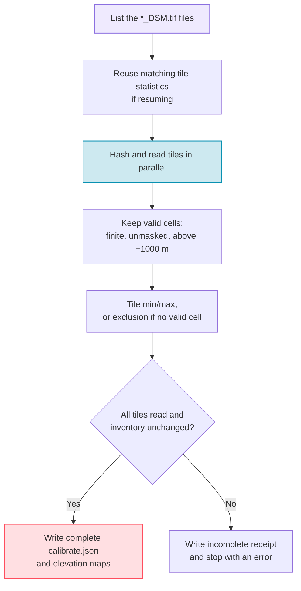

# Step 2 — Calibrate Elevations

The calibration step scans **every downloaded tile** and records the global
minimum and maximum elevation. The generation step uses this range to scale the
stored elevation into `[0, 1]`. The calibration file also records a hashed
inventory of the tiles; the generator refuses to run when the tiles it reads
differ from that inventory.

---

## Why Calibrate?

Each JAXA tile holds raw elevation values in meters. To store comparable
scenes across resolutions and regions, PASSAGE scales the elevation channel of
every scene with the same global bounds:

$$
\bar{e}(i,j) = \frac{e(i,j) - e_{\min}}{e_{\max} - e_{\min}}
$$

Here $e_{\min}$ and $e_{\max}$ are the **global** minimum and maximum over all
tiles, found by this step. For PASSAGE v1.0 they are **−430.0 m** and
**8767.0 m**.

This global range only scales the stored elevation channel. Route costs use the
minimum and maximum of each crop instead; see the
[graph and label contract](../dataset/index.md#graph-and-label-contract) of the
dataset card.

---

## Usage

### Basic calibration

```bash
passage calibrate
```

### With options

```bash
# Specify tile and output directories
passage calibrate \
  --tiles-dirpath outputs/download/tiles \
  --outputs-dirpath outputs/calibrate \
  --num-cpus 8

# Recompute every tile and replace an existing calibration
passage calibrate --no-resume
```

---

## CLI Reference

| Flag | Default | Description |
|------|---------|-------------|
| `--outputs-dirpath` | `outputs/calibrate` | Where to write calibration results |
| `--tiles-dirpath` | `outputs/download/tiles` | Folder of extracted `*_DSM.tif` tiles |
| `--no-resume` | off | Recompute every tile and replace an existing `calibrate.json` |
| `--num-cpus` | All CPUs | Parallel tile-scanning workers; `0` runs sequentially |
| `--log-level` | `info` | Logging verbosity: `debug`, `info`, `warning`, `error` or `critical` |

---

## How It Works



1. **Tile discovery** — lists every `*_DSM.tif` file directly inside the tiles
   folder.
2. **Hashing and reading** — each tile is hashed (SHA-256) and read with
   `rasterio`. Tiles that depend on side files (`.msk`, `.aux.xml`, `.ovr`) are
   rejected.
3. **Valid cells** — only band 1 is read. Masked cells, non-finite values and
   values at or below −1000 m are ignored. A tile without any valid cell is
   excluded with the reason `no_valid_data`.
4. **Aggregation** — the global minimum and maximum come from the tiles that
   were read successfully.
5. **Completeness** — the calibration is complete only when no tile failed and
   the tile folder did not change during the scan. Otherwise the receipt is
   written with `"complete": false` and null bounds, and the command stops with
   an error.
6. **Resume** — by default, a re-run reuses the statistics of tiles whose hash
   still matches, when the receipt comes from the same calibration code. If a
   complete calibration already exists and the new result differs, the command
   keeps the existing file, saves the new receipt as
   `calibrate.pending.<receipt_sha256>.json` and stops. Use `--no-resume` to
   replace it; the previous version stays as `calibrate.<receipt_sha256>.json`.

---

## Output Structure

```text
outputs/calibrate/
├── calibrate.json                     # Range, tile inventory and per-tile statistics (read-only)
├── calibrate.<receipt_sha256>.json    # The same receipt, named by its hash
├── max_elevation_map.png              # World map of each tile's maximum elevation (terrain colormap)
└── ptp_elevation_map.png              # World map of each tile's elevation range (plasma colormap)
```

### `calibrate.json` schema

The receipt below is an excerpt of the released
[`calibrate.json`](https://huggingface.co/datasets/thalesgroup/passage/blob/main/calibration/calibrate.json).
Lists hold one entry per tile; `"…"` marks shortened values. The two
`tile_stats` entries are the tiles that set the global maximum and minimum.

```json
{
  "schema": "passage-calibration-v2",
  "complete": true,
  "global_min": -430.0,
  "global_max": 8767.0,
  "tiles_expected": 23993,
  "tiles_processed": 23993,
  "tiles_excluded": 0,
  "tiles_failed": 0,
  "ptp_min": 0.0,
  "ptp_max": 8579.0,
  "valid_data_policy": {
    "band": 1,
    "raster_mask": true,
    "finite_only": true,
    "exclusive_minimum_elevation": -1000,
    "external_raster_dependencies": "rejected",
    "allowed_exclusions": ["no_valid_data"]
  },
  "source_inventory": [
    {"filename": "ALPSMLC30_N000E006_DSM.tif", "size_bytes": 25993150, "sha256": "2873a14a…"}
  ],
  "source_inventory_sha256": "…",
  "tile_stats": [
    {"filename": "ALPSMLC30_N027E086_DSM.tif", "lat": 27, "lon": 86,
     "min": 188.0, "max": 8767.0, "source_sha256": "d332e2fc…"},
    {"filename": "ALPSMLC30_N031E035_DSM.tif", "lat": 31, "lon": 35,
     "min": -430.0, "max": 1301.0, "source_sha256": "b9f9ffc5…"}
  ],
  "excluded_tiles": [],
  "failed_tiles": [],
  "failures": [],
  "calibration_errors": [],
  "producer": {"code_sha256": "…", "numpy_version": "…", "rasterio_version": "…", "gdal_version": "…"},
  "inventory_scope": "…",
  "tiles_dirpath": "…",
  "receipt_sha256": "…"
}
```

| Key | Meaning |
|-----|---------|
| `global_min`, `global_max` | Elevation range in meters; `null` when the calibration is incomplete |
| `source_inventory` | Every tile scanned: file name, size and SHA-256 hash |
| `tile_stats` | Usable tiles: file name, latitude, longitude, minimum, maximum and source hash |
| `excluded_tiles`, `failures` | Tiles without valid data, and tiles that could not be read |
| `ptp_min`, `ptp_max` | Smallest and largest elevation range (maximum − minimum) of a single tile |
| `receipt_sha256` | Hash of all the other fields; the generator checks it before use |

---

## Next Step

With calibration complete, proceed to **[Step 3 — Generate Dataset](generate.md)** to create pathfinding samples.
