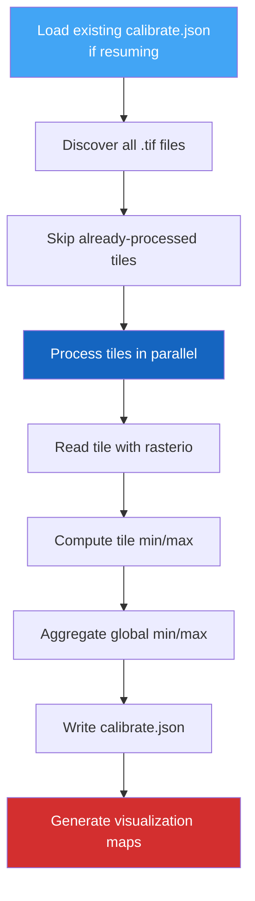

# Step 2 — Calibrate Elevations

The calibration step scans **all downloaded tiles** to compute global minimum and maximum elevation values. These statistics are essential for the generation step, which normalizes elevation data into the `[0, 1]` range.

---

## Why Calibrate?

Each JAXA tile contains raw elevation values in meters. To create consistent, comparable samples across resolutions and geographic regions, PASSAGE normalizes elevation using global bounds:

$$
\bar{e}(i,j) = \frac{e(i,j) - e_{\min}}{e_{\max} - e_{\min}}
$$

Where $e_{\min}$ and $e_{\max}$ are the **global** minimum and maximum across all tiles — determined by this calibration step.

---

## Usage

### Basic calibration

```bash
passage calibrate
```

### With options

```bash
# Specify tile and output directories
passage calibrate \
  --tiles-dirpath outputs/download/tiles \
  --outputs-dirpath outputs/calibrate \
  --num-cpus 8

# Force fresh calibration (no resume)
passage calibrate --no-resume
```

---

## CLI Reference

| Flag | Default | Description |
|------|---------|-------------|
| `--outputs-dirpath` | `outputs/calibrate` | Where to write calibration results |
| `--tiles-dirpath` | `outputs/download/tiles` | Path to extracted GeoTIFF tiles |
| `--no-resume` | `false` | Start fresh, ignoring existing results |
| `--num-cpus` | `1` | Parallel tile scanning workers |
| `--log-level` | `INFO` | Logging verbosity |

---

## How It Works



1. **Tile Discovery** — scans the tiles directory for all `*.tif` files
2. **Parallel Processing** — each tile is read with `rasterio` and its local min/max computed
3. **Aggregation** — global min/max are computed across all successfully read tiles
4. **Output** — results written to `calibrate.json` + visualization maps
5. **Error Handling** — corrupted or unreadable tiles are recorded in `failed_tiles`

---

## Output Structure

```
outputs/calibrate/
├── calibrate.json            # Global stats + per-tile breakdown
├── max_elevation_map.png     # World map colored by max elevation (terrain cmap)
└── ptp_elevation_map.png     # World map colored by elevation range (plasma cmap)
```

### `calibrate.json` schema

```json
{
  "global_min": -415.0,
  "global_max": 8848.0,
  "tile_stats": {
    "N00E005_AVE_DSM.tif": {"min": 0.0, "max": 523.0},
    "N25E085_AVE_DSM.tif": {"min": 12.0, "max": 8848.0}
  },
  "failed_tiles": []
}
```

---

## Next Step

With calibration complete, proceed to **[Step 3 — Generate Dataset](generate.md)** to create pathfinding samples.
