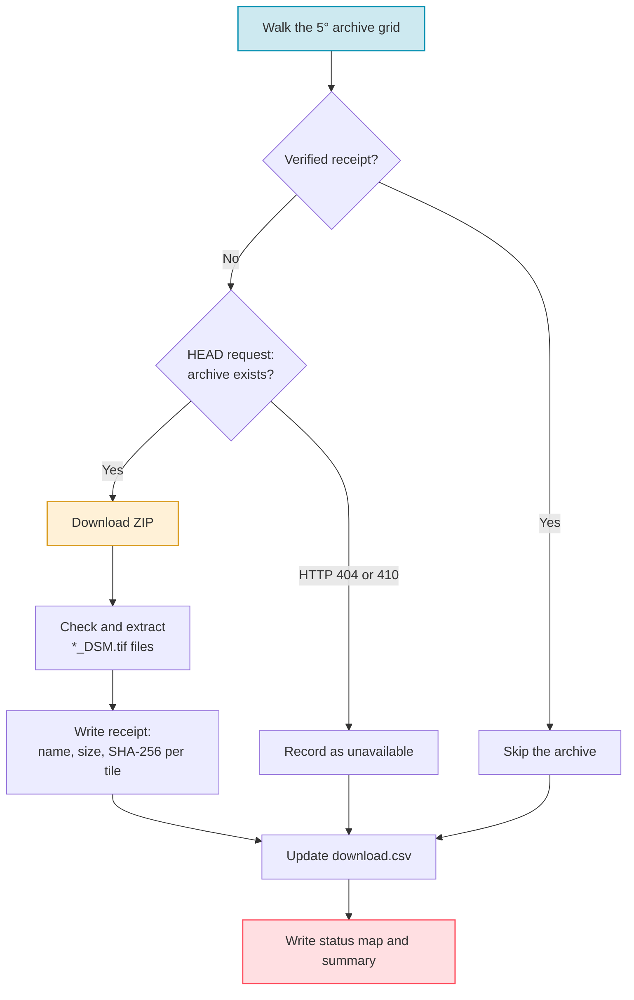

# Step 1 — Download Tiles

The first step downloads the **JAXA ALOS World 3D–30 m (AW3D30)** Digital
Surface Model (DSM): satellite elevation data of the land surface, with cells
of about 30 m.

---

## What Gets Downloaded?

The [AW3D30 dataset](https://www.eorc.jaxa.jp/ALOS/en/dataset/aw3d30/aw3d30_e.htm)
is split into **1° × 1° GeoTIFF tiles**. JAXA groups these tiles into
**5° × 5° ZIP archives**. PASSAGE walks the world grid of archives, named by
their south-west corner:

- **Latitude:** −90° to +85° in 5° steps
- **Longitude:** −180° to +175° in 5° steps

This gives **2,592 archive candidates**. Many do not exist, for example over
open ocean, so the downloader checks each URL before it downloads anything.

The 23,993 DSM tiles used by PASSAGE v1.0 take about **463 GB** of disk (the
sum of the file sizes in the released
[`calibrate.json`](https://huggingface.co/datasets/thalesgroup/passage/blob/v1.0/calibration/calibrate.json)
inventory). Leave extra room for the ZIP archives while they are extracted.

!!! info "Data source"
    URL pattern: `https://www.eorc.jaxa.jp/ALOS/aw3d30/data/release_v2404/<SW>_<NE>.zip`,
    for example `N000E005_N005E010.zip` for the archive whose south-west corner
    is 0° N, 5° E.

    Each archive holds one `ALPSMLC30_<lat><lon>_DSM.tif` file per 1° tile, for
    example `ALPSMLC30_N000E006_DSM.tif`. PASSAGE extracts only the `*_DSM.tif`
    files.

---

## Usage

### Basic download

```bash
passage download
```

This writes outputs to `outputs/download/` by default.

### With options

```bash
# Custom output directory with 8 parallel workers
passage download --outputs-dirpath outputs/my_download --num-cpus 8

# Download only some archives (south-west corner, in degrees); repeat the flag
passage download --archive 45 5 --archive 40 5

# Download every selected archive again, even archives already verified
passage download --no-resume

# Verbose logging
passage download --log-level debug
```

---

## CLI Reference

| Flag | Default | Description |
|------|---------|-------------|
| `--outputs-dirpath` | `outputs/download` | Output directory for tiles, receipts and `download.csv` |
| `--archive LAT LON` | Every archive of the grid | Download only this archive, given by its south-west corner on the 5° grid; repeat for several |
| `--no-resume` | off | Ignore existing receipts and download every selected archive again |
| `--num-cpus` | All CPUs | Number of parallel download workers; `0` runs sequentially |
| `--log-level` | `info` | Logging verbosity: `debug`, `info`, `warning`, `error` or `critical` |

---

## How It Works



1. **Receipt check** — on a re-run, an archive is skipped when its receipt lists
   every tile and each tile still has the recorded size and SHA-256 hash.
2. **URL check** — a HEAD request asks JAXA's server whether the archive exists.
   HTTP 404 or 410 marks it `unavailable`.
3. **Download and extract** — the ZIP goes to `archives/`. Each `*_DSM.tif`
   file is checked (safe name, complete size) in a staging folder, then moved
   to `tiles/`. The ZIP is deleted once extraction succeeds.
4. **Retries** — network and archive errors are retried up to three times.
   After that, the archive is marked `failed`.
5. **Tracking** — `download.csv` holds one row per archive (`lat_min`,
   `lon_min`, `url`, `url_valid`, `extracted`, `status`, `error`), and
   `download_summary.json` counts the archives per status.
6. **Status map** — `world_coverage.png` shows the status of each archive.

An archive ends in one of three statuses: `complete` (every tile verified and
extracted), `unavailable` (the archive does not exist) or `failed` (errors
remained after three attempts). Only `complete` archives count as downloaded.

---

## Output Structure

```text
outputs/download/
├── download.csv            # One row per 5° archive: URL, status, error
├── download_summary.json   # Number of archives per status
├── world_coverage.png      # Status map of the archive grid
├── manifests/              # One JSON receipt per archive: tile names, sizes, SHA-256
├── archives/               # ZIP files while they download (deleted after extraction)
└── tiles/                  # Extracted 1° × 1° GeoTIFF tiles
    ├── ALPSMLC30_N000E006_DSM.tif
    ├── ALPSMLC30_N000E009_DSM.tif
    └── ...
```

---

## Next Step

Once tiles are downloaded, proceed to **[Step 2 — Calibrate Elevations](calibrate.md)** to scan them for global statistics.
