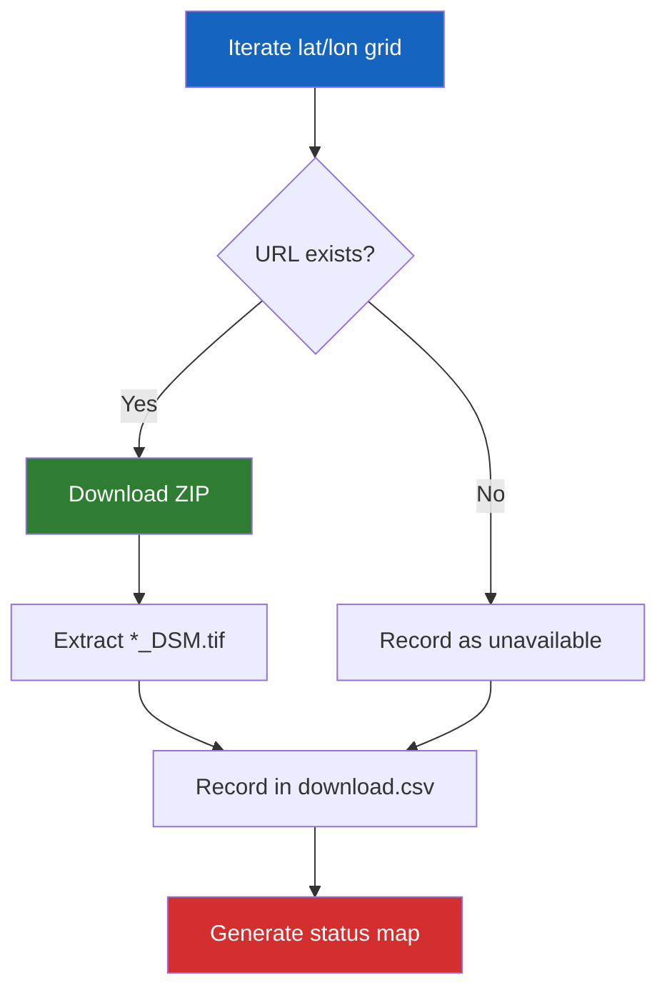

# Step 1 — Download Tiles

The first step in the PASSAGE pipeline downloads **JAXA ALOS AW3D30** Digital Surface Model (DSM) tiles — real-world satellite elevation data at 30 m/pixel resolution covering the entire globe.

---

## What Gets Downloaded?

The [ALOS AW3D30 dataset](https://www.eorc.jaxa.jp/ALOS/en/dataset/aw3d30/aw3d30_e.htm) consists of **5° × 5° geographic tiles**. Each tile is distributed as a ZIP archive containing GeoTIFF files with elevation values.

PASSAGE systematically iterates over the full latitude/longitude grid:

- **Latitude:** −90° to +85° in 5° steps
- **Longitude:** −180° to +175° in 5° steps

This produces up to **2,592 tile candidates**. Not all exist (ocean tiles, ice caps), so the downloader checks URL availability before attempting each download.

!!! info "Data source"
    URL pattern: `https://www.eorc.jaxa.jp/ALOS/aw3d30/data/release_v2404/{tile}.zip`

    Each ZIP contains `*_DSM.tif` GeoTIFF files — the digital surface model rasters.

---

## Usage

### Basic download

```bash
passage download
```

This writes outputs to `outputs/download/` by default.

### With options

```bash
# Custom output directory with 8 parallel workers
passage download --outputs-dirpath outputs/my_download --num-cpus 8

# Disable resume (start fresh)
passage download --no-resume

# Verbose logging
passage download --log-level DEBUG
```

---

## CLI Reference

| Flag | Default | Description |
|------|---------|-------------|
| `--outputs-dirpath` | `outputs/download` | Output directory for tiles and tracking CSV |
| `--no-resume` | `false` | Disable resume — reprocess all tiles |
| `--num-cpus` | `1` | Number of parallel download workers |
| `--log-level` | `INFO` | Logging verbosity (`DEBUG`, `INFO`, `WARNING`, `ERROR`) |

---

## How It Works



1. **URL Validation** — a HEAD request checks if the tile archive exists at JAXA's server
2. **Download & Extract** — valid archives are downloaded, and `*_DSM.tif` files are extracted to `tiles/`
3. **Status Tracking** — results are logged in `download.csv` with status codes (success, 404, error)
4. **Resume Support** — on re-run, already-processed tiles are skipped based on `download.csv`
5. **Status Map** — a world-coverage PNG is generated showing tile availability

---

## Output Structure

```
outputs/download/
├── download.csv          # Tile-level status tracking
├── archives/             # Raw ZIP archives (optional, can be cleaned)
└── tiles/                # Extracted GeoTIFF files
    ├── N00E005_AVE_DSM.tif
    ├── N00E010_AVE_DSM.tif
    └── ...
```

---

## Next Step

Once tiles are downloaded, proceed to **[Step 2 — Calibrate Elevations](calibrate.md)** to scan them for global statistics.
