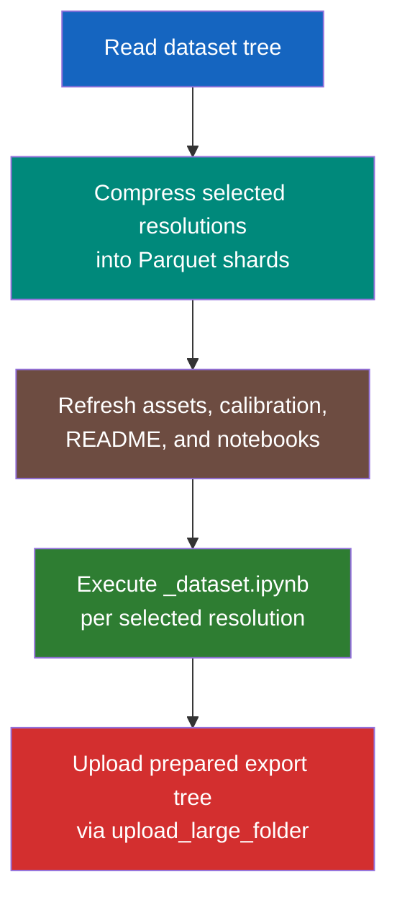

# Steps 4-6 — Release

PASSAGE splits release preparation into three explicit commands:

1. `passage compress` rewrites Parquet shards for the selected resolutions.
2. `passage export` refreshes the upload-ready export tree.
3. `passage upload` publishes that prepared tree to Hugging Face.

The default export directory is derived from the calibration path. For example, `--calibrate-dirpath /data/PASSAGE/calibrate`
targets `/data/PASSAGE/export` automatically, so the `/data` workflow stays compatible with the previous setup.

---

## 1. Compress

`compress` scans the generated dataset, deletes any existing prepared configs for the selected resolutions, and writes fresh
zstd-compressed Parquet shards under `outputs/export` (or the export directory derived from your calibration path).

```bash
# Compress every discovered dataset resolution
passage compress

# Compress one resolution locally
passage compress --resolution 256

# Compress against the /data dataset tree
passage compress \
  --dataset-dirpath /data/PASSAGE/dataset \
  --calibrate-dirpath /data/PASSAGE/calibrate \
  --resolution 256
```

Key flags for `compress`:

| Flag | Default | Description |
|------|---------|-------------|
| `--config` | `config/config.yaml` | Configuration file |
| `--dataset-dirpath` | `outputs/dataset` | Generated dataset directory |
| `--calibrate-dirpath` | `outputs/calibrate` | Used to derive the export directory |
| `--calibration-filepath` | `<calibrate-dirpath>/calibrate.json` | Explicit calibration file for export-dir derivation |
| `--export-dirpath` | Derived from calibration path | Explicit export directory override |
| `--resolution` | All discovered dataset resolutions | Restrict compression to specific resolutions |
| `--num-cpus` | All CPUs | Multiprocessing workers (`0` = sequential) |

---

## 2. Export

`export` assumes Parquet shards already exist. It refreshes the export root by copying assets and calibration files, copying
analysis notebooks, executing `_dataset.ipynb` for each selected resolution, and rebuilding `README.md` for upload.

```bash
# Refresh every prepared resolution
passage export

# Refresh one prepared resolution
passage export --resolution 256

# Refresh the /data-backed export tree
passage export \
  --dataset-dirpath /data/PASSAGE/dataset \
  --calibrate-dirpath /data/PASSAGE/calibrate \
  --resolution 256
```

Key flags for `export`:

| Flag | Default | Description |
|------|---------|-------------|
| `--config` | `config/config.yaml` | Configuration file |
| `--dataset-dirpath` | `outputs/dataset` | Dataset root passed to the notebooks |
| `--calibrate-dirpath` | `outputs/calibrate` | Calibration directory copied into the export tree |
| `--calibration-filepath` | `<calibrate-dirpath>/calibrate.json` | Explicit calibration file |
| `--notebooks-dirpath` | `notebooks` | Notebook directory containing `_dataset.ipynb` |
| `--export-dirpath` | Derived from calibration path | Explicit export directory override |
| `--resolution` | All prepared resolutions | Restrict notebook refresh to specific resolutions |
| `--repo-id` | `thalesgroup/passage` | Repo id embedded in the generated README |
| `--max-notebook-retries` | `3` | Retry count for `_dataset.ipynb` execution |
| `--notebook-retry-delay` | `5` | Delay between retries, in seconds |

If the selected `<resolution>x<resolution>` or `<resolution>x<resolution>_samples` Parquet directories do not exist yet,
`export` fails fast and asks you to run `passage compress` first.

---

## 3. Upload

`upload` publishes the prepared export tree. By default it targets `thalesgroup/passage` and reads `HF_TOKEN` from
`.env.secret` after optionally loading `.env`.

```bash
# Upload the prepared export tree to the default dataset repo
passage upload

# Upload just one prepared resolution
passage upload --resolution 256

# Override the repo explicitly
passage upload --repo-id alice/passage-dataset --env-path .env --secret-path .env.secret
```

Key flags for `upload`:

| Flag | Default | Description |
|------|---------|-------------|
| `--calibrate-dirpath` | `outputs/calibrate` | Used to derive the export directory |
| `--calibration-filepath` | `<calibrate-dirpath>/calibrate.json` | Explicit calibration file for export-dir derivation |
| `--export-dirpath` | Derived from calibration path | Explicit export directory override |
| `--resolution` | Full prepared export tree | Restrict upload to specific prepared resolutions |
| `--repo-id` | `thalesgroup/passage` | Hugging Face dataset repo |
| `--env-path` | `.env` | Optional env file loaded before reading the token |
| `--secret-path` | `.env.secret` | Secret env file containing `HF_TOKEN` |
| `--private` | `false` | Create a private dataset repo |
| `--no-create-repo` | `false` | Skip repo creation |

---

## Release Flow



---

## Output Structure

```text
outputs/export/
├── README.md                     # HF dataset card with YAML header
├── assets/
│   ├── banner.png
│   ├── sample.png
│   └── download.png
├── calibration/
│   └── calibrate.json
├── notebooks/
│   ├── demo.ipynb
│   ├── obstacles.ipynb
│   ├── solve.ipynb
│   └── costmodel.ipynb
├── 256x256/
│   ├── train/
│   │   ├── data-00000.parquet
│   │   └── ...
│   ├── validation/
│   ├── test/
│   ├── calibration/
│   └── dataset.ipynb             # Executed per-resolution notebook
└── ...                           # Other resolutions and *_samples configs
```

`make manifest` still writes `outputs/export/manifest.sha256` once the tree is ready.

---

## Loading from Hugging Face

Once uploaded, anyone can load the dataset with:

```python
from datasets import load_dataset
from passage.utils import decode_tensor_blob

ds = load_dataset("thalesgroup/passage", name="256x256")
sample = ds["train"][0]

tensor = decode_tensor_blob(sample["tensor"], (256, 256, 3))
elevation = tensor[:, :, 0]
markers = tensor[:, :, 1]
obstacles = tensor[:, :, 2]
```

!!! success "Release ready"
    Once `compress`, `export`, and `upload` have all run successfully, the PASSAGE export tree is ready for distribution.
