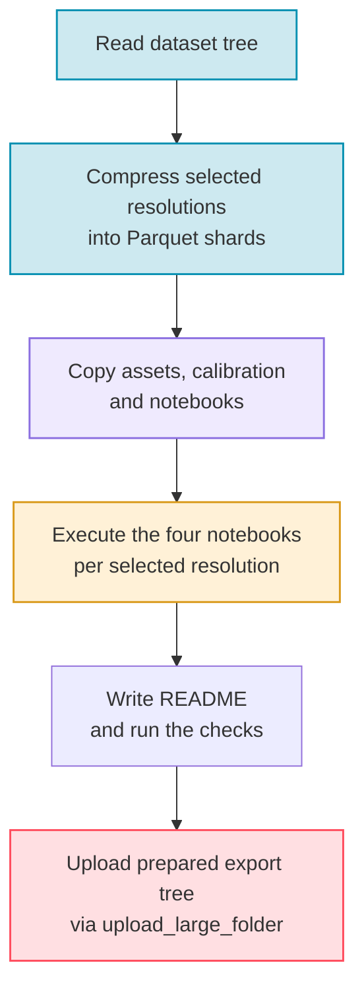

# Steps 4-6 — Release

PASSAGE splits release preparation into three explicit commands:

1. `passage compress` writes Parquet shards for the selected resolutions.
2. `passage export` prepares the upload-ready export tree: notebooks, assets, calibration and dataset card.
3. `passage upload` publishes that prepared tree to Hugging Face.

The export directory sits next to the calibration directory by default: PASSAGE
uses the parent of the folder that holds `calibrate.json`, plus `export`. For
example, `--calibrate-dirpath <root>/calibrate` targets `<root>/export`, and the
defaults give `outputs/export`. Pass `--export-dirpath` to choose another place.

For the full release, [`passage regenerate`](#all-in-one-passage-regenerate)
runs generation, Parquet export and the notebooks in one resumable command.

---

## 1. Compress

`compress` reads the generated dataset tree and writes zstd-compressed Parquet
shards into the export directory. Each selected resolution gives two
configurations:

- `<R>x<R>`: every scene, without images;
- `<R>x<R>_samples`: the first `export.sample.num_samples` scenes of each split
  (64 by default), with one preview image per solver. Missing preview images
  are rendered from the saved tensors and routes.

The new shards are written to temporary storage first. The existing
configurations of the selected resolutions are replaced only once every new
configuration is complete; after an error, the previous ones are restored.

```bash
# Compress every discovered dataset resolution
passage compress

# Compress one resolution locally
passage compress --resolution 256

# Compress a dataset tree stored under another root
passage compress \
  --dataset-dirpath <root>/dataset \
  --calibrate-dirpath <root>/calibrate \
  --resolution 256
```

Key flags for `compress`:

| Flag | Default | Description |
|------|---------|-------------|
| `--config` | `config/config.yaml` | Configuration file (shard sizes, preview row count, compression level) |
| `--dataset-dirpath` | `outputs/dataset` | Generated dataset directory |
| `--calibrate-dirpath` | `outputs/calibrate` | Used to derive the export directory |
| `--calibration-filepath` | `<calibrate-dirpath>/calibrate.json` | Explicit calibration file for export-dir derivation |
| `--export-dirpath` | Derived from calibration path | Explicit export directory override |
| `--resolution` | All discovered dataset resolutions | Restrict compression to specific resolutions |
| `--num-cpus` | All CPUs | Multiprocessing workers (`0` = sequential) |
| `--log-level` | `info` | Logging verbosity |

---

## 2. Export

`export` needs the Parquet shards written by `compress`. It prepares the export
directory in nine steps and skips each step whose output is already present
and valid:

1. copy the images of the repository's `assets/` folder;
2. copy the calibration directory;
3. copy every notebook under `notebooks/`;
4. strip the outputs of the copied notebooks;
5. write the root metadata files (`LICENSE`, `DATASET_LICENSE.md`, `croissant.json`, `DATASHEET.md`, `CITATION.cff`, `CHANGELOG.md`) with the target repository's address;
6. execute the four per-resolution notebooks — `dataset`, `display`, `metrics`
   and `passage_eval_metrics`, from the templates `notebooks/_dataset.ipynb`,
   `_display.ipynb`, `_metrics.ipynb` and `_passage_eval_metrics.ipynb` — for
   each selected resolution, and record them in `notebook-export-manifest.json`;
7. write `README.md`, the dataset card;
8. write `.gitattributes`;
9. check Parquet compression, preview sizes, `croissant.json` and the README.

An executed notebook is reused only when its inputs, source and configuration
match the recorded ones. The `--force-*` flags redo one step; `--force` redoes
them all.

```bash
# Refresh every prepared resolution
passage export

# Refresh one prepared resolution
passage export --resolution 256

# Refresh an export tree stored under another root
passage export \
  --dataset-dirpath <root>/dataset \
  --calibrate-dirpath <root>/calibrate \
  --resolution 256

# Execute the per-resolution notebooks again
passage export --resolution 256 --force-notebooks
```

Key flags for `export`:

| Flag | Default | Description |
|------|---------|-------------|
| `--config` | `config/config.yaml` | Configuration file |
| `--dataset-dirpath` | `outputs/dataset` | Dataset root passed to the notebooks |
| `--calibrate-dirpath` | `outputs/calibrate` | Calibration directory copied into the export tree |
| `--calibration-filepath` | `<calibrate-dirpath>/calibrate.json` | Explicit calibration file |
| `--notebooks-dirpath` | `notebooks` | Notebook sources, including the four per-resolution templates |
| `--export-dirpath` | Derived from calibration path | Explicit export directory override |
| `--resolution` | All prepared resolutions | Restrict notebook refresh to specific resolutions |
| `--repo-id` | `thalesgroup/passage` | Repository id written into the README and the notebooks |
| `--max-notebook-retries` | `3` | Execution attempts per notebook |
| `--notebook-retry-delay` | `5` | Delay between attempts, in seconds |
| `--force` | off | Redo every step |
| `--force-notebooks`, `--force-assets`, `--force-calibration`, `--force-analysis-notebooks`, `--force-metadata`, `--force-readme`, `--force-gitattributes`, `--force-strip-outputs` | off | Redo one step |
| `--no-strip-outputs`, `--no-gitattributes`, `--no-validate-croissant`, `--no-validate-readme`, `--no-audit-compression` | off | Skip one step or check |
| `--keep-existing-configs` | off | Keep compatible configurations declared in the existing README; use it only after checking their earlier uploads |
| `--num-cpus` | All CPUs | Workers passed to the notebooks |
| `--log-level` | `info` | Logging verbosity |

If the selected `<resolution>x<resolution>` or `<resolution>x<resolution>_samples` Parquet directories do not exist yet,
`export` fails fast and asks you to run `passage compress` first.

---

## 3. Upload

`upload` publishes the prepared export tree with the Hugging Face
`upload_large_folder` method. It makes up to three attempts when the network
times out.
It reads `HF_TOKEN` from `.env.secret` after optionally loading `.env` (both
at the repository root by default).

By default, `upload` targets `thalesgroup/passage`. To publish your own build,
always pass `--repo-id`.

```bash
# Upload the prepared export tree to your dataset repository
passage upload --repo-id <user>/<dataset>

# Upload one prepared resolution: its two configurations, plus the root files,
# assets, calibration and notebooks
passage upload --repo-id <user>/<dataset> --resolution 256

# Use other credential files
passage upload --repo-id <user>/<dataset> --env-path .env --secret-path .env.secret
```

Key flags for `upload`:

| Flag | Default | Description |
|------|---------|-------------|
| `--calibrate-dirpath` | `outputs/calibrate` | Used to derive the export directory |
| `--calibration-filepath` | `<calibrate-dirpath>/calibrate.json` | Explicit calibration file for export-dir derivation |
| `--export-dirpath` | Derived from calibration path | Explicit export directory override |
| `--resolution` | Full prepared export tree | Restrict upload to specific prepared resolutions |
| `--repo-id` | `thalesgroup/passage` | Hugging Face dataset repository |
| `--env-path` | `.env` | Optional env file loaded before reading the token |
| `--secret-path` | `.env.secret` | Secret env file containing `HF_TOKEN` |
| `--private` | off | Create a private dataset repository |
| `--no-create-repo` | off | Skip repository creation |
| `--num-cpus` | All CPUs | Upload workers (one fewer than the CPUs, at least one) |
| `--log-level` | `info` | Logging verbosity |

---

## Release Flow



---

## Output Structure

```text
outputs/export/
├── README.md                       # Dataset card with YAML header
├── .gitattributes                  # Large-file rules for the Hub
├── notebook-export-manifest.json   # Notebook inputs, parameters and output hashes
├── croissant.json, LICENSE, ...    # Root metadata files
├── assets/                         # Images from the repository's assets/ folder
├── calibration/
│   ├── calibrate.json
│   └── ...                         # Elevation maps and versioned receipts
├── notebooks/                      # Notebook sources, outputs stripped
│   ├── demo.ipynb
│   ├── costmodel.ipynb
│   ├── obstacles.ipynb
│   ├── solve.ipynb
│   ├── astar_inference_timing.ipynb
│   ├── passage-eval/
│   └── ...                         # Per-resolution templates
├── 256x256/
│   ├── train/
│   │   ├── data-00000.parquet
│   │   ├── ...
│   │   └── export-manifest.json
│   ├── calibration/
│   ├── validation/
│   ├── test/
│   ├── dataset.ipynb               # Executed per-resolution notebooks
│   ├── display.ipynb
│   ├── metrics.ipynb
│   └── passage_eval_metrics.ipynb
├── 256x256_samples/                # Preview rows with images, same split folders
└── ...                             # Other resolutions
```

`make manifest` writes `outputs/export/manifest.sha256`, the SHA-256 hash of
every file in the export tree.

---

## All in one: `passage regenerate`

`passage regenerate` builds the full release after `download` and `calibrate`.
For each resolution, it generates the scenes in bounded stages, exports them to
Parquet, verifies the shards and deletes the exported raw files. It then
executes the notebooks and writes the dataset card. It never uploads.

```bash
# Full run with config/config.yaml
passage regenerate

# Print the plan (scene counts, batches, storage checks) as JSON; writes nothing
passage regenerate --dry-run

# One scene per resolution, recorded as a separate pilot, for a quick check
passage regenerate --pilot 1
```

Raw scenes go to the scratch folder, and the final tree goes to the dataset
folder: Parquet configurations, executed notebooks and `release-receipts/`.
After an interruption, run the same command again: it resumes from
`release-receipts/regeneration-journal.json`. At the end,
`release-receipts/ready-upload.json` reports the run status. Publish the
result separately with
`passage upload --export-dirpath outputs/release/dataset --repo-id <user>/<dataset>`.

| Flag | Default | Description |
|------|---------|-------------|
| `--config` | `config/config.yaml` | Configuration file |
| `--dataset-dirpath` | `outputs/release/dataset` | Final tree; must be empty or belong to this run |
| `--scratch-dirpath` | `outputs/release/scratch` | Raw scenes waiting for export |
| `--tiles-dirpath` | `outputs/download/tiles` | Extracted DSM tiles |
| `--calibration-filepath` | `outputs/calibrate/calibrate.json` | Calibration receipt |
| `--notebooks-dirpath` | `notebooks` | Notebook sources |
| `--resolution` | All configured resolutions | Restrict the run to some resolutions |
| `--num-cpus` | 75 % of the CPUs available to the process, rounded down | Worker ceiling; `0` runs sequentially |
| `--pilot SCENES` | off | Scenes per resolution for a separately identified pilot |
| `--dry-run` | off | Check inputs, counts and storage without writing files |
| `--batch-scenes` | off | Upper bound on the scenes of one generation stage |
| `--max-raw-bytes` | 16 GiB | Raw scene data staged before export |
| `--min-free-bytes` | 64 GiB | Disk space kept free |
| `--export-memory-bytes` | 8 GiB | Memory admitted for parallel export workers |

---

## Check a Snapshot: `passage qualify`

`passage qualify` checks a local copy of the dataset against a pinned commit of
the Hub repository. It never changes the copy and writes its receipts to a
separate folder. It runs three phases, which can also run one at a time with
`--phase`:

- `authenticate`: hash every file listed at the commit and compare it with the hash recorded on the Hub;
- `census`: scan the metadata of every core scene and freeze an audit roster, a fixed selection of scenes;
- `routes`: re-check the stored routes of that roster with independent solves.

```bash
passage qualify \
  --dataset-path <root>/passage-snapshot \
  --dataset-revision c09cc5a21a55a93e7c09d47368d5f5bf75cb8fae \
  --output <root>/qualification
```

| Flag | Default | Description |
|------|---------|-------------|
| `--dataset-path` | `dataset` | Local copy of the dataset (read only) |
| `--dataset-repo` | `thalesgroup/passage` | Hub repository |
| `--dataset-revision` | required | Commit hash (40 hexadecimal characters) |
| `--output` | `outputs/qualification` | Receipt folder, outside the dataset copy |
| `--phase` | `all` | `all`, `authenticate`, `census` or `routes` |
| `--workers` | `4` | Hashing and audit workers, from 1 to 8 |
| `--batch-size` | `2048` | Metadata rows read per batch |

---

## Loading from Hugging Face

Once uploaded, anyone can load the dataset. Pin a commit for reproducible work;
the example uses the verified PASSAGE v1.0 upload.

```python
from datasets import load_dataset
from passage.utils import decode_tensor_blob

REVISION = "c09cc5a21a55a93e7c09d47368d5f5bf75cb8fae"  # verified PASSAGE v1.0 upload

# Preview rows: small, 64 per split, with rendered images
rows = load_dataset("thalesgroup/passage", "256x256_samples",
                    split="validation", revision=REVISION)
sample = rows[0]

tensor = decode_tensor_blob(sample["tensor"], (256, 256, 3))
elevation = tensor[:, :, 0]  # scaled to [0, 1] with the calibration range
markers = tensor[:, :, 1]    # -1 background, 0 start, 1 goal
obstacles = tensor[:, :, 2]  # 1 = blocked cell

# Core configurations are large: stream them instead of downloading them
core = load_dataset("thalesgroup/passage", "256x256", split="train",
                    streaming=True, revision=REVISION)
for row in core.take(4):
    print(row["id"], row["metadata"]["split"])
```

!!! success "Release ready"
    Once `compress`, `export`, and `upload` have all run successfully, the PASSAGE export tree is ready for distribution.
