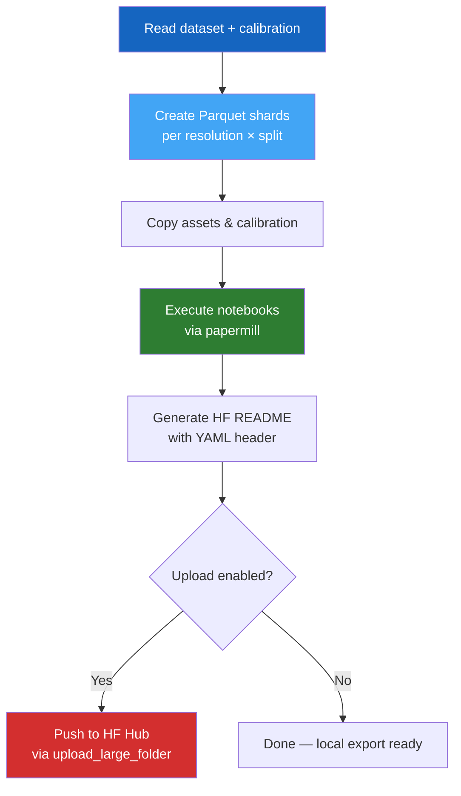

# Step 4 — Export & Publish

The final step packages your generated dataset into compressed **Parquet shards**, executes analysis notebooks, and optionally uploads everything to the **Hugging Face Hub** for public or private sharing.

---

## Usage

### Full export with upload

```bash
passage export --repo-id alice/passage-dataset
```

### Dry run (no upload)

```bash
passage export --no-upload
```

### With all options

```bash
passage export \
  --dataset-dirpath outputs/dataset \
  --calibrate-dirpath outputs/calibrate \
  --config config/config.yaml \
  --outputs-dirpath outputs/export \
  --repo-id alice/passage-dataset \
  --env-path .env \
  --secret-path .env.secret \
  --max-notebook-retries 3 \
  --num-cpus 4
```

---

## CLI Reference

| Flag | Default | Description |
|------|---------|-------------|
| `--dataset-dirpath` | `outputs/dataset` | Generated dataset directory |
| `--calibrate-dirpath` | `outputs/calibrate` | Calibration results |
| `--config` | `config/config.yaml` | Configuration file |
| `--outputs-dirpath` | `outputs/export` | Export output directory |
| `--repo-id` | From `.env` | Hugging Face repo (`user/name`) |
| `--no-upload` | `false` | Skip uploading to HF Hub |
| `--private` | `false` | Create a private HF repository |
| `--no-create-repo` | `false` | Don't create repo if it doesn't exist |
| `--no-exec-notebooks` | `false` | Skip notebook execution |
| `--max-notebook-retries` | `3` | Max retries for notebook execution |
| `--notebook-retry-delay` | `5` | Seconds between retries |
| `--env-path` | `.env` | Path to public env file |
| `--secret-path` | `.env.secret` | Path to secret env file |
| `--num-cpus` | `1` | Parallel workers |
| `--log-level` | `INFO` | Logging verbosity |

---

## Export Pipeline



### What happens

1. **Parquet Creation** — for each resolution and split, samples are read, processed, and written as zstd-compressed Parquet files with a rich `Features` schema
2. **Asset Bundling** — banner, sample images, calibration data, and hold-out mask are copied into the export tree
3. **Notebook Execution** — `_dataset.ipynb` is parameterized and executed for each resolution via `papermill`; analysis notebooks (`demo`, `obstacles`, `solve`, `costmodel`) are copied
4. **README Generation** — the HF dataset card (`assets/README.md`) is customized with a YAML front-matter header describing all configs, splits, and data files
5. **Upload** — the entire export folder is pushed to HF Hub using `HfApi.upload_large_folder`

---

## Parquet Schema

Each Parquet file uses the Hugging Face `Features` schema:

```
tensor                bytes      # zstd-compressed (H,W,3) numpy array
metadata
  ├── tile             struct    # lat, lon, filename
  ├── crop             struct    # row_start, col_start, height, width
  ├── markers          struct    # start (row,col), end (row,col)
  ├── obstacles        struct    # enabled, count, coverage_ratio
  └── solvers[]        list      # per-solver config + timing
path_<solver>_free     string    # CSV path coordinates (obstacle-free)
path_<solver>_obstacles string   # CSV path coordinates (with obstacles)
image                  bytes     # (Optional) PNG image
```

---

## Output Structure

```
outputs/export/
├── README.md                     # HF dataset card with YAML header
├── assets/
│   ├── banner.png
│   ├── sample.png
│   └── download.png
├── calibration/
│   └── calibrate.json
├── notebooks/
│   ├── demo.ipynb
│   ├── obstacles.ipynb
│   ├── solve.ipynb
│   └── costmodel.ipynb
├── 256x256/
│   ├── train/
│   │   ├── 0000000000.parquet
│   │   ├── 0000000001.parquet
│   │   └── ...
│   ├── validation/
│   ├── test/
│   ├── calibration/
│   └── dataset.ipynb             # Executed per-resolution notebook
└── ...                           # Other resolutions
```

---

## Loading from Hugging Face

Once exported and uploaded, anyone can load your dataset with:

```python
from datasets import load_dataset
from passage.utils import decode_tensor_blob

# Load a specific resolution config
ds = load_dataset("alice/passage-dataset", name="256x256")
sample = ds["train"][0]

# Decode the compressed tensor
tensor = decode_tensor_blob(sample["tensor"], (256, 256, 3))
elevation = tensor[:, :, 0]  # Normalized [0, 1]
markers   = tensor[:, :, 1]  # -1 bg, 0 start, 1 goal
obstacles = tensor[:, :, 2]  # Binary mask
```

!!! success "You're done!"
    Your dataset is now publicly available on Hugging Face Hub, with rich metadata, analysis notebooks, and documentation — ready for the research community.
