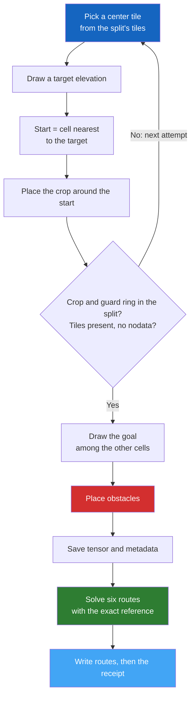

# Step 3 — Generate Dataset

This is the **core step** of the PASSAGE pipeline. It creates the scenes. A
scene is a square crop of real terrain with a start cell, a goal cell,
procedural obstacles and six reference routes: three cost objectives
(`elevation`, `slope_uphill`, `energy`), each solved once on free terrain and
once with the obstacle cells blocked.

With the shipped `config/config.yaml`, `passage generate` runs the generator
that built PASSAGE v1.0. The key `generation.dataset_version` selects it; keep
the value shipped in `config/config.yaml`. Without that key, `passage generate`
runs another generation path, which the v1.0 release does not use and this
guide does not cover.

---

## Usage

### Basic generation

```bash
passage generate
```

This reads the tiles in `outputs/download/tiles` and the calibration in
`outputs/calibrate/calibrate.json`, and writes to `outputs/dataset`. With the
default configuration it requests all 4,400,000 scenes of the release.

### Common options

```bash
# A small trial: 1,000 scenes at 256×256 with 8 workers, in its own output root
passage generate \
  --resolution 256 \
  --num-samples 1000 \
  --num-cpus 8 \
  --outputs-dirpath outputs/trial

# Several resolutions in one run
passage generate --resolution 64 128 256 512

# Resume an interrupted run: repeat the same command
passage generate
```

To start again from scratch, choose a new `--outputs-dirpath`. With the release
configuration, `--force` stops with an error when the output root already
exists, so finished scenes are never overwritten.

---

## CLI Reference

| Flag | Default | Description |
|------|---------|-------------|
| `--outputs-dirpath` | `outputs/dataset` | Output root for the generated scenes |
| `--tiles-dirpath` | `outputs/download/tiles` | Folder of extracted DSM tiles |
| `--calibration-filepath` | `outputs/calibrate/calibrate.json` | Calibration receipt from step 2 |
| `--config` | `config/config.yaml` | Configuration file |
| `--resolution` | All values in `resolutions` | One or more resolutions to generate |
| `--num-samples` | `num_samples` from the configuration | Scenes per resolution; one value for every selected resolution |
| `--num-cpus` | All CPUs, capped at 16 for 2048 and 8 for 4096 | Worker processes; `0` runs sequentially |
| `--no-images` | off | No effect with the release configuration: `generate` writes no images, and `passage compress` renders the preview images |
| `--force` | off | Refused when the output root exists; use a fresh `--outputs-dirpath` instead |
| `--log-level` | `info` | Logging verbosity: `debug`, `info`, `warning`, `error` or `critical` |

---

## Generation Pipeline

Each scene goes through the following process:



### Step-by-step

1. **Split and seed** — each scene index receives a split, so that the split
   counts match `splits.ratios`, rounded to whole scenes. It also receives its
   own seed, `blake2b(generation.seed, resolution, index, split)`.
2. **Center tile** — drawn uniformly among the source tiles of the scene's
   split (see [Splits](#splits)).
3. **Start** — a target elevation is drawn uniformly in the calibration range.
   The start is the cell of the center tile whose elevation is nearest to it.
4. **Crop** — the R × R crop is placed at a random offset around the start. It
   can extend into neighboring 1° tiles at any resolution; PASSAGE reads the
   matching window of every tile it touches.
5. **Checks** — the attempt is rejected when a source tile of the crop, or of
   its one-tile guard ring, belongs to another split, when a tile is missing,
   or when a cell has no data. Missing data is never padded. A scene makes up
   to `generation.max_scene_attempts` (100) attempts; after that it is recorded
   as `rejected`.
6. **Goal** — drawn uniformly among the other cells of the crop.
7. **Obstacles** — superellipse obstacles are added until the next one would
   push coverage above a target drawn uniformly between 0 and
   `obstacles.ratio_max` (30 %). They never cover the start or the goal.
8. **Tensor** — three float32 channels are stacked into an (R, R, 3) tensor:
   elevation scaled with the calibration range, markers (−1 background, 0
   start, 1 goal) and obstacles (1 = blocked). The tensor is compressed with
   Zstandard and saved, with its metadata, before any route is solved.
9. **Labels** — the saved tensor is decoded, and an exact A\* reference solves
   each objective in float64, once on free terrain and once with the obstacle
   cells blocked. Each of the six variants is `ok` (an exact optimum) or
   `infeasible` (no path exists: empty route, null cost). The shipped
   `max_reference_expansions: null` sets no search budget; with a budget, an
   unfinished search would be recorded as `failed`.
10. **Receipt** — the route CSV files are written, then a receipt that lists
    the SHA-256 hash of every file. The receipt is written last: on resume,
    scenes with a receipt are checked and skipped, and a scene without one is
    generated again.

The [dataset card](../dataset/index.md#how-the-scenes-were-made) summarizes the
same steps, and [Sampling Procedure](../generation/sampling.md),
[Obstacle Generation](../generation/obstacles.md) and
[Solvers & Heuristics](../generation/solvers.md) give the details.

---

## Splits

Splits are geographic: every AW3D30 source tile belongs to exactly one split.

- Tiles inside the hold-out mask (`hold_out.mask_path`, South America) belong
  to `test` only, and every `test` scene comes from them.
- The other tiles go to `train`, `calibration` or `validation` by seeded
  5° × 5° blocks, in proportion to the split ratios.
- A crop is admitted only if all its source tiles, plus a one-tile guard ring,
  belong to its split. The source cells of different splits never overlap.

| Split | Default ratio | Purpose |
|-------|---------------|---------|
| `train` | 90% | Model training |
| `calibration` | 2% | Fix a method's free settings (thresholds, steps, schedules) before the test pass |
| `validation` | 4% | Model and hyperparameter selection |
| `test` | 4% | Final evaluation on unseen geography (South America) |

The split seed (`splits.seed`, default `42`) fixes both the scene-to-split
assignment and the block assignment, so repeated runs give the same splits.

---

## Default Sample Counts

These counts come from `num_samples` in `config/config.yaml`. The nominal side
assumes 30 m cells; the actual ground spacing varies with latitude.

| Resolution | Default scenes | Nominal side |
|-----------|----------------|--------------|
| 64×64 | 1,000,000 | 1.92 km |
| 128×128 | 1,000,000 | 3.84 km |
| 256×256 | 1,000,000 | 7.68 km |
| 512×512 | 1,000,000 | 15.36 km |
| 1024×1024 | 250,000 | 30.72 km |
| 2048×2048 | 100,000 | 61.44 km |
| 4096×4096 | 50,000 | 122.88 km |

---

## Output Structure

```text
outputs/dataset/
├── generation_manifest.json     # Run provenance: configuration, calibration, tile hashes, code hashes
├── generation-source-snapshot/  # Copy of the generating source code
├── generation-input-snapshot/   # Copy of the configuration, calibration and hold-out mask
└── 256/                         # One folder per resolution
    ├── roster.json              # Requested scene count and split assignment identity
    ├── summary.json             # Outcome counts of the last run
    ├── train/
    │   ├── tensors/N045/E006/0000000000.npy.zst
    │   ├── metadata/N045/E006/0000000000.yaml
    │   ├── paths/astar_elevation/free/N045/E006/0000000000.csv
    │   ├── paths/astar_elevation/obstacles/N045/E006/0000000000.csv
    │   ├── paths/...            # The same for astar_energy and astar_slope
    │   └── receipts/0000000000.json
    ├── calibration/
    ├── validation/
    └── test/
```

- Scene files are named by the 10-digit scene index. `N045/E006` stands for
  the latitude and longitude of the scene's center tile.
- Each route CSV holds one `row,col` cell per line, from start to goal. It is
  empty when the variant is `infeasible`.
- `passage compress` later adds `images/<solver>/…/<index>.png` for the
  preview rows of the `_samples` configurations.

---

## Performance Tips

!!! tip "Speed up generation"
    - `--num-cpus` sets the number of worker processes. Without it, PASSAGE
      starts one worker per CPU reported by the system, within the caps below.
    - Start with a small `--num-samples` in a separate output root to check
      your setup before a full run.
    - Re-run the same command to resume. Use the same output root, configuration,
      calibration, tiles, code and `--num-samples`: the run refuses to resume
      when its provenance or scene roster has changed.
    - Run the generator from a git clone: its provenance records the commit of
      the code.

!!! warning "Large resolutions"
    Crops at 2048 and 4096 hold many more cells per worker and use much more memory.
    When `--num-cpus` is omitted, `generate` caps the workers at 16 for 2048 and 8 for 4096.
    On Slurm, pass `--num-cpus` equal to `--cpus-per-task`: the default counts every CPU of the node,
    not only the CPUs allocated to the job.

---

## Next Step

Once scenes are generated, proceed to **[Steps 4-6 — Release](export.md)** to compress Parquet shards, refresh the export tree, and publish them.
For the full release, [`passage regenerate`](export.md#all-in-one-passage-regenerate)
runs generation and export together in bounded batches.
