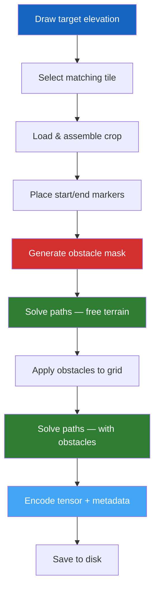

# Step 3 — Generate Dataset

This is the **core step** of the PASSAGE pipeline. It creates multi-resolution pathfinding samples — each containing normalized elevation data, start/end markers, procedural obstacles, and computed paths from multiple solvers.

---

## Usage

### Basic generation

```bash
passage generate
```

### Common options

```bash
# Generate 1000 samples at 256×256 resolution using 8 workers
passage generate \
  --resolution 256 \
  --num-samples 1000 \
  --num-cpus 8

# Multiple resolutions at once
passage generate --resolution 64 128 256 512

# Skip image generation (tensors only — faster)
passage generate --no-images

# Force regeneration (overwrite existing samples)
passage generate --force
```

---

## CLI Reference

| Flag | Default | Description |
|------|---------|-------------|
| `--outputs-dirpath` | `outputs/dataset` | Output directory for generated samples |
| `--tiles-dirpath` | `outputs/download/tiles` | Path to extracted tiles |
| `--config` | `config/config.yaml` | Configuration file |
| `--resolution` | All configured | Resolution(s) to generate |
| `--num-samples` | From config | Number of samples per resolution |
| `--num-cpus` | All visible CPUs | Parallel generation workers (`0` = sequential) |
| `--no-images` | `false` | Skip PNG image generation |
| `--force` | `false` | Overwrite existing samples |
| `--log-level` | `INFO` | Logging verbosity |

---

## Generation Pipeline

Each sample goes through the following process:



### Step-by-step

1. **Target Elevation Sampling** — a random elevation $e_{\text{target}}$ is drawn uniformly from the global range
2. **Tile Selection** — tiles whose elevation range includes $e_{\text{target}}$ are filtered, and one is randomly selected
3. **Crop Assembly** — a random crop of the requested resolution is extracted (multi-tile assembly for large resolutions)
4. **Marker Placement** — start and end points are placed randomly on the crop
5. **Obstacle Generation** — superellipse obstacles are procedurally placed until a target coverage ratio is reached
6. **Path Solving (Free)** — each configured solver computes the optimal path on the obstacle-free terrain
7. **Obstacle Application** — obstacles are applied to the elevation grid as high-penalty regions
8. **Path Solving (Obstacles)** — solvers recompute paths avoiding obstacles
9. **Tensor Encoding** — elevation, markers, and obstacles are stacked into a `(H, W, 3)` tensor, compressed with zstd
10. **Output** — tensor, metadata YAML, path CSVs, and optional PNG image are written to disk

---

## Splits

Samples are deterministically assigned to splits based on the configured ratios and global seed:

| Split | Default ratio | Purpose |
|-------|---------------|---------|
| `train` | 90% | Model training |
| `calibration` | 2% | Model calibration / threshold tuning |
| `validation` | 4% | Hyperparameter selection |
| `test` | 4% | Final evaluation |

The split seed (default: `42`) ensures identical assignments across runs.

---

## Default Sample Counts

| Resolution | Default samples | Approximate coverage |
|-----------|----------------|---------------------|
| 64×64 | 10,000 | ~1.9 km patches |
| 128×128 | 2,500 | ~3.8 km patches |
| 256×256 | 1,000 | ~7.7 km patches |
| 512×512 | 500 | ~15.4 km patches |
| 1024×1024 | 100 | ~30.7 km patches |
| 2048×2048 | 20 | ~61.4 km patches |
| 4096×4096 | 10 | ~122.9 km patches |

---

## Output Structure

```
outputs/dataset/
├── summary.json              # Global dataset summary
└── 256/                      # Per-resolution directory
    ├── summary.json          # Resolution-level summary
    ├── train/
    │   ├── 000000/
    │   │   ├── tensor.npy.zst
    │   │   ├── metadata.yaml
    │   │   ├── sample.png          # (if images enabled)
    │   │   ├── path_astar_elevation_free.csv
    │   │   ├── path_astar_elevation_obstacles.csv
    │   │   └── ...
    │   ├── 000001/
    │   └── ...
    ├── validation/
    ├── test/
    └── calibration/
```

---

## Performance Tips

!!! tip "Speed up generation"
    - Use `--num-cpus 8` for typical parallel sample generation
    - Use `--no-images` to skip PNG rendering — **~2× faster**
    - Start with a small `--num-samples` to validate your setup before full runs
    - PASSAGE automatically resumes interrupted runs — no need to start over

!!! warning "Large resolutions"
    Resolutions ≥2048 require multiple tiles to be assembled and consume significantly more memory and CPU time.
    For `4096×4096`, start with `--num-cpus 4` or `--num-cpus 8` instead of relying on the all-CPU default.
    On Slurm, `--cpus-per-task` controls how many CPUs are visible to the job, while `passage generate --num-cpus ...` controls how many Python workers are actually spawned.

---

## Next Step

Once samples are generated, proceed to **[Steps 4-6 — Release](export.md)** to compress Parquet shards, refresh the export tree, and publish them.
