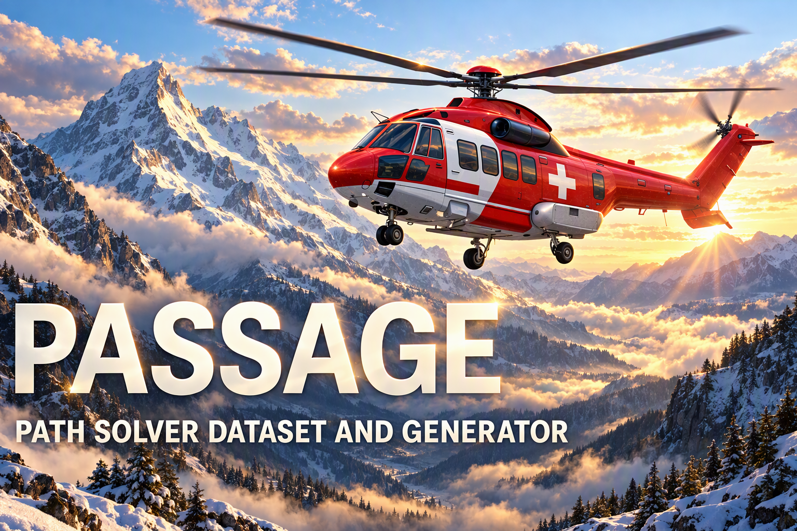

<p align="center">
  
</p>

<!-- Hero Section -->
<div class="hero-section" markdown>

# PASSAGE

<p class="hero-tagline">
  <strong>PA</strong>th <strong>S</strong>olving Data<strong>S</strong>et <strong>A</strong>nd <strong>GE</strong>nerator<br>
  Real terrain, exact answers: a benchmark and generator for trustworthy constrained path planning.
</p>

<div class="hero-buttons" markdown>

[:material-rocket-launch: **Get Started**](guide/index.md){ .btn-primary }
[:simple-huggingface: **Dataset card**](dataset/index.md){ .btn-secondary }
[:fontawesome-brands-github: **View on GitHub**](https://github.com/ThalesGroup/passage){ .btn-secondary }
[:simple-huggingface: **Dataset on HF**](https://huggingface.co/datasets/thalesgroup/passage){ .btn-secondary }

</div>

</div>

!!! success "Accepted at NeurIPS 2026 — Track on Evaluations and Datasets"

    *PASSAGE: A Real-Terrain Benchmark for Trustworthy Constrained Path Planning*
    is accepted as a poster at the **40th Conference on Neural Information
    Processing Systems (NeurIPS 2026), Track on Evaluations and Datasets**.
    See [how to cite it](#cite-passage).

<!-- Badges -->
<div class="badges" markdown>

[](#cite-passage)
[](https://huggingface.co/datasets/thalesgroup/passage)
[](https://huggingface.co/datasets/thalesgroup/passage/blob/main/DATASET_LICENSE.md)
[](https://www.python.org/)
[](https://docs.astral.sh/ruff/)
[](https://docs.astral.sh/uv/)
[](https://pre-commit.com/)

</div>

<!-- Stats Bar -->
<div class="stats-bar" markdown>

<div class="stat-item">
  <span class="stat-value">4.4 M</span>
  <span class="stat-label">Core scenes</span>
</div>
<div class="stat-item">
  <span class="stat-value">26.36 M</span>
  <span class="stat-label">Exact routes</span>
</div>
<div class="stat-item">
  <span class="stat-value">7</span>
  <span class="stat-label">Resolutions</span>
</div>
<div class="stat-item">
  <span class="stat-value">3</span>
  <span class="stat-label">Cost objectives</span>
</div>
<div class="stat-item">
  <span class="stat-value">30 m</span>
  <span class="stat-label">Cell size</span>
</div>

</div>

---

<!-- Story Section -->
<div class="story-section" markdown>

## Context

**Helicopter Emergency Medical Services (HEMS)** fly some of the hardest routes on
Earth. When a rescue crew heads for a patient in mountainous terrain, the flight
path must account for elevation changes, ridgelines, valleys and no-fly zones.
Choosing an efficient route across real 3D terrain is an operational problem, and
the pathfinding algorithms behind mission planning matter.

Yet most pathfinding research still relies on **synthetic flat grids** or small
hand-crafted maps that do not reflect the complexity of real terrain, and learned
planners are often scored against labels that are not proved optimal.

**PASSAGE gives path planners real terrain and exact answers.** Each scene is a
square crop of the [JAXA ALOS AW3D30](https://www.eorc.jaxa.jp/ALOS/en/dataset/aw3d30/aw3d30_e.htm)
digital surface model (30 m cells) with a start, a goal and procedural obstacles.
Each scene carries six reference routes: three cost objectives, each solved on
free terrain and with the obstacles blocked. Every route is either an exact
optimum or a proved "no path".

We open-source the generator, the dataset and the `passage-eval` evaluator so that
classical planners, reinforcement learning, graph neural networks and certified
surrogate models can be compared, reproduced and audited on a shared benchmark.

</div>

---

## :compass: What is PASSAGE?

**PASSAGE** is a complete, reproducible pipeline that turns satellite elevation
data into ready-to-use pathfinding datasets:

<div class="pipeline-steps" markdown>

<div class="pipeline-step" markdown>
  <div class="step-number">1</div>

#### Download

Acquire JAXA ALOS AW3D30 DSM tiles covering the entire globe, with geographic tracking and resume support.
</div>

<div class="pipeline-step" markdown>
  <div class="step-number">2</div>

#### Calibrate

Scan all tiles to compute the global minimum and maximum elevation.
</div>

<div class="pipeline-step" markdown>
  <div class="step-number">3</div>

#### Generate

Create multi-resolution scenes with start and goal markers, super-ellipse obstacles and exact A\* reference routes.
</div>

<div class="pipeline-step" markdown>
  <div class="step-number">4</div>

#### Compress

Write the full and preview configurations as Parquet shards.
</div>

<div class="pipeline-step" markdown>
  <div class="step-number">5</div>

#### Export

Prepare the release tree: card, notebooks, calibration assets and per-resolution analyses.
</div>

<div class="pipeline-step" markdown>
  <div class="step-number">6</div>

#### Upload

Publish the prepared tree to a Hugging Face dataset repository that you name explicitly.
</div>

</div>

---

## :package: PASSAGE v1.0 at a glance

The dataset is published on the Hugging Face Hub as
[thalesgroup/passage](https://huggingface.co/datasets/thalesgroup/passage). The
[dataset card](dataset/index.md) describes its files, columns, label contract,
evaluation, splits and limitations.

| Item | Value |
| --- | --- |
| Version | 1.0 |
| Core scenes | 4,400,000 at seven resolutions, from 64×64 to 4096×4096 cells |
| Route variants | 26,400,000: 26,358,039 exact routes and 41,961 proved no-path |
| Splits | train / calibration / validation / test = 90 / 2 / 4 / 4 % |
| Test geography | South America hold-out; other tiles split by 5°×5° blocks |
| Preview rows | 1,792 (64 per split and resolution), with rendered images |
| Size | about 1.27 TB of Parquet (5,997 shards) |
| Licence | Code: MIT. Data: JAXA AW3D30 terms, see [DATASET_LICENSE.md](https://huggingface.co/datasets/thalesgroup/passage/blob/main/DATASET_LICENSE.md) |

<p align="center">
  
</p>

<p align="center"><em>PASSAGE v1.0 validation preview sample 0000000024 (256 × 256), the first row
of the first validation preview shard, without selection. Columns are the elevation,
uphill-slope and energy objectives; solid green routes ignore obstacles and
short-dashed blue routes respect them. All panels share one elevation scale in
metres. Stored optimality was not revalidated for this figure.</em></p>

---

## :star2: Key Features

<div class="feature-grid" markdown>

<div class="feature-card" markdown>
  <span class="feature-icon">🌐</span>

### Multi-Resolution

Seven resolutions from **64×64** to **4096×4096** cells, covering terrain patches from 1.9 km to 123 km across.
</div>

<div class="feature-card" markdown>
  <span class="feature-icon">🏔️</span>

### Real Elevation Data

Every scene comes from **JAXA ALOS AW3D30**, a 30 m digital surface model covering the entire globe.
</div>

<div class="feature-card" markdown>
  <span class="feature-icon">🔷</span>

### Procedural Obstacles

**Super-ellipse** obstacles of varied shape, size and rotation cover up to 30 % of each crop and never touch the start or the goal.
</div>

<div class="feature-card" markdown>
  <span class="feature-icon">⚡</span>

### 3 Cost Objectives

`elevation`, `slope_uphill` and `energy`, each solved on free terrain and with the obstacles blocked: six routes per scene.
</div>

<div class="feature-card" markdown>
  <span class="feature-icon">🧮</span>

### Exact A\* Oracle

A compiled grid A\* labels every route; each label is an exact optimum or a proved no-path. The published notebooks solve a sample again with an exact reference.
</div>

<div class="feature-card" markdown>
  <span class="feature-icon">🤗</span>

### Hugging Face-Ready

Parquet configurations, preview rows with images, executed notebooks and release receipts on the Hub.
</div>

<div class="feature-card" markdown>
  <span class="feature-icon">🔁</span>

### Fully Resumable

Generation and release stages can be rerun independently, with input identities audited before any reuse.
</div>

<div class="feature-card" markdown>
  <span class="feature-icon">✅</span>

### Tested & Reproducible

860 tests, 80 %+ coverage, deterministic seeding, pre-commit hooks and continuous integration.
</div>

<div class="feature-card" markdown>
  <span class="feature-icon">🛡️</span>

### Certification-Aware

Designed with aerospace certification standards (ARP 6983 / ED-324) in mind: bounded operational design domain and traceable scenes.
</div>

</div>

---


<!-- Leaderboard preview ----------------------------------------------------->

## :material-trophy-outline: Leaderboard



---

## :zap: Quick Start

Most users only need the released data. Install `datasets`, `zstandard` and
`numpy`, pin the dataset revision and decode one scene:

```python
import numpy as np
import zstandard
from datasets import load_dataset

REVISION = "65f1e4f0a37d8a7b476ddf02d48fe542542924ea"  # verified PASSAGE v1.0 upload

rows = load_dataset("thalesgroup/passage", "256x256_samples",
                    split="validation", revision=REVISION)
row = rows[0]
n = row["metadata"]["resolution"]
x = np.frombuffer(zstandard.ZstdDecompressor().decompress(row["tensor"]),
                  dtype="<f4").reshape(n, n, 3)  # elevation, markers, obstacles
route = np.asarray(row["path_astar_energy_obstacles"])  # ordered [row, col] cells
```

The [dataset card](dataset/index.md#quick-start) shows how to recover metres,
read the route status and stream the large configurations.

??? example "Rebuild the dataset from the JAXA tiles"

    The generator rebuilds the release from the source terrain. This is a large
    job: the AW3D30 inventory holds 23,993 tiles, and the shipped
    `config/config.yaml` asks for 1,000,000 scenes at 256 × 256. Read the
    [user guide](guide/index.md) first, and lower `num_samples` for a trial run.

    ```bash
    # Install uv (if needed), then the locked environment
    curl -LsSf https://astral.sh/uv/install.sh | sh
    git clone https://github.com/ThalesGroup/passage.git
    cd passage
    uv sync --frozen

    uv run --frozen passage download                  # Step 1 — fetch JAXA tiles
    uv run --frozen passage calibrate                 # Step 2 — compute elevation range
    uv run --frozen passage generate --resolution 256 # Step 3 — generate scenes and routes
    uv run --frozen passage compress --resolution 256 # Step 4 — write Parquet shards
    uv run --frozen passage export --resolution 256   # Step 5 — prepare the release tree
    uv run --frozen passage upload --repo-id <your-user>/<your-dataset>  # Step 6
    ```

---

## :microscope: Research Applications

PASSAGE supports a wide range of pathfinding research:

| Domain | Use case | Relevant features |
|--------|----------|-------------------|
| **Classical AI** | A\*, Dijkstra and anytime planners against exact references | 3 cost objectives, obstacles, seven resolutions |
| **Reinforcement Learning** | Terrain navigation agents | Grid observations, exact optimal costs for reward and regret |
| **Graph Neural Networks** | Learned heuristics | Eight-connected graphs from elevation grids, route labels |
| **Surrogate Models** | Fast approximation of optimal routes | 4.4 M scenes and 26.4 M route variants |
| **Computer Vision** | Route prediction from elevation images | (N, N, 3) tensors, path masks |
| **Certified ML** | ARP 6983 / ED-324-oriented evaluation | Bounded operational design domain, deterministic generation, traceability |

---

## :memo: Cite PASSAGE { #cite-passage }

PASSAGE is accepted as a poster at the **40th Conference on Neural Information
Processing Systems (NeurIPS 2026), Track on Evaluations and Datasets**. Please
cite the paper, and name the dataset version you used (PASSAGE v1.0):

```bibtex
@inproceedings{delhomme2026passage,
  title     = {{PASSAGE}: A Real-Terrain Benchmark for Trustworthy Constrained Path Planning},
  author    = {Delhomme, Geoffrey and Trap, Fran{\c{c}}ois and Kaakai, Fateh},
  booktitle = {Advances in Neural Information Processing Systems (NeurIPS), Track on Evaluations and Datasets},
  year      = {2026},
  url       = {https://github.com/ThalesGroup/passage}
}
```

!!! note "Future reference"

    The NeurIPS 2026 proceedings are not published yet. This entry will be
    completed with the proceedings details (volume, pages and paper URL) once
    they are available; the title, authors, venue and year will not change.
    Machine-readable metadata is in
    [`CITATION.cff`](https://github.com/ThalesGroup/passage/blob/main/CITATION.cff).

---

## :book: Learn More

<div class="feature-grid" markdown>

<div class="feature-card" markdown>
  <span class="feature-icon">🤗</span>

### [Dataset card](dataset/index.md)

What the release contains, how to load it, the label contract, the six evaluation metrics and the limitations.
</div>

<div class="feature-card" markdown>
  <span class="feature-icon">📖</span>

### [User Guide](guide/index.md)

Step-by-step walkthrough of the complete pipeline, from installation to Hugging Face export.
</div>

<div class="feature-card" markdown>
  <span class="feature-icon">🔬</span>

### [Generation Process](generation/index.md)

Sampling, cost models, obstacle generation and solver algorithms, with the full mathematics.
</div>

<div class="feature-card" markdown>
  <span class="feature-icon">🏁</span>

### [Benchmark](benchmark/index.md)

The evaluation protocol, the `passage-eval` package and how to submit a method.
</div>

<div class="feature-card" markdown>
  <span class="feature-icon">🏗️</span>

### [Code Architecture](architecture/index.md)

Module-by-module tour of the codebase, data formats and test strategy.
</div>

<div class="feature-card" markdown>
  <span class="feature-icon">📚</span>

### [API Reference](api/index.md)

Documentation generated from the source code docstrings.
</div>

</div>

---

## :handshake: Acknowledgments

PASSAGE is built on the shoulders of outstanding open data and open-source communities:

- **[JAXA](https://www.eorc.jaxa.jp/ALOS/en/dataset/aw3d30/aw3d30_e.htm)** for the ALOS AW3D30 Digital Surface Model
- **[Hugging Face](https://huggingface.co/)** for the Datasets library and Hub infrastructure
- **[Thales Group](https://www.thalesgroup.com/)** for supporting open-source research in safety-critical AI

---

## JAXA license and attribution

The PASSAGE code is released under the [MIT License](https://github.com/ThalesGroup/passage/blob/main/LICENSE),
**but the elevation data every PASSAGE scene is built on are provided by JAXA under
the [JAXA terms of use](https://earth.jaxa.jp/en/data/policy/)**. The dataset is
neither MIT-licensed nor public domain. Any user of PASSAGE, or of any artefact
derived from it (a trained model, a planning result, a downstream benchmark),
**must respect those JAXA terms**. In practice:

!!! warning "JAXA AW3D30 — User obligations"
    1. **Credit the source** with the line: *"The original data used for this
       product have been supplied by JAXA's ALOS World 3D–30m (AW3D30)."*
    2. **Cite the JAXA AW3D30 source** when you publish results using PASSAGE —
       for example Takaku *et al.*, *"Updates of 'AW3D30' ALOS Global DSM with
       Other Open Access Datasets,"* ISPRS Archives, 2020.
    3. **Notify JAXA before any commercial use**; modification and
       redistribution are allowed with credit.
    4. **Read and abide by the JAXA terms of use** linked above for the
       authoritative wording.

A summary of these terms is in
[`DATASET_LICENSE.md`](https://huggingface.co/datasets/thalesgroup/passage/blob/main/DATASET_LICENSE.md);
the JAXA terms of use remain the authoritative text. The [dataset card](dataset/index.md#licence-and-attribution) lists the
third-party elevation sources that AW3D30 uses to fill voids.

---

<p align="center" style="color: var(--md-default-fg-color--light); font-size: 0.9rem;">
  Made with ❤️ for the pathfinding research community<br>
  <strong>Code: MIT License</strong> · <strong>Data: JAXA AW3D30 terms</strong>
</p>
