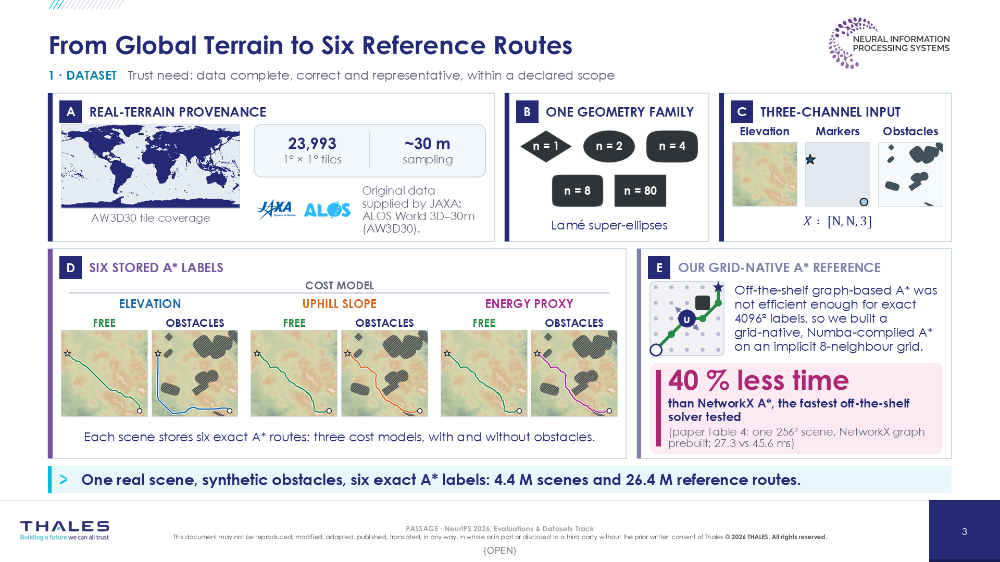
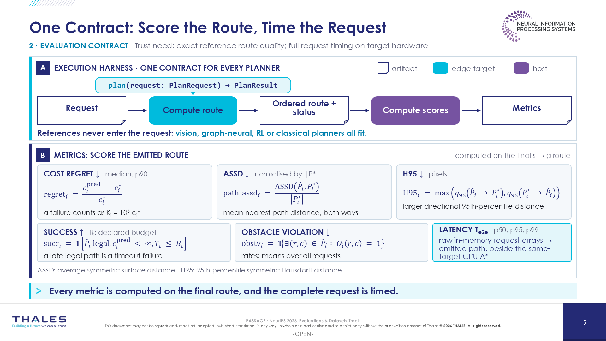
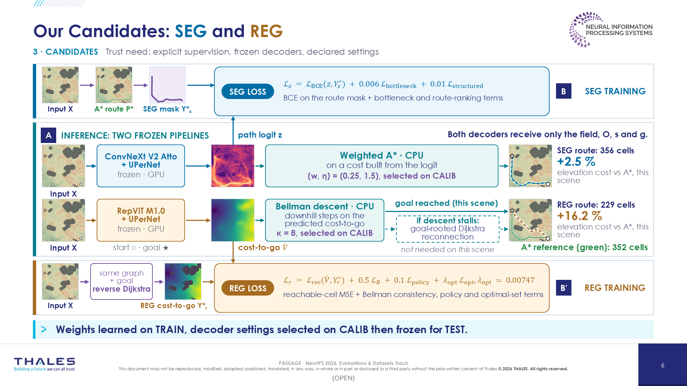

# Presentation schemes

These schemes explain how PASSAGE connects real terrain, reference routes,
evaluation and learned candidates. They reproduce slides 3, 5 and 6 of the
**final talk v17**, alongside the **final poster v9**, from the delivery dated
**14 November 2026**. The images are unchanged slide renders.

Download the full [talk v17 (PDF)](assets/presentation/passage_talk_v17_final.pdf)
or [poster v9 (PDF)](assets/presentation/passage_poster_v9_final.pdf).
The [provenance record](assets/presentation/provenance.json) identifies every
copied source; [SHA-256 checksums](assets/presentation/SHA256SUMS) let you verify
the downloads and images.

## From terrain to six reference routes

*Figure 1 — Dataset construction and reference solver, final talk v17, slide 3.*

The source inventory covers 23,993 AW3D30 tiles at approximately 30 m sampling.
Each scene combines elevation, start and goal markers, and synthetic Lamé
super-ellipse obstacles in an `N × N × 3` tensor. Three objectives—elevation,
uphill slope and an energy proxy—are each solved with and without obstacles.
The resulting release contains 4.4 million scenes and 26.4 million exact
reference routes. The grid-native, Numba-compiled A* operates on an implicit
eight-neighbour grid.

The slide's 40% time reduction refers to the paper's Table 4 comparison on
**one 256×256 scene**: 27.3 ms for the grid-native solver versus 45.6 ms for
NetworkX A*, with its graph prebuilt. It is a scoped solver comparison.
See the [dataset guide](dataset/index.md) for the released representation and
[solver documentation](generation/solvers.md) for the reference graph.

## Score the route, time the request

*Figure 2 — Execution harness and route metrics, final talk v17, slide 5.*

Every planner implements `plan(request: PlanRequest) → PlanResult`.
The target computes an ordered route and status; references stay outside the
request and the host scores the emitted route. The complete request runs from
raw in-memory inputs through preparation, inference or search, decoding,
synchronization, repair and fallback. Independent host scoring is outside the
paper's direct timing boundary.

Route metrics cover median and p90 cost regret, average symmetric surface
distance (ASSD, normalised by the reference route's cell count), symmetric
95th-percentile Hausdorff distance (H95, the larger directional p95 distance,
in pixels), success within the declared budget, and obstacle violation rate.
Success requires a legal route with finite recomputed cost. Failed routes
receive a cost of one million times the reference
cost; late legal routes count as timeout failures. Latency reports p50, p95 and
p99 beside the same-target CPU A* reference. See the
[evaluation protocol](benchmark/protocol.md) for the full metric and aggregation
contract, or [evaluate your planner](benchmark/contributing-a-method.md).

## SEG and REG: supervision and frozen inference

*Figure 3 — Training supervision and inference for SEG and REG, final talk v17,
slide 6. The route comparison illustrates one TRAIN scene.*

**SEG** uses ConvNeXt V2 Atto with UPerNet to predict path logits. Training
combines binary cross-entropy on the reference route mask with bottleneck and
structured route-ranking terms. Weighted A* decodes the logits on the CPU,
with calibration-selected parameters `w = 0.25` and `η = 1.5`.

**REG** uses RepViT M1.0 with UPerNet to predict cost-to-go, supervised by
reverse Dijkstra on the same graph and goal. Its loss combines reachable-cell
mean squared error, Bellman consistency, local-policy and optimal-set terms.
CPU Bellman descent uses `κ = 8`; if descent stalls, goal-rooted geometric
Dijkstra reconnects the route. Both decoders receive only the predicted field,
obstacles, start and goal. Weights are learned on TRAIN; decoder settings are
selected on CALIB and frozen for TEST. The
[final candidate definitions](benchmark/final-candidates.md) give the equations,
loss weights, checkpoint identities and decoder settings.

The example is **TRAIN256 scene `0000001971`, seed 2026**. SEG's 356-cell route
costs **+2.5%** and REG's 229-cell route costs **+16.2%** relative to the
352-cell A* reference under the elevation objective on this scene. REG reaches
the goal without reconnection here. These are qualitative, per-scene values;
they are not aggregate TEST scores. The [paper results](benchmark/candidates.md)
describe the separate 40,000-scene TEST comparison and its limitations.

These presentation assets explain the reported work; they introduce no new
measurements and make no certification or regulatory-compliance claim.
