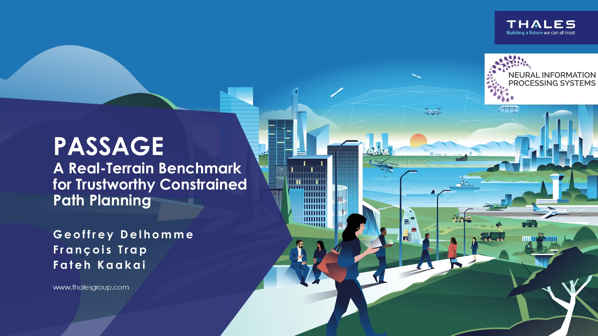
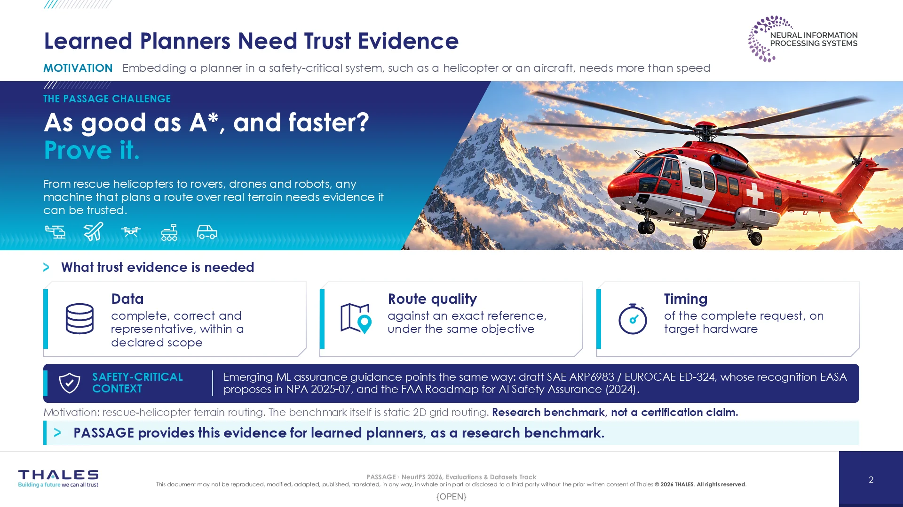
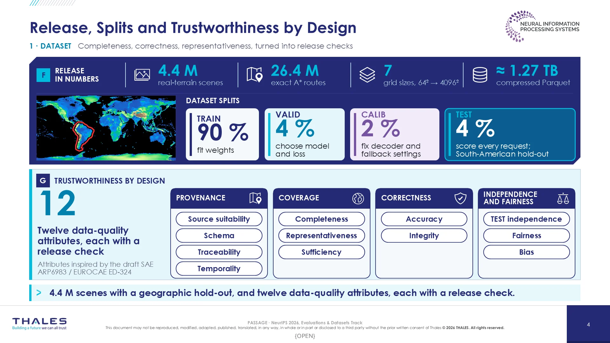
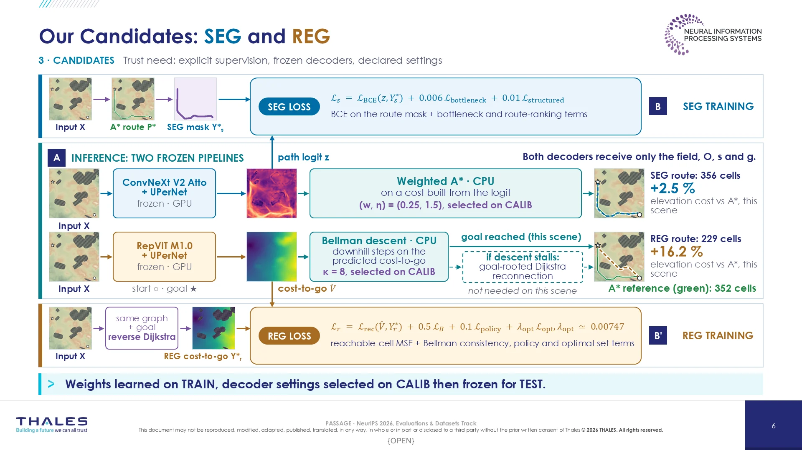
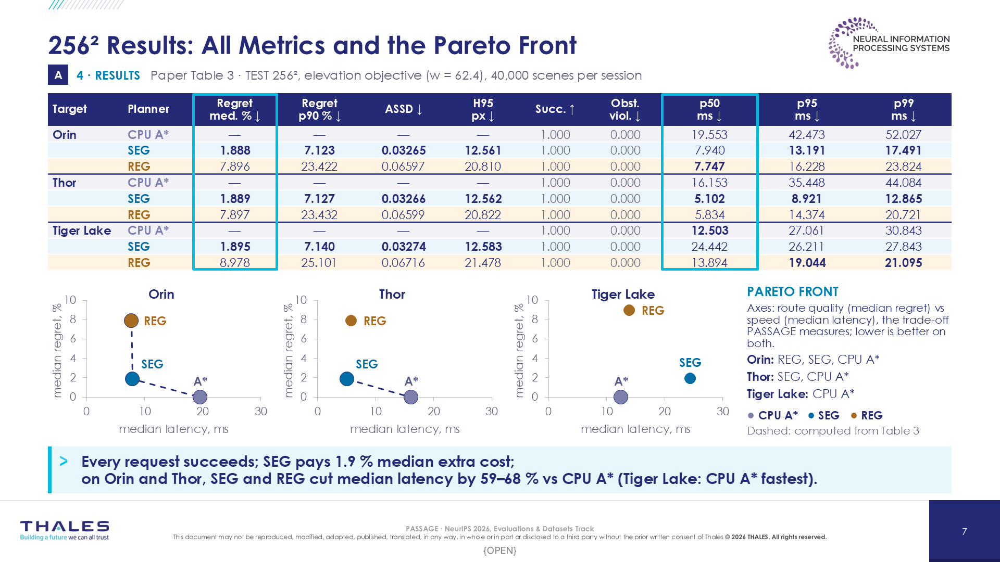
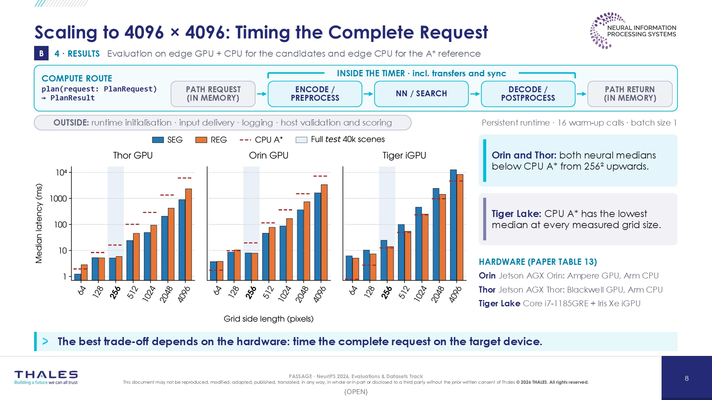
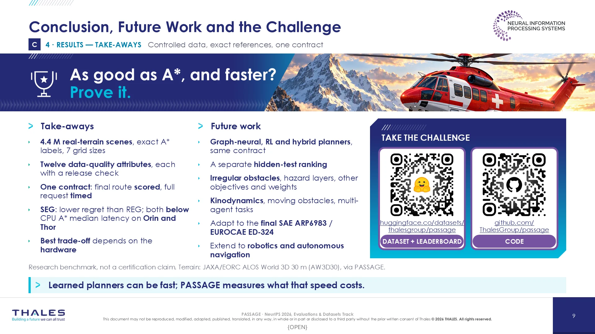

# PASSAGE at NeurIPS 2026

*PASSAGE: A Real-Terrain Benchmark for Trustworthy Constrained Path Planning* was
accepted at NeurIPS 2026, in the Track on Evaluations and Datasets. In this
five-minute talk, Geoffrey Delhomme (Thales Avionics) presents the dataset, the
evaluation contract, the two vision-based candidates and their results on edge
hardware. Watch the recording first; the second section follows the talk slide by
slide, each with its speaker script.

## :material-play-circle-outline: Recorded talk

  <iframe src="https://recorder-v3.slideslive.com/#/share?share=115719&amp;s=628ee4dc-6efc-43ae-b73d-1e8a629abbc8"
          title="PASSAGE talk at NeurIPS 2026, recorded on SlidesLive"
          loading="lazy" allow="autoplay; fullscreen; picture-in-picture; encrypted-media"
          allowfullscreen referrerpolicy="strict-origin-when-cross-origin"></iframe>

[:material-open-in-new: Open the recording on SlidesLive](https://recorder-v3.slideslive.com/#/share?share=115719&s=628ee4dc-6efc-43ae-b73d-1e8a629abbc8){ .md-button .md-button--primary }
[:material-file-pdf-box: Download the slides (PDF)](assets/presentation/passage-neurips-2026-talk.pdf){ .md-button }

## :material-script-text-outline: Slides and script

Each slide is followed by the speaker's script for that slide. Select a slide to
enlarge it.

### 1. PASSAGE (cover)

Hello everyone, I am Geoffrey Delhomme from Thales Avionics, and today I will present PASSAGE, a benchmark for trustworthy constrained path planning.

### 2. Learned Planners Need Trust Evidence

Nowadays, rescue helicopters, rovers and drones are all routing over real terrain with obstacles. For complex tasks, routing algorithms are often expensive and hard to embed.

Our intent is to propose a common ground to evaluate and compare routing algorithms that are harnessing edge accelerated computing together with safety and trustworthiness concerns.

This common ground is PASSAGE: a dataset and an evaluation harness inspired by the latest aerospace standards for the certification of AI onboard aircraft.

### 3. From Global Terrain to Six Reference Routes

Let's start with the data. Each sample has three channels, like an RGB image:

One first channel we embed real-terrain elevation drawn from the JAXA ALOS World 3D tiles

On second channel, uniformly drawn start and goal points

And on last channel we’ve generated obstacles from a Lamé super-ellipse generator, with shapes varying from the diamond to the rectangle.

As a reference, we've selected the A* algorithm, with three empirically calibrated cost models.

### 4. Release, Splits and Trustworthiness by Design

We've computed 4.4 million scenes for 7 grid sizes from 64 to 4096, which makes nearly 1.2 TB that we shared openly on Hugging Face.

We designed the dataset with 12 data-quality attributes inherited from the future Recommended Practice for machine learning certification in aeronautics.

### 5. One Contract: Score the Route, Time the Request

Along with the dataset, we release an evaluation harness based on a simple contract that each candidate shall comply with.

To score them, we’ve defined task-centered metrics on the cost and shape of the candidate routes, along with their latency to compute them.

### 6. Our Candidates: SEG and REG

Now, our candidates.

We propose two brand new approaches bridging vision-based neural networks to path planning.

The first one, SEG, is inherited from semantic segmentation. It learns the reference path mask and keeps only the path-class logits. From there, a simple post processing stays at the top of the cost hill joining start to goal.

The second candidate, REG, borrows depth-estimation techniques to compute aggregated cost maps. It then runs a Bellman descent along them, with a Dijkstra fallback in case of stall.

Both are trained with a mix of native vision losses and custom path-planning losses, before calibrating their post-processing on the calibration dataset.

### 7. 256² Results: All Metrics and the Pareto Front

We’ve then evaluated these two candidates with the harness on three edge devices, alongside the A* reference latencies.

The Pareto front retains SEG and REG on NVIDIA Orin and Thor, where the CPU/GPU trade-off favors them, and the A* reference on Intel Tiger Lake, where it is the opposite.

On NVIDIA edge devices, for nearly 2% of extra cost, we reduce computation by nearly 60%!

To our knowledge, it opens a new area for real-time embedded path planning.

### 8. Scaling to 4096 × 4096: Timing the Complete Request

And more than that, this conclusion is reinforced when we consider higher-resolution. Indeed, as we can see the gains grow exponentially as resolution increases.

### 9. Conclusion, Future Work and the Challenge

To conclude, PASSAGE is an open real-terrain benchmark for trustworthy constrained path planning, released on Hugging Face and GitHub, with an associated leaderboard with our two innovative vision-based candidates.

In future work, we plan to assess GNN and RL-based planners and extend also the task at stake to kinodynamics, moving obstacles or multi-agent tasks.

With this contribution, we also expect to foster trustworthiness concerns beyond safety-critical domains, in robotics or autonomous navigation to help make future AI applications safer for everyone, in everyday use.

Thank you.

---

The slide images and the PDF can be checked against their
[SHA-256 checksums](assets/presentation/SHA256SUMS). The poster will be added to this
page later. The talk reports the work described in the paper; it introduces no
measurement beyond it and makes no certification or regulatory-compliance claim.
